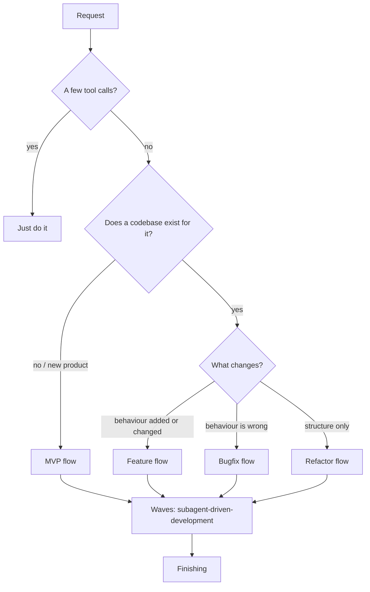
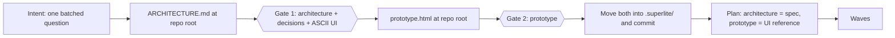
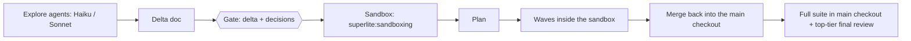
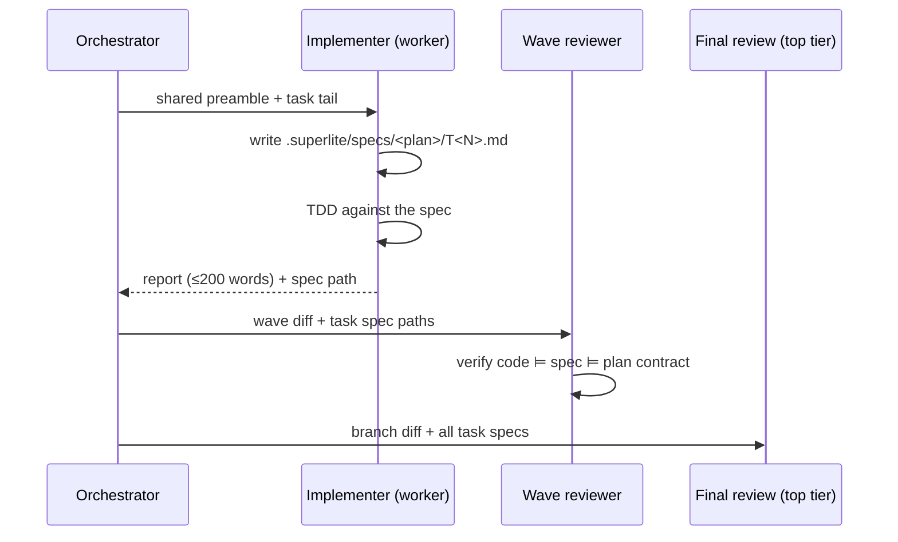

# Superlite 0.3: flows design (MVP, Feature, Bugfix, Refactor)

> **Erratum (2026-10-17, from the 0.2 session).** Smoke tests (0.2 design §9) invalidate parts of this document:
> - **A "shared wave preamble" with the task tail in the same brief does not share cache.** Siblings hit only the ~4.7k system-and-tools prefix. Use **prime-then-assign** instead: an identical first message (preamble + plan + spec sections + sandbox manifest path) answered with READY, then each task sent by SendMessage. Wherever this doc says the task tail follows the preamble in the brief, read it as the next message.
> - **A sibling hit-rate target of 80% is reachable only with prime-then-assign.** Measured: siblings 2..n read 100% of the prime.
> - **Agent files written mid-session are not loaded.** Agent definitions load at session start, so per-plan generated agents can't carry shared context.
> - **Forks run on the session model and in `-p` need `CLAUDE_CODE_FORK_SUBAGENT=1`.** No per-fork model or effort is documented. A Fable session therefore means Fable-priced forks.
> - **The implementer's `experimental.cacheTtl: 1h` is verified (E6):** a resume after about 7 min read 26.9k cached tokens.
>
> **Update (2026-10-17, main supalite session), after the minisheet run and an independent Opus review (architecture design §2.3c, §2.5, D9, E10):**
> - **Orchestration lean (D9, the user's decision).** Every flow leans toward an orchestrator dispatching parallel subagents. The workflow decides by its own complexity judgment, and builds inline only when it judges the task small and says so.
> - **A separate reviewer always runs**, inline or orchestrated.
> - **The 15 s Opus fork final review is too shallow.** It missed a recursion crash on deep formulas, an `inf` leak and HTTP 501s, which superpowers' review caught and fixed. Plan the final review as a fresh Opus reviewer at high effort with a robustness checklist (deep or long input, non-finite numbers, invalid encodings, unsupported methods, oversize input). That is E10, pending the user.
> - **The Orchestrator tier** is D1: the second most powerful model at max effort (Opus 5.5), Fable opt-in.


**Status:** draft for review, 2026-10-17
**Repo:** `C:\Users\CWogu\source\repos\superlite` ([github.com/iha2/superlite](https://github.com/iha2/superlite))
**Builds on:** `Specs\2026-10-17-superlite-architecture-design.md` (the 0.2 design: pipelined review, Opus-fork final review, cache tiers, the `detail` plan switch). This doc adds the flows on top and changes one thing there: the model tier (§2).
**Implementation plan:** `Plans\2026-10-17-superlite-flows-implementation.md`

## 1. Goal

Superlite routes every non-trivial request into one of **four flows**. Each flow has its own artifacts, gates and execution environment:

| Flow | For | Signature artifact | Gates | Where the code changes happen |
|---|---|---|---|---|
| **MVP** | A new product | `ARCHITECTURE.md` (Mermaid diagrams, decisions, ASCII UI), then `prototype.html` | 2 | The repo (new) |
| **Feature** | New or changed behaviour in an existing app | Delta doc (current vs target diagrams, ASCII for changed screens) | 1 | A **sandbox**, then merged back |
| **Bugfix** | Wrong behaviour | Repro command, root cause, regression test | 0 (attended: root cause shown before merge) | A **sandbox**, then merged back |
| **Refactor** | Same behaviour, new structure | Current vs target diagram, must-not-change list | 1 | In place or a sandbox, the orchestrator's choice |

All four flows end in the same execution engine: waves via `superlite:subagent-driven-development`, as specified in the 0.2 design.

## 2. The orchestrator is always the top-tier model

This supersedes the 0.2 design's "Opus" in the coordinator, final-review and security-review rows.

| Tier | Claude Code today | Roles |
|---|---|---|
| **Orchestrator** | The most capable model the account offers: Fable 5.1 if available, else Opus 5.5 | The coordinator session, architecture decisions, prototype review, final review (fork), take-over after 2 failed fix rounds |
| **Worker** | Sonnet 5.5 | Implementers, wave reviewer, prototype builder, research |
| **Runner** | Haiku 5.5 | Test runs, lookups, sandbox health checks |

- **Detection:** at the start of any flow, `using-superlite` checks the session model. If it isn't the top tier, it says once how to switch (`/model`, or `claude --model <id>`) and then continues. Orchestrator-tier subagents always pass the top model explicitly.
- **Forks inherit the session model,** so the final-review fork is automatically the top tier when the session is.
- **Other harnesses:** `skills/using-superlite/references/<harness>-tools.md` maps the three tiers to that harness's models.
- **Cost guard:** Fable costs 2.5× Opus per token. The tier is used only for the roles above, and the benchmark reports its share of cost.

## 3. Router



- The router names its pick in one line, so the user can override it.
- A flow can upgrade mid-way: a bugfix that needs an interface change becomes a feature. It never downgrades.
- **Unattended** (the user is away, or the request pre-approves): every gate is pre-approved and each choice becomes a `Ruling:` line. Outward actions (push, PR, publish) are deferred.

## 4. MVP flow



### 4.1 Intent

One `AskUserQuestion` call, up to 4 questions: who it's for, the core job, what success looks like, and constraints (stack, hosting, data). Skip anything the request already answers.

### 4.2 `ARCHITECTURE.md` (orchestrator writes it)

| Section | Content |
|---|---|
| Goals / non-goals | One short paragraph each |
| System context | Mermaid `flowchart`: users, the app, external systems |
| Components | Mermaid `flowchart` of modules and stores, one line on what each does |
| Key flows | One Mermaid `sequenceDiagram` per core journey (at most 3) |
| Data model | Mermaid `erDiagram` |
| Architectural decisions | Each open decision as options + trade-offs + recommendation (e.g. "Persistence: SQLite (recommended, zero ops) / Postgres (multi-user) / browser storage (single device)"). After the user answers, each becomes an ADR line: decision, choice, why, consequence |
| UI sketch | One ASCII wireframe per screen in a fenced `text` block (layout, key controls, empty and error states), plus a navigation list |

**How decisions are asked:** at Gate 1, the open decisions go in **one** `AskUserQuestion` (up to 4, recommendation first). If there are more than 4, the orchestrator takes the defaults for the low-stakes ones and lists them as rulings.

**Mermaid check:** before the gate, every Mermaid block is parse-checked, using the harness's renderer or `mmdc` if installed. Broken diagrams never reach the user.

### 4.3 Gate 1

The user approves the architecture, the decisions and the ASCII UI together. Requested changes are revised once and re-presented.

### 4.4 `prototype.html` (Sonnet worker builds it, orchestrator reviews it)

- A single self-contained file: inline CSS and vanilla JS. No build step, no CDN, no network calls. It opens from disk.
- Realistic inline mock data (`const MOCK = {...}`): at least 5 records per list, plus one empty state and one error state.
- Every screen in the UI sketch is reachable. Core interactions work in memory against the mock data: create, edit, delete, filter, navigate.
- A fixed banner reads: "Prototype: mock data, changes are not saved."
- The orchestrator checks it against the ASCII sketch, screen by screen. Where the harness has a browser preview, it loads the file, confirms there are no console errors, and screenshots each screen for the gate.

### 4.5 Gate 2

The user approves the prototype. Change requests go to the same worker via `SendMessage`, with at most 2 rounds.

### 4.6 Archive and build

After Gate 2, `git mv` both files into `.superlite/` (as `architecture.md` and `prototype.html`) and commit them. The generated app's README links to them.

`writing-plans` then uses `architecture.md` as the spec and the prototype as the UI reference. The prototype's `MOCK` data becomes the app's seed data and test fixtures. Waves run without stopping.

## 5. Feature flow



1. **Explore.** Agents locate and explain the touched code. The orchestrator reads only their reports.
2. **Delta doc** at `.superlite/features/<date>-<topic>.md`:
   - "current" and "target" Mermaid diagrams of only the components that change;
   - the interfaces that change;
   - ASCII sketches of changed screens;
   - open decisions, asked in one batch.

   An HTML prototype is built only when the change is mostly UI, or the user asks for one. It follows the §4.4 rules and is archived the same way.
3. **Gate:** one approval.
4. **Sandbox (§8), plan and waves.** Every brief points at the sandbox manifest, so all agents share one fast test loop.
5. **Merge back.** When the sandbox is green, merge its branch into the main checkout's working branch (fast-forward when possible). The runner tier runs the full suite in the main checkout, then the top-tier final review runs. A remote push or a PR needs the human.

## 6. Bugfix flow

1. **Sandbox first (§8).** The target is one repro command that fails in seconds: a focused test, a script, or a request against seeded data.
2. **Root cause.** Per `superlite:systematic-debugging`, with probes inside the sandbox. Heavy logging and data mutation are fine there, because nothing touches the main checkout.
3. **Fix.** Regression test (red), minimal fix (green), focused tests.
4. **Merge back** as in the Feature flow.
   - Final review is worker tier, unless the fix touches auth, security, data integrity or concurrency; then it's top tier.
   - Attended: the human sees the root cause and the regression test before the merge.
5. **Record:** `.superlite/bugs/<date>-<topic>.md`, at most 10 lines: symptom, repro, root cause, fix, test.

## 7. Refactor flow

1. **Plan the target.** A current vs target Mermaid diagram, plus a **must-not-change** list of public behaviours.
2. **Safety net.** Characterisation tests for every item on that list that isn't already covered. They are committed before any move.
3. **Environment: the orchestrator's choice,** recorded as a `Ruling:`.
   - **In place** (default): the refactor stays inside a few files or one module.
   - **Sandbox:** cross-cutting moves, long-running work, or when the main checkout must stay usable.
4. **Waves of moves.** The suite stays green after every wave.
5. **Final review** on the top tier, focused on "no behaviour change".
6. **Gate:** one, on the target diagram and the must-not-change list.

## 8. Sandboxes: `superlite:sandboxing`

The orchestrator picks the **lightest level that gives a fast, isolated test loop**. It records the level and why as a `Ruling:`.

| Level | What it is | Choose when |
|---|---|---|
| **L0 in place** | The current checkout, on a new branch | Refactor default; tiny fixes; no slow setup |
| **L1 worktree, shared deps** | `git worktree add .superlite/sandboxes/<topic> -b superlite/<topic>`, reusing installed deps (the uv cache, a linked `node_modules`) | Most Feature and Bugfix work: file isolation in seconds |
| **L2 worktree, isolated env** | L1 plus its own venv or `node_modules`, a seeded fixture DB, a `.env` copied with secrets replaced by test values, and offset ports | Dependency or schema changes, stateful bugs, parallel runs that would collide |
| **L3 container** | L2 inside `docker compose` with the services the app needs | Bugs that need real services, or environment-specific behaviour |

### Fast test loop (every level)

- A **focused test command** per task, recorded in the manifest.
- **Changed-file test selection** where the stack supports it: pytest on the touched test modules, `vitest related`, `dotnet test --filter`.
- A warm watch process where the stack allows one.
- The full suite runs once per wave on the runner tier, never per edit.

### Manifest

`.superlite/sandboxes/<topic>/SANDBOX.md` records:
- level and branch;
- the setup steps run;
- the focused test command and the full test command;
- the seeded data;
- the ports used.

Every implementer and reviewer brief includes the manifest path. For cache sharing, it sits in the shared wave preamble (0.2 design §3.3).

### Merge back and teardown

Green in the sandbox → commit → merge into the main checkout's branch → full suite in the main checkout → teardown (`git worktree remove`, `docker compose down`, delete the seeded DB) → record it in the progress file. A merge conflict or a red main suite blocks the merge. The orchestrator fixes it or reports it, and never forces it.

### Safety

- No real secrets or production data in sandboxes.
- `.superlite/sandboxes/` is git-ignored.
- L3 runs only local services and is always torn down.

## 9. Specs everywhere, one style: `superlite:writing-specs`

### 9.1 Task specs (one per parallel agent, no human gate)



- **Purpose:** each agent makes its local design explicit before it codes. The wave and final reviews then check *code against spec* and *spec against plan*. Divergence is caught at the design level, not only in the diff.
- **No review gate.** Writing the spec is part of the task, not a stop. The orchestrator never reads it in full: specs reach reviewers by path, so the orchestrator's context stays small.
- **Contents** (only what applies to the task):
  - a component/class diagram;
  - a sequence diagram for each non-trivial interaction;
  - a state diagram for stateful units;
  - a contract table: signature, preconditions, postconditions, invariants;
  - an edge-case table;
  - local decisions, one line each.
- **Budget:** ≤ 150 words of prose outside diagrams and tables, and about 1 worker-minute per task.
- **Consistency:** when a task spec contradicts the plan, the plan wins. The implementer reports `DONE_WITH_CONCERNS` and gives the delta.

### 9.2 Spec style (parent docs and task specs alike)

| Rule | Instead of |
|---|---|
| A diagram first for any structure, flow or state; prose only for what a diagram can't carry (rationale, constraints) | Paragraphs describing boxes and arrows |
| Tables for enumerations, contracts, options and trade-offs | Bulleted prose lists |
| Precise technical register: *idempotent, monotonic, linearizable, TOCTOU, O(n log n), invariant, precondition* | Lay paraphrase ("calling it twice is fine") |
| Every sentence carries a fact, constraint or decision | Filler, hedges, restatement, signposting |
| Define only non-standard or project-specific terms | Glossing standard vocabulary |
| Code only where a diagram plus a contract is ambiguous (a tie-break rule, a regex) | Full implementations in specs |

**Clarity bar:** a domain-competent engineer can implement from the spec without asking a question. Density never wins over that bar. When a term is precise but obscure for the audience, use the plainer precise term.

**Checks** (scorer and evals):
- every Mermaid block parses;
- prose word count outside code fences and tables is within budget;
- task specs exist for every implementer dispatch.

## 10. The `.superlite/` folder

```text
.superlite/
  architecture.md        MVP, archived after Gate 2
  prototype.html         MVP (and UI-heavy features), archived after its gate
  decisions.md           ADR log, appended by every flow
  features/<date>-<topic>.md
  bugs/<date>-<topic>.md
  refactors/<date>-<topic>.md
  plans/<date>-<topic>.md (+ -progress.md)
  specs/<plan-topic>/T<N>-<slug>.md   one per implementer task (§9.1)
  sandboxes/<topic>/     git-ignored; SANDBOX.md + worktree
```

- **Committed,** except `sandboxes/`.
- **Review-time location:** artifacts awaiting a gate sit at the repo root, where they're easy to see, and move into `.superlite/` once approved.
- **Plan location:** superlite's own plan and progress files move from `docs/plans/` to `.superlite/plans/`, so product docs stay clean.

## 11. Benchmark additions

| Task | Flow | Scores |
|---|---|---|
| `sitegen` (existing) | MVP without UI | Regression against 0.1/0.2 |
| `tasklist-web`: a 3-screen web app from a one-paragraph brief | MVP | All Mermaid blocks parse; the prototype covers every sketched screen, has no console errors and runs the scripted interactions; time to first green build; hidden tests on the built app |
| `sitegen-feature`: add pagination and draft previews to a finished sitegen | Feature | Sandbox level chosen, setup seconds, focused-loop latency, hidden feature tests, main-suite green after the merge |
| `sitegen-bugs`: 3 seeded bugs with hidden regression tests | Bugfix | Time to repro, correct root cause (the hidden test passes, no unrelated diffs), regressions |
| `sitegen-refactor`: split `site.py` into a pipeline package | Refactor | Hidden suite unchanged and green, environment choice, waves |

Gates are auto-approved by the harness: on a gate, it resumes with "Approved", as in 0.1. Each resume is counted.

## 12. Rulings in this design

- Ruling: the folder is `.superlite/`, matching the plugin name. If the plugin is renamed "supalite", the folder is renamed with it.
- Ruling: "push it to the main application" means merge the sandbox branch into the main checkout's working branch. A remote push stays human-gated.
- Ruling: the prototype is one vanilla HTML file, whatever the app's stack. It's zero-install and independent of the build, and its mock data is reused as seed data.
- Ruling: the orchestrator is the top-tier model even at Fable prices. The benchmark reports its cost share so this can be revisited.
- Ruling: task specs are committed with their task's code, in the same commit, and are never human-gated. Reviewers receive them by path. The orchestrator reads one only to settle a dispute.

## 13. Open questions

1. Feature flow: HTML prototype only for UI-heavy changes (current design), or for any change that touches UI?
2. Unattended L3 containers: allowed (current design: local-only, always torn down)?
3. Name: keep "superlite", or rename the plugin and folder to "supalite"?

## Related
- Plans: [[2026-10-17-superlite-flows-implementation]], [[2026-10-17-superlite-0.3-plan]]
- Benchmark: [[2026-10-17-minisheet-benchmark-design]]
- Research: [[2026-10-17-superlite-script-complexity]]
- Project: [[Superlite]]

Hub: [[Specs index]]
