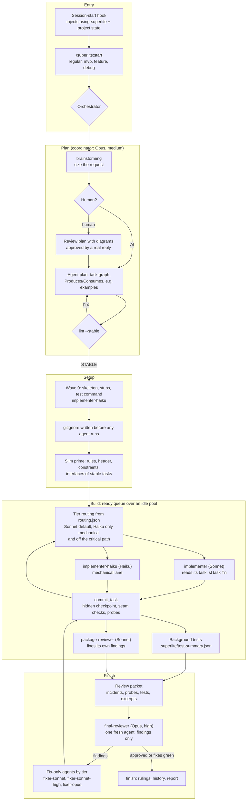
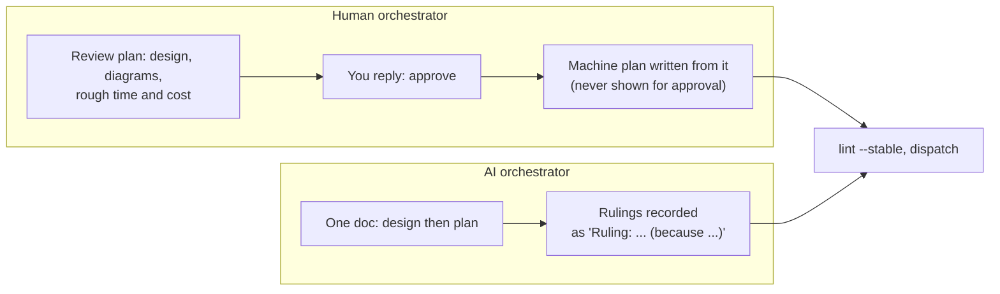

# superlite architecture, current state (with models)

Date: 2026-10-19. Source: the repo docs at `main` (`0dbbd18`): `docs/how-a-run-works.md`, `skills-and-agents.md`, `gates.md`, `hooks.md`, `config.md`, `tools.md`, `mvp-flow.md`, plus `agents/*.md`, `config/routing.json` and `config/models.json`. Items still being built or decided are marked, and listed in section 8.

## 1. The whole run on one page

## 2. Who runs on which model today

| Role | Agent | Model, effort | What it does |
|---|---|---|---|
| Coordinator | the session itself | Opus, medium | plans, dispatches, rules; never writes project code or runs raw tests |
| Implementer | `implementer` | Sonnet, medium | builds one task, then stays idle for reuse |
| Mechanical implementer | `implementer-haiku` | Haiku, high | Wave 0 and `Kind: mechanical` tasks off the critical path; stops rather than guesses |
| Package reviewer | `package-reviewer` | Sonnet, medium | reviews a task or package, fixes its own findings with regression tests |
| Final reviewer | `final-reviewer` | Opus, high | one fresh one-turn agent; reads only the packet; findings with a fix tier, never fixes |
| Fixer, tier 1 | `fixer-sonnet` | Sonnet, medium | cause known, fix confined to one module |
| Fixer, tier 2 | `fixer-sonnet-high` | Sonnet, high | cause known, fix spans modules or a seam |
| Fixer, tier 3 | `fixer-opus` | Opus, high | cause unknown, or a lower tier failed twice |

Rules: Haiku never fixes and never sits on the critical path. No agent spawns agents. Prices and speeds are in `config/models.json` (Opus 4/20 per million in/out, Sonnet 2/10, Haiku 0.10/0.50; Opus is 2x Sonnet, not 5x).

## 3. Enforcement: code, not prompt text

| Gate | Mechanism |
|---|---|
| Coordinator cannot write code (allowed: `docs/plans/**`, `SPEC*.md`, `docs/**/*.md`, `.superlite/**`) | `block-coordinator-edits` hook |
| No kills by name, only PIDs the run started | `block-unsafe-kill` hook |
| Raw test commands become background `sl run_tests` | `rewrite-test-runs` hook |
| Human mode: no build until a real human reply approves the review plan | `block-coordinator-edits` plus `record-human-reply` |
| Plan must lint before work starts; unstable tasks wait with a reason | `lint --stable` |
| Tier by task features; Haiku only mechanical and off the critical path; stats gate at 80% first-time pass | `routing.py`, `routing.json` |
| A task goes only to an idle agent of its own tier | `dispatch` |
| Cost warning at 70% of the cap | `sl budget` |
| Every agent's tokens, cost, time captured | `capture-agent-launch`, `capture-agent-stop` into `.superlite/metrics.jsonl` |

## 4. The prime and the task text (changed since 1.1.0, committed in `0dbbd18`)

- Each agent first reads a **slim prime** (7.8 KB against 26.4 KB for the full prime on the k1 plan): implementer rules, plan header, Global constraints, and each stable task's title, Owns, dependencies and Produces/Consumes lines. No plan body, diagrams or spec, so nothing in it goes stale.
- It then fetches its own task text from the current plan with `sl task Tn`, which also prints what that task consumes. This fixes the k1 bug where three agents read a plan that was patched after the prime was built.
- `build_prime --prime full` keeps the old whole-plan prime. The Haiku lane uses a `mini` prime.
- `.gitignore` entries per language (`config/gitignore.json`) are written before any agent runs, so `node_modules` or build output never shows up as a change outside `Owns`. A file a task explicitly owns is never ignored.

## 5. Human and AI orchestrator

The human approves the design in the review plan, once. The machine plan is for the orchestrator only and must not add or change anything the human approved. Bounded requests show only the design in chat, with one yes and no files. Auto-commit is off by default: work is checkpointed in hidden `refs/superlite/*` commits, and real commits only with `sl autocommit on` or `/superlite:commit`.

## 6. Measuring and reporting

- Capture hooks write `.superlite/metrics.jsonl` during a run; `finish` lists rulings; `history write` appends rows to `~/.superlite/history.jsonl`.
- `predict.py` forecasts time and context; `lint --stable` saves the projection (`.superlite/projection.json`).
- `sl report` prints a summary of at most 10 lines in Claude (projected against actual) and stores the full per-build file `<plan>.report.md` and `.json`. `/superlite:report` lists and shows them.
- Not yet in the report: cost by role and per-phase coordinator cost (planned, section 8).

## 7. Commands (16)

`start`, `mvp`, `feature`, `debug`, `status`, `resume`, `stop`, `human`, `ai`, `approve`, `review`, `finish`, `small`, `report`, `setup`, `commit`. The session-start hook adds "Project state: empty folder, existing code, or run in progress", and `/superlite:start` shows the menu that fits.

## 8. Decided but not in `main` yet

| Item | State | Where |
|---|---|---|
| Hang probe (reports `SUSPECT HANG` from output, CPU and child processes; does not kill by default; hook for tests waited on in loops; agent and coordinator rules) | being built by the cost fork, uncommitted | session superlite-cost |
| Coordinator split: Sonnet session, Opus `planner-opus` and `ruling-advisor` agents, escalation triggers, `sl route coordinator`, `sl escalate`, `sl health` | being built on branch `coord-split` with one benchmark rep; no Sonnet-coordinator run exists yet | session coord-model; design `Specs/2026-10-19-coordinator-model-decision.md` |
| MVP flow: plan, raw HTML/JS prototype the user assesses, then the orchestrated build | design only, nothing built | `docs/mvp-flow.md` |
| Cost instrumentation: `cost_by_role` in bench and `report.py`, forecast fix in `predict.py` | planned, step 1 of the cost plan | `Plans/2026-10-19-superlite-cost-parity-plan.md` |
| More Haiku inside k1's graph (tagging mechanical tasks, `slack_s_gte` gate) | partly in the routing change; saving estimated at only $0.2 to $0.5 on k1 | cost plan, step 3 |

## 9. Cost position (the reason for the current work)

k1, the reference run (16.1 min, 177/177 hidden tests), cost $9.38 against $7.10 for superpowers on the same task. Opus is at parity ($4.01 against $4.18). The gap is Sonnet ($5.35 against $2.92), mostly per-agent overhead from 21 dispatches that each wrote a 26 KB prime. The slim prime is the first lever. Nothing is measured against the target yet; every claim needs at least 3 reps, since one rep carries about $2 of noise.
