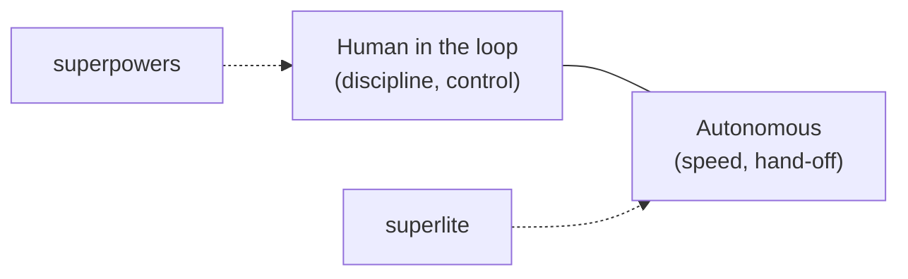
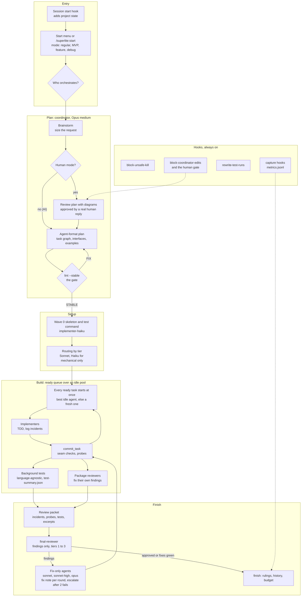
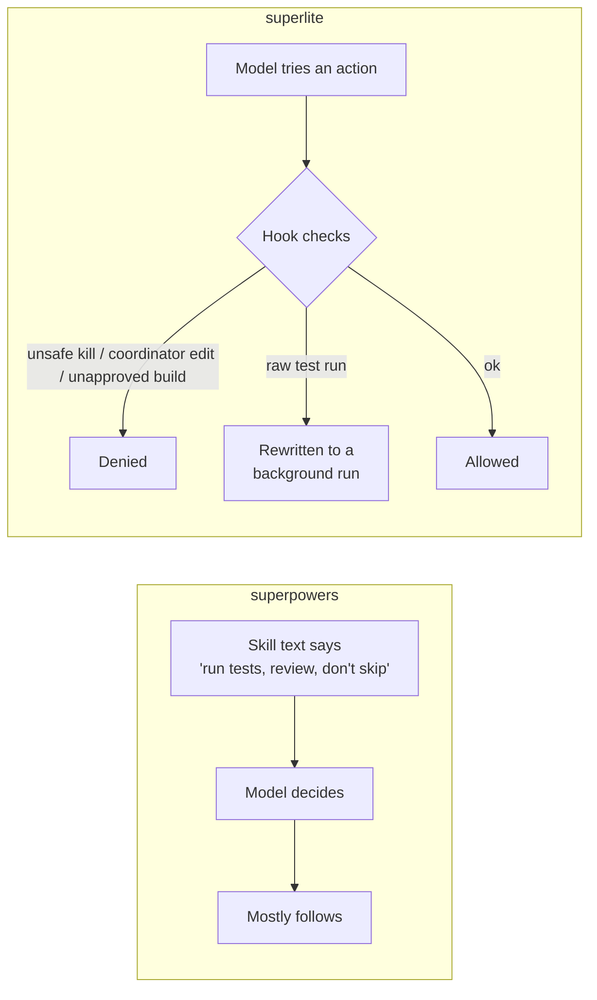
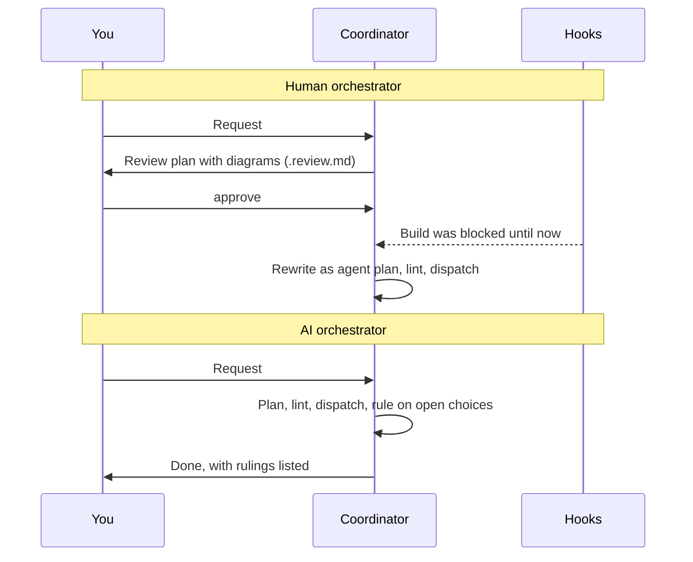
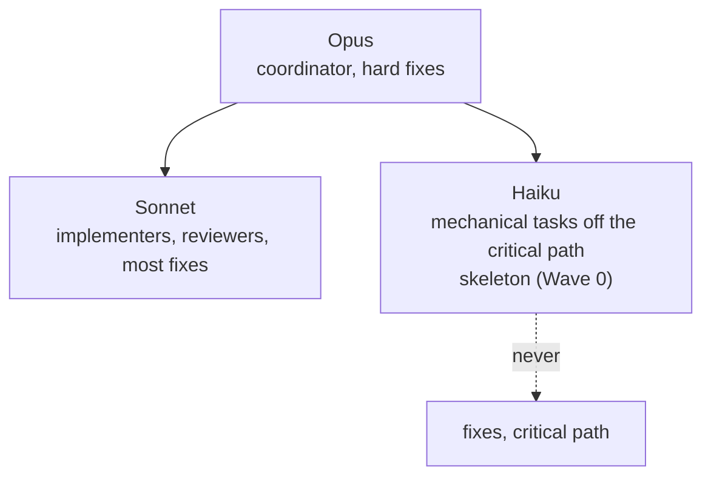

# superlite vs superpowers: a detailed comparison

Date: 2026-10-19. Superlite is 1.1.0 (main, `cba1a2e`). Superpowers is 7.0.0 (the installed copy; the benchmark used 6.4.1).

Sources: the superlite repo (README, `docs/`, skills, hooks, `config/`), the superlite architecture spec (`2026-10-17-superlite-architecture-design.md`), and the installed superpowers 7.0.0 skills and hooks (headings and structure read, not every line). Benchmark figures come from `bench/` and the README footnotes.

## 1. One-paragraph difference

**Superpowers** is a set of process skills that keep a capable model disciplined: brainstorm, write a plan with full code steps, execute each task with an implementer and a reviewer, review at the end. It relies on the model following the skill text. A human stays close to the work.

**Superlite** is a fork built for autonomous, fast builds. It keeps the same lifecycle but moves the rules into code: hooks, a plan linter, background test runs, tiered model routing, a deterministic review packet. The goal is to hand off a build and get it back quickly, measured by time, cost and quality.

They are not rivals so much as two points on one axis: superpowers optimizes for a developer working with the model, superlite for a developer who has left the room.

## 2. The same lifecycle, different machinery

```mermaid
flowchart TB
  subgraph P["superpowers"]
    P1[Brainstorm] --> P2["Plan<br/>(full code per step)"]
    P2 --> P3["Per task:<br/>implementer"]
    P3 --> P4[Task reviewer]
    P4 --> P5{Findings?}
    P5 -- yes --> P6[Fix loop] --> P4
    P5 -- no --> P7[Next task]
    P7 --> P3
    P7 --> P8[Final review]
    P8 --> P9[Finish branch]
  end
  subgraph L["superlite"]
    L1["Size the request<br/>start menu"] --> L2[Brainstorm]
    L2 --> L3["Plan<br/>(task graph)"]
    L3 --> L4{"lint --stable<br/>the gate"}
    L4 -- FIX --> L3
    L4 -- STABLE --> L5["Wave 0<br/>skeleton on Haiku"]
    L5 --> L6["Parallel build by tier<br/>Sonnet / Haiku"]
    L6 --> L7["Background tests<br/>seam + probe checks"]
    L7 --> L8["Package reviews<br/>fix their own findings"]
    L8 --> L9["Final review<br/>one fresh agent, packet only"]
    L9 --> L10["Fix-only agents<br/>by tier"]
    L10 --> L11["Finish + history"]
  end
```

The main structural difference: superpowers loops task by task (implement, review, fix, next). Superlite builds a dependency graph, runs everything that can run at once, and reviews by package, then once more for the whole run.

### 2.1 The 1.0 design (shipped as 1.1.0), whole system on one page

What the diagram shows beyond the basic lifecycle: the entry step and orchestrator choice, the review plan and its human gate, the lint gate with FIX looping back to the plan, Haiku limited to mechanical tasks, background tests, findings-only final review with tiered fix-only agents, and a hooks lane that is always on.

## 3. Feature-by-feature

| Area | superpowers | superlite |
|---|---|---|
| Purpose | Disciplined engineering with a human close by | Autonomous, fast hand-off builds |
| Form | Skills plus a session-start hook; no plugin agents | Skills, seven agents with model/effort set, five hook types, 15 slash commands, Python `sl` tools |
| Rule enforcement | Skill text the model should follow | Code: hooks block or rewrite tool calls, a linter gates the plan |
| Plan format | Prose steps with the full code for each | Task graph with interfaces, `e.g.` contract examples, sizes, frozen items |
| Plan check | Self-review by the model | `plan_tools lint --stable`: STABLE or FIX, size band 1.5–6 min, chains, edges |
| Execution | Mostly sequential task loop | Ready-queue over a pool of idle agents, parallel waves |
| Concurrency (benchmark) | 3–4 agents at once | 18 agents at once |
| Models | One capable model, with model-selection guidance | Routed by tier: Opus coordinates, Sonnet builds, Haiku only for mechanical tasks off the critical path, never for fixes |
| Coordinator | Does more of the work itself | Never writes project code or runs raw tests (hook-enforced) |
| Tests | Run by the agent in the loop | Background run, language-agnostic, summary file, raw runs rewritten by a hook |
| Review | Per-task reviewer, re-review prompt, final review | Package reviewers fix their own findings; one fresh final reviewer reads a packet and reports findings only |
| Fixes | The fix loop in the same flow | Fix-only agents by tier (Sonnet, Sonnet high, Opus), a note file per fix, escalate after two fails |
| Human control | Default: the human is in the conversation | Choice: human orchestrator (approves a review plan with diagrams) or AI orchestrator (hands off) |
| Entry | Skills fire by description | Start menu and `/superlite:start`, `mvp`, `feature`, `debug`, `resume`, `status` and more |
| Measurement | None built in | Per-run metrics, a history file, a budget with a 70% warning, benchmark tools |
| Scope of skills | Wide: worktrees, receiving review, writing skills, parallel agents, diagnosing | Narrower: the build lifecycle, debugging, TDD, verification, finishing |
| Harness reach | Claude Code, Codex, Pi, Antigravity, Hermes, Muse | Same harness files are carried over; the hooks and agents are Claude Code first |
| Dependencies | None beyond the harness | Python 3.10+ for the `sl` tools |

## 4. Enforcement: prompt versus code

Superlite's gates:

- `block-unsafe-kill`: stops killing processes by name.
- `block-coordinator-edits`: the coordinator cannot write project code; in human mode it also blocks writes and agent dispatch until the plan is approved.
- `rewrite-test-runs`: a raw test command becomes a background run.
- `record-human-reply`: logs real human replies so approval cannot be faked by the model.
- `capture-agent-launch` and `capture-agent-stop`: write the metrics that the budget and history use.

The benefit is consistency across runs. The cost is more moving parts, and the hooks cost about 340 ms per call on this machine.

## 5. Orchestrator choice

Superpowers has no equivalent switch; its human is always in the loop through the conversation.

## 6. Model use and cost routing

Superpowers gives model-selection guidance in its subagent skill. Superlite sets the model and effort in each agent's frontmatter and in `config/routing.json`, and measures the outcome per band.

## 7. Results so far

Benchmark (one task, same machine; see the README for the caveats):

| Arm | Runs | Mean wall-clock |
|---|---|---|
| superpowers, inline | 2 (30.1, 21.2 min) | 25.7 min |
| superpowers, orchestrated | 3 (27.2, 13.3, 31.9 min; the 47.6 min run is excluded as an outlier) | 24.1 min |
| superlite, current stack | 1 (16.1 min) | 16.1 min |

- 37% less wall-clock than inline superpowers (16.1 against 25.7) and 33% less than orchestrated (16.1 against 24.1). With the 47.6 min run included the orchestrated mean is 30.0 min and the gap is 46%.
- Superlite has one run, so this is an indication, not a proof. The best orchestrated superpowers run (13.3 min) was faster than superlite's 16.1.
- First-version benchmark, n=1 each: 8.8 min against 34.4 min, 89 of 89 hidden tests for both.
- The cost is not always lower: on some tasks superlite costs more than superpowers.
- Superlite's own goal, a combined benchmark of 13.4 minutes (half of its 26.9 baseline), has not been reached.

## 8. Where superpowers is the better choice

- You want to stay in the conversation and steer: it assumes that, and superlite works hardest when you do not.
- You need its wider skill set: git worktrees, receiving review feedback, parallel-agent dispatch, writing new skills, diagnosing a bad session.
- You work in a language or setup where Python tooling is unwelcome. Superlite's seam checks and probe stage are Python-only today.
- You want fewer moving parts to debug. Superlite's hooks, linter and routing are more to learn and to break.
- Small or exploratory work: forced orchestration cost more than building inline on small tasks.

## 9. Where superlite is the better choice

- You want to hand off a build and review a finished, tested result.
- Wall-clock time matters and the work splits into independent parts.
- You want rules enforced by code rather than remembered by the model, for example no coordinator code edits and no unapproved human-mode builds.
- You want measured runs (time, cost, findings) and a history that tunes sizing and routing.
- You want an explicit approval step with a readable plan and diagrams before anything runs.

## 10. Can they run together?

Both can be enabled, and today they are, in this project. Both define process skills that fire at session start, so they compete: the session gets two "using-" skills with different rules. The recommendation is to enable one per project. `/superlite:setup` checks for this.
