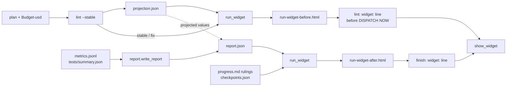

# Tools

Mechanical steps are scripts, not agents. Every tool runs as `bash <skill-dir>/scripts/superlite-cli <tool> ...`, where `<skill-dir>` is `skills/swarm`. The `superlite-cli` launcher runs a `.sh` tool under bash and a `.py` tool under the first working Python, and exits 3 when there is none. It caches that interpreter, so each later call is one Python start (`SUPERLITE_PYTHON` skips the probe entirely). Tools that need each other import them in process instead of spawning `superlite-cli` again. The tools are Python, but the project can be any language.

A checkpoint is a hidden save of one task under `refs/superlite/*`. superlite never commits during a run; at session end shipping asks once whether to commit to the session branch.

| Tool | What it does |
|---|---|
| `plan_tools` | Plan lint (`--stable` freezes tasks and tiers), task graph, stubs, schedule (prints only), and the `adapter`, `packet` and `contract` review subcommands |
| `graph` | `--plan <plan>`: the plan's task graph as a mermaid `flowchart TD` (id and title per node, the critical path in a `critical` class; cached in `.superlite/graph.txt`); `lint --stable` prints it framed as `GRAPH ... END GRAPH` on the first lint and when the flowchart changes, marking lint's own critical path, and the coordinator shows it as a mermaid block |
| `wave0` | Builds the Wave 0 skeleton brief for `implementer-haiku` from the plan alone |
| `routing` | Maps each task's plan features to a tier (haiku or sonnet) using `routing.json` |
| `predict` | Predicts each task's time, context and cost; `--refit` fits the coefficients |
| `build_prime` | Builds the shared prime every agent reads first. By tier (`prime` in `routing.json`): `slim` for sonnet (rules, plan header, Global constraints, stable tasks' title, Owns, dependencies and interfaces; about 8 KB where the whole plan is 20 KB), `mini` for haiku (`--tier haiku`), or `--prime full` (whole plan and `--sections` spec text) |
| `task` | `superlite-cli task Tn`: task Tn's block from the current plan plus the Produces lines of every task it consumes; how agents read their task and neighbours |
| `dispatch` | `ready` (the ready task ids), `assign --task Tn` (the agent for one task), and by default both in one call; batches ready tasks of one tier per agent message with `max(B+A, F/T)` (`--batch 1` turns it off). When the plan (or `SUPERLITE_HOST`) selects a host such as cursor, also prints an additive `SWARM` block |
| `host_models` | `resolve` / `show` / `job-for`: once-per-run host profile → `.superlite/host-models.json` (Cursor Multitask map) |
| `next_tasks` | Computes which tasks are ready |
| `checkpoint` | Checks scope, then records one or more tasks' owned files as hidden checkpoints (`refs/superlite/*`, branch untouched); `--dispatch` also prints the next dispatch |
| `cost` | `line` (live host-reported spend, silent before the host reports usage) and `table` (per-agent cost table) |
| `agent_specs` | `on`/`off`/`status` opt-in pre-impl specs (`.superlite/agent-specs.json`, env `SUPERLITE_AGENT_SPECS`); `open on\|off` toggles `open_in_harness` (opens plans and specs; `status` always shows it); `prefer on\|off` records the first-session global default in `$SUPERLITE_HOME/preferences.json`. Spec = done+why; plan = how |
| `run_tests` | Runs the project's test command, with `--background`, then `--wait` for the summary. `--affected [--base REF] [--files F...]` runs only tests for changed files, `--full --reuse` skips a rerun when the working tree is unchanged since a green run; writes `.superlite/tests/summary.json`. Probes for a hung run (see below) |
| `testprobe` | The hung-test probe `run_tests` uses; run alone it prints the CPU-time method in use and the effective config |
| `testcmd` | Resolves the project's test command: `.superlite/test-cmd.json`, else detection (npm, go, cargo, dotnet, Python) |
| `pt_review` | `adapter`, `packet` (the final review packet) and `contract` (seam checks) |
| `probe_run` | Parallel robustness probes with no agents (Python projects only) |
| `lessons` | Per-repo lessons cache: `list`, `show ID`, `drop ID`, `pin ID`, `restore ID`, `report`, and `brief --task Tn [--plan P] [--agent implementer\|fixer\|reviewer\|drafter] [--file F] [--files P...]` (a short brief for an agent) |
| `learn` | `sync [--plan P] [--final] [--status finished]` learns from the run's signals (advisory); `note --task Tn --tag T --text X` records a `Learned:` line. Anonymised rows go to an outbox under the superlite home |
| `review_findings` | `record [--file F]` (stdin otherwise) stores the final reviewer's `file:line - problem - fix - tier N` lines in the run folder |
| `incident` | Records and queries the shared incident log (file, line, context) |
| `budget` | One line of elapsed time and cost against the plan's target and cap |
| `metrics` | Per-task time, tokens and cost from `.superlite/metrics.jsonl` and agent transcripts |
| `history` | Run history: `write` rows to `history.jsonl` in the superlite home (`$SUPERLITE_HOME`, else `$XDG_DATA_HOME/superlite`), `read`, `derive` stats, `import` bench scores |
| `graphify_gate` | Gates Graphify for search in non-trivial codebases |
| `orchestrator` | Who orchestrates: `set human|ai`, `approve --review <plan>` (needs an approving human reply newer than the plan), `status` |
| `report` | The end-of-build report: a short summary in the session, the full file next to the plan, projected against actual; in feature mode the prototype and the integration as two parts |
| `run_widget` | The run cards, one self-contained HTML fragment each: `--before` the forecast (projected time and cost against the `Budget-usd` cap, agents, critical path, projected cost by model), default the result (time and cost, tasks and tests, cost by model, rulings and checkpoint state); prints nothing without its source. See [Run cards](#run-cards) |
| `suggest_flow` | `--text "<request>"`: one line, the suggested flow (regular, mvp, feature, debug, small, review, research, resume, status) from the request and the project state, with the other fits; deterministic |
| `research` | Research mode's ledger (level-free JSON): `init`, `source`, `claim`, `contradiction [--id]`, `lint [--parity]`, `render --level [--part]`, `downloads`, `download --yes`, `list` (every ledger, live or parked in a session store; a parked one is read-only). See [Research flow](research-flow.md) |
| `proto` | Feature mode's prototype: `start` (a sandbox folder `.superlite/sandboxes/<session>/<topic>/`, no worktree or branch), `tryout` (how to try it; `--approve` needs the human's reply in human mode), `status`, `discard` (deletes the folder, archives run files into `.superlite/runs/`); state in `feature.json` |
| `session` | `ensure` (flow auto-start) / `close` (end of flow) / `untracked` (ask\|stash\|keep) / `create` / `use` (park+stash or REDIRECT) / `split` (parallel worktrees) / `discard` / `status` / `sync` (bring local main into a session branch); `session_hud` one-liner for hooks. See [Sessions](sessions.md) |
| `mvp_check` | MVP mode: `build` the prototype page from the template, the `.mvp.md` plan's features and a mock fragment; `stamp` its sha; `check` the page (parses, every feature id in the mock, no external URLs) and `mvp-feedback.json` (schema, features, `prototype_sha`); `ai` writes the AI orchestrator's feedback; `fetch` copies a saved file in from Downloads |
| `finish` | Collects the finish summary (rulings, checkpoints, test counts, open incidents); with `--plan` also writes the after card and ends with a `widget:` line |

`_pyrun.py` is a shared helper, not a tool. Probes live in `probes/` with the probe pack in `probes/pack/`.

## Run cards

Two cards in one look, for a coordinator with an inline widget tool (Claude desktop's `show_widget`); other harnesses skip the `widget:` lines and keep the text output.

- **Before**: the first `plan_tools lint --stable` saves the fixed forecast (`projection.json`) and hands it, with the stable and fix tasks and the plan's `**Budget-usd:**` cap, to `run_widget`, which writes `.superlite/run-widget-before.html`. Lint prints `widget: .superlite/run-widget-before.html (...)` just before its last line, so it still ends with `DISPATCH NOW:`. The forecast is saved once, so later lints print no card. In human mode this lint runs only after approval, so the card shows right before the first dispatch.
- **After**: `finish --plan` writes the build report, then hands `report.json`, the ledger and the checkpoint count to `run_widget`, which writes `.superlite/run-widget-after.html`; finish ends with its `widget:` line. There is no card without `--plan`, and none when this finish wrote no report (no `metrics.jsonl`), so an old `report.json` is never shown again.

Both cards are HTML fragments on the host's CSS variables (so they follow light and dark mode), with no scripts and no external loads. Every value is HTML-escaped and every missing value reads `n/a`. The forecast's model bars add up to its headline cost: a muted "other" bar covers the part no task owns.

## Hung test run probe

A probe, not a watchdog: tests can legitimately run long, so by default it reports and never kills. While `run_tests` has a test process alive it samples every `sample_interval_s` (12 s) the output bytes of the process tree, its CPU time and its set of child processes, but only after the run passes 3x its expected time (`--expect SECONDS`, else env `SUPERLITE_TEST_EXPECT_S`, else the last green run of the same mode, else `fallback_expected_s`), so a normal run pays nothing. Two consecutive samples classify the run: output and children flat with CPU flat is `blocked` (deadlock or wait), with CPU busy `spinning` (likely an infinite loop), with CPU time unavailable `stalled`; anything else keeps waiting. A verdict that holds for `min_flat_s` is a SUSPECT HANG.

On a suspect `run_tests` prints one `SUSPECT HANG: <VERDICT> <test file> - no output for Ns, cpu P% (...); process tree: ...` line, logs a `perf` incident, and writes a provisional `tests/summary.json` (`failed: 1`, `running: true`) plus a `test-summary-<id>.suspect` sidecar for a background run. The run itself keeps going. `run_tests --wait` returns at once with exit 3 and that line when it sees the sidecar (`--patient` keeps waiting); a wait that runs out exits 2 with `TIMEOUT`. A killed or crashed test command is worded `process killed or crashed (exit -1)` (Windows exit 4294967295), never a bare exit code.

`config/testprobe.json` holds the thresholds (data, not code): `enabled`, `multiplier` (3), `fallback_expected_s` (60), `min_start_s` (30), `sample_interval_s` (12), `min_flat_s` (30), `cpu_idle_pct` (2), `cpu_busy_pct` (20), `auto_kill_blocked` (false), `auto_kill_after_s` (300), `hard_timeout_s` (0, off), `max_tree_listed` (8). `auto_kill_blocked` kills a BLOCKED run at about 0% CPU after `auto_kill_after_s`; `hard_timeout_s` kills any run after that many seconds and records a TIMEOUT. Both are process-tree kills by PID (`taskkill /T /F /PID`, or `killpg`), never by name. Override the file with env `SUPERLITE_TESTPROBE_CONFIG=<path>`, turn the probe off with `SUPERLITE_TESTPROBE=0`.

Summary fields, all additive (a run the probe saw nothing in keeps the old shape exactly): `verdict` (`SUSPECT HANG` or `TIMEOUT`), `suspect_hang` (`verdict`, `flat_s`, `cpu_pct`, `cpu_method`, `test_file` when known, `tree` as pid and name, `recovered`, `elapsed_s`, `killed_after_s` when killed, and the printed `line`), `timeout_s` (hard timeout kill) and `running: true` (provisional summary only). `failures` leads with the same SUSPECT HANG or TIMEOUT text.

CPU time of the process tree, first that works: psutil if importable; Windows, ctypes (Toolhelp32 process snapshot for the tree, `GetProcessTimes` for the CPU, no spawn and no PowerShell); Linux `/proc/<pid>/stat`; macOS and others `ps`. `SUPERLITE_TESTPROBE_BACKEND=psutil|ctypes|proc|ps|none` forces one. When none works the probe degrades to output and children only (verdict `stalled`) and never errors.
