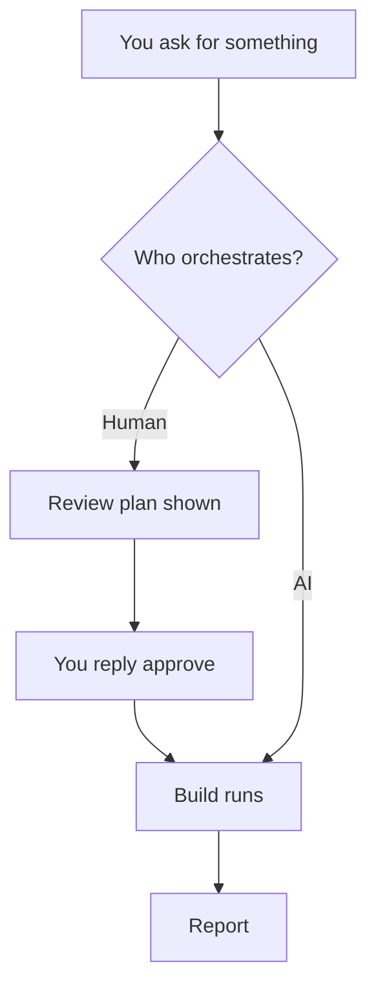
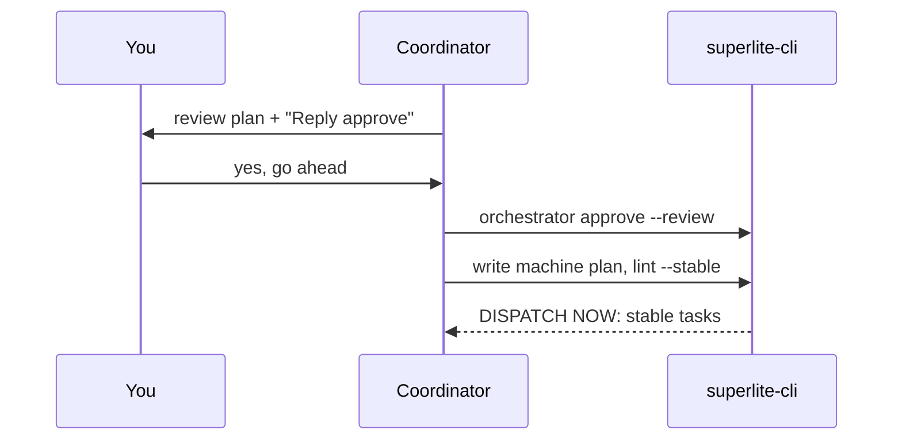
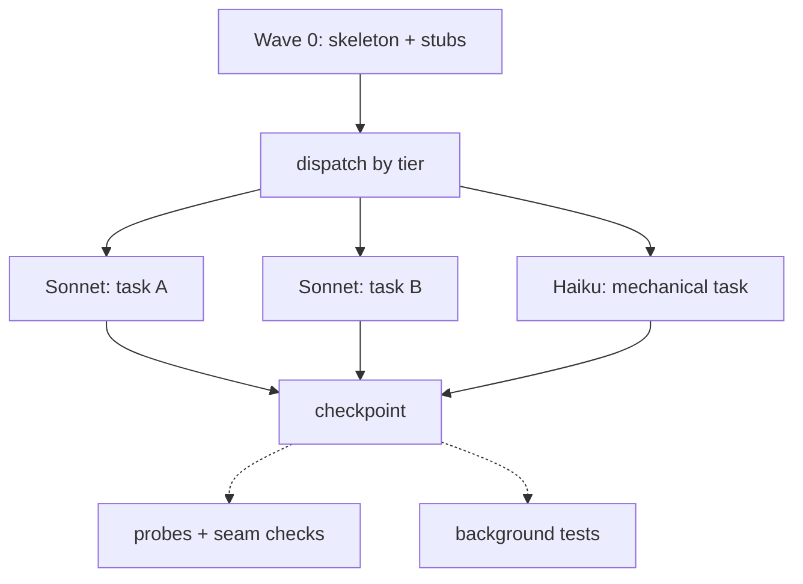
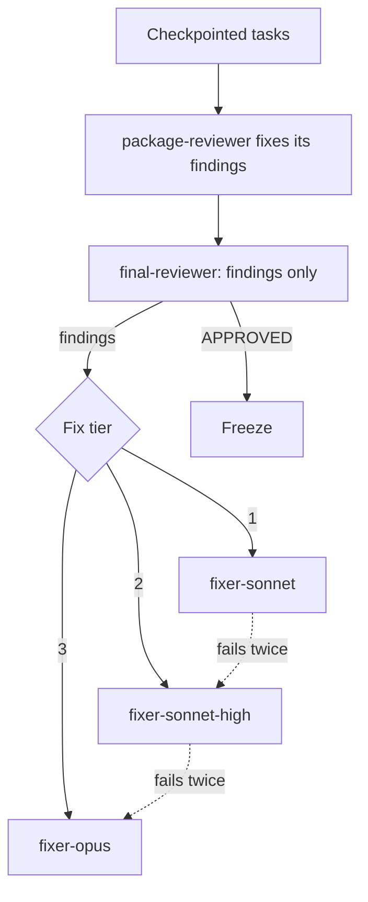
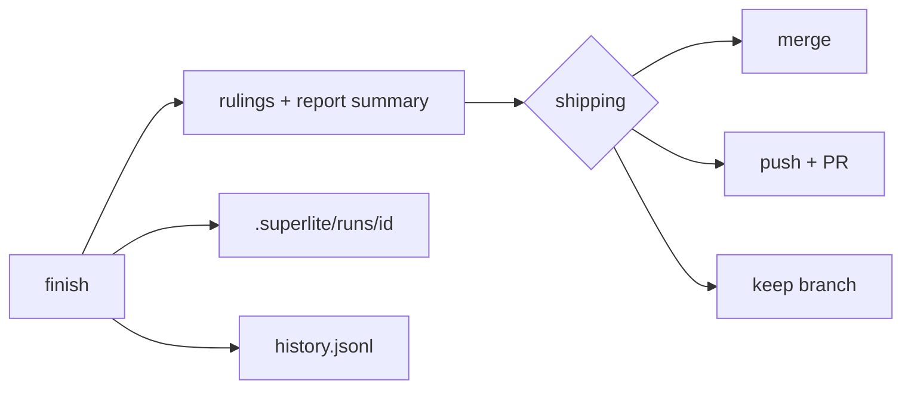
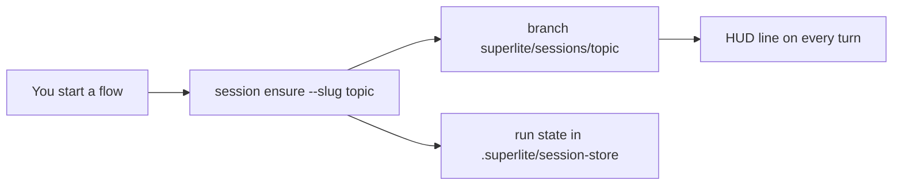
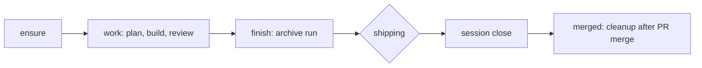
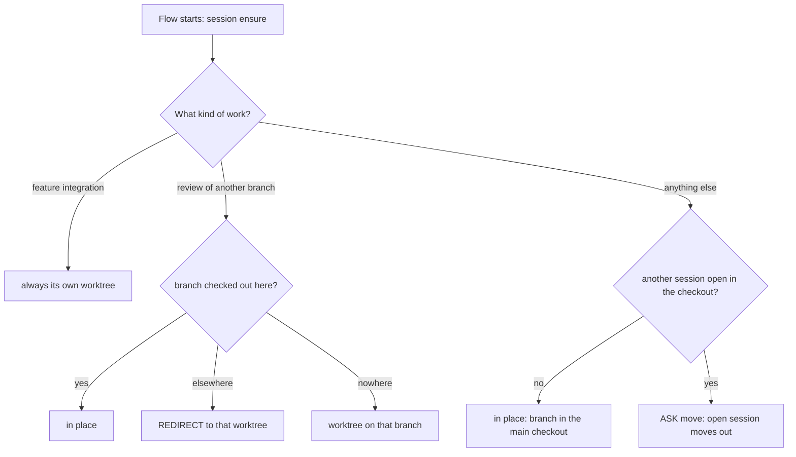
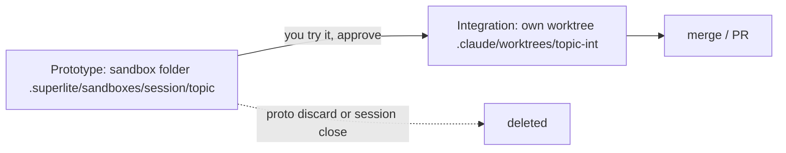

# Facts: how a run works, and sessions

Only facts with a source. Paths are repo-root relative. Sections map to pages.

## Page: orchestrators (run/orchestrators)

- Before building, superlite settles who orchestrates: a human orchestrator or an AI orchestrator. (src: skills/swarm/orchestrator.md)
- Human orchestrator: you approve the plan before it is linted and sent to agents. (src: skills/swarm/orchestrator.md)
- AI orchestrator: does everything itself (plan, lint, dispatch, rulings) and never stops to ask, except for destructive, outward-facing (push, merge, publish) or security-sensitive actions. (src: skills/swarm/orchestrator.md)
- The question is asked once, as a single choice: "Human orchestrator: I approve the plan before it runs" or "AI orchestrator: hands off, it does everything". (src: skills/swarm/orchestrator.md)
- It is not asked when the request already settles it ("decide yourself", "I am away", pre-approved design and plan); a headless `claude -p` run defaults to AI. (src: skills/swarm/orchestrator.md)
- `superlite-cli orchestrator status` prints one line: `human, awaiting approval`, `human, approved <time> by <name>`, `AI`, or `not set (ungated)`. (src: skills/swarm/orchestrator.md)
- An AI orchestrator prints one line naming `/superlite:agents` at the first dispatch and asks nothing about views. (src: skills/swarm/orchestrator.md)
- Human mode: nothing is linted, dispatched or sent to an agent until your approving reply; `plan_tools lint --stable`, `dispatch`, `wave0`, `build_prime` exit 4 with BLOCKED before it. (src: skills/swarm/orchestrator.md)
- The approval gate is enforced by hooks and scripts, not by instructions alone. (src: docs/gates.md)
- Small inline work (trivial or bounded, no plan) is not orchestrated; it needs only your yes in chat and has no review plan. (src: skills/swarm/orchestrator.md)
- The coordinator (Opus, medium effort) never writes project code or runs raw tests. (src: docs/how-a-run-works.md)
- Delegated run: the plan is streamed, so stable tasks start building while fixes to the rest are made. (src: docs/how-a-run-works.md)

Diagram (orchestrators):

## Page: plan and approval (run/plan-and-approval)

- Human mode, phase 1: the coordinator writes a review plan `docs/plans/<date>-<topic>.review.md`, plain words with diagrams and a few key code snippets, no task graph. (src: skills/drafting/SKILL.md)
- Nothing but the review plan is written before your approving reply. (src: skills/drafting/SKILL.md)
- The review plan is opened for you first when `open_in_harness` is on; it is then shown with its path and a five-line summary: "Reply approve to start, or tell me what to change". The turn ends and waits. (src: skills/swarm/orchestrator.md)
- Approval is asked in plain text, never with AskUserQuestion, because the typed reply is what the hook verifies. (src: skills/swarm/orchestrator.md)
- Any clear approval counts (yes, go ahead, looks good, or similar); you are not asked to retype "approve". (src: docs/gates.md)
- The coordinator then runs `superlite-cli orchestrator approve --review <path>`; it exits 3 BLOCKED unless a human reply newer than the review plan exists in `.superlite/human-replies.jsonl`. (src: skills/swarm/orchestrator.md)
- Phase 2, after the yes: the coordinator writes the machine plan `docs/plans/<date>-<topic>.md` from the review plan, header `**Review plan:** <path>`, same tasks and scope. (src: skills/drafting/SKILL.md)
- If the reply asked for `map`, the agent map is opened to watch the run. (src: skills/swarm/orchestrator.md)
- The machine plan is a task graph: a Mermaid diagram with a `%% taskgraph` section where an edge `Tn --> Tm` means Tm's tests run Tn's code. (src: skills/drafting/SKILL.md)
- Each task block has Owns, Components, LOC owned, Tests (fast or slow), Model, Consumes, Produces and Review Focus. (src: skills/drafting/SKILL.md)
- Task size band: predicted 1.5 to 6.0 minutes; over 6 fails lint with `SIZE:`. (src: skills/drafting/SKILL.md)
- Plan size cap is 15k characters. (src: skills/drafting/SKILL.md)
- `plan_tools lint --stable` splits tasks into STABLE (dispatch now) and FIX (wait with a reason) and writes `.superlite/stable.json`. (src: skills/drafting/SKILL.md)
- A task is stable when its own checks pass, every Consumes has a clean Produces line, and it has no edge to an unstable task. (src: skills/drafting/SKILL.md)
- Fixed order: write plan, lint, dispatch the whole stable set, only then patch the FIX tasks, re-lint, dispatch the newly stable ones. (src: skills/swarm/SKILL.md)
- Dispatched tasks are frozen; changing one later is a follow-up fix task, not a restart. (src: skills/swarm/SKILL.md)
- After approval the run decides on its own: scope or interface changes become `Ruling: [scope] <decision> - <why> - <cost if wrong>`, listed by `finish` under "Changed from the approved plan". (src: skills/swarm/orchestrator.md)
- MVP mode: the `.mvp.md` plan is the review plan. Feature mode: the `.feature.md` plan is the review plan, with a second planned gate, the prototype try-out ("it works" or list changes). (src: skills/swarm/orchestrator.md)
- AI mode skips the review plan and goes straight to the machine plan. (src: skills/drafting/SKILL.md)
- The review plan can set "Run the whole test suite at finish?" (default no). (src: skills/drafting/SKILL.md)

Diagram (plan and approval):

## Page: parallel build (run/parallel-build)

- Wave 0 (skeleton and interface stubs) is built first by `implementer-haiku` from a brief the tools write from the plan; `superlite-cli wave0 --plan` prints it. (src: docs/how-a-run-works.md)
- Wave 0 holds the manifest, package inits, test config, shared error types and a stub for every Produces another task consumes. (src: skills/drafting/SKILL.md)
- A task waits only when its tests execute another task's code; consumers build against stubs and the `e.g.` examples. (src: skills/drafting/SKILL.md)
- Integration is one small task per package at the end. (src: skills/drafting/SKILL.md)
- Tiers: Sonnet `implementer` (sonnet, medium) by default; Haiku `implementer-haiku` only for `Kind: mechanical` tasks that are off the critical path. (src: skills/swarm/config/routing.json)
- Tier is fixed by lint from `config/routing.json` and never overridden; a critical-path task never gets Haiku. (src: skills/swarm/config/routing.json)
- `superlite-cli dispatch` packs ready tasks into batches (busy agents counted, critical-path tasks alone, context budget); each line is `Tn agent=ID`, `Tn poll IDs` or `Tn fresh tier=T`. (src: skills/swarm/SKILL.md)
- A task goes only to an idle agent of its own tier; nothing queues behind a busy one. (src: docs/gates.md)
- Context limit per agent: Haiku 60k, Sonnet 80k; at most 20 tasks and 50 idle minutes. (src: skills/swarm/config/routing.json)
- Every agent first reads the same small prime (rules, plan header, global constraints, each stable task's title, Owns, dependencies, Produces/Consumes); no plan body. Same bytes for the whole run. (src: docs/how-a-run-works.md)
- The agent replies READY; its task is then sent as `superlite-cli task Tn --plan PLAN`, which also prints the Produces lines of what the task consumes. (src: skills/swarm/SKILL.md)
- An implementer writes the failing test, runs it, implements, runs it again, and replies DONE, DONE_WITH_CONCERNS, NEEDS_CONTEXT or BLOCKED in at most 200 words. (src: skills/swarm/SKILL.md)
- `superlite-cli checkpoint T3 T5 --dispatch` saves each task's own files as a hidden checkpoint under `refs/superlite/*`; nothing is committed during a run. (src: docs/how-a-run-works.md)
- A checkpoint prints `Tn <sha>` or `Tn FAILED` (unowned files or syntax/import problems send the task back) and starts probes and seam checks in the background. (src: skills/swarm/SKILL.md)
- Tests run in the background into `.superlite/test-summary.json`; the coordinator never waits on a test run mid-build. (src: skills/swarm/SKILL.md)
- A raw `pytest`, `npm test` or `go test` is rewritten into a background `superlite-cli run_tests`. (src: docs/gates.md)
- Hidden waits (a test inside an until/while loop, output to /dev/null) are denied; `run_tests --wait` reports a SUSPECT HANG instead. (src: docs/gates.md)
- Pool state lives in `.superlite/pool.json`; the progress ledger is `.superlite/progress.md`. (src: skills/swarm/SKILL.md)
- Cost caps: warns at 70% of the cap; over the cap it stops optional work. (src: docs/gates.md)
- Watch a run with `/superlite:agents` (agent map pane) or `/superlite:tail` where the map mod is not installed; `/superlite:status` shows mode, approval, tasks and cost; `/superlite:stop` stops dispatching cleanly; `/superlite:resume` continues from the last checkpointed tested wave. (src: commands/agents.md, commands/tail.md, commands/status.md, commands/stop.md, commands/resume.md)
- No agent spawns agents: subagents get explicit tool lists without `Agent`. (src: docs/gates.md)

Diagram (parallel build):

## Page: reviews and fixes (run/reviews-and-fixes)

- `package-reviewer` (sonnet, medium) reviews selected tasks or whole packages and fixes its own findings with regression tests. (src: docs/how-a-run-works.md)
- A task is reviewed at checkpoint when it has a seam, Complexity >= 5, a Review Focus risk or an open incident; otherwise one review per checkpointed package. (src: skills/swarm/SKILL.md)
- A review packet (incidents, probe failures, test summary, source excerpts) goes to one fresh `final-reviewer` (opus, high). (src: docs/how-a-run-works.md)
- The final reviewer only reports: `Verdict: APPROVED` or `CHANGES_REQUESTED` plus `file:line - problem - fix - tier N` lines. (src: skills/swarm/SKILL.md)
- The packet is built with `plan_tools packet`; its header says FAST PATH or REVIEW REQUIRED. (src: skills/swarm/SKILL.md)
- Final-review gate: every task checkpointed, every review reported, every seam verified. The tree stays frozen while it reads. (src: skills/swarm/SKILL.md)
- Fix-only agents by tier: 1 `fixer-sonnet` (sonnet, medium): cause known, one module. 2 `fixer-sonnet-high` (sonnet, high): spans modules or a seam. 3 `fixer-opus` (opus, high): cause unknown, or a lower tier failed twice. (src: skills/swarm/fixing.md)
- Haiku never fixes, because a fix keeps a decision. (src: skills/swarm/fixing.md)
- Escalation: after 2 failed rounds at a tier, move up one; each failed round is logged as an incident. (src: skills/swarm/fixing.md)
- Each fixer round rewrites a note `.superlite/fixes/<id>.md` (at most 1,500 chars, ends FIXED or NOT_FIXED). A later round starts a fresh agent that reads only that note. (src: skills/swarm/fixing.md)
- A fixer fixes only the named findings, adds one regression test per fix, runs only touched tests in the background, checkpoints, and reports a closed list. (src: skills/swarm/fixing.md)
- Notes still NOT_FIXED after the last tier become a `Ruling:` in the closing message. (src: skills/swarm/fixing.md)
- A Haiku task that ends red, BLOCKED or NEEDS_CONTEXT goes to tier 1 and is never retried on Haiku (`superlite-cli routing miss`). (src: skills/swarm/fixing.md)
- After fixes: checkpoint again and one more `run_tests --affected --background`, then freeze. (src: skills/swarm/SKILL.md)
- Red test lines are findings too; shipping runs the one blocking test run, and red blocks merge and PR. (src: skills/swarm/SKILL.md)
- The coordinator is blocked from writing code; the block message says which fixer tier to use. (src: docs/gates.md)

Diagram (reviews and fixes):

## Page: report (run/report)

- `superlite-cli finish --plan PLAN` moves the run's files into `.superlite/runs/<id>/`, lists the rulings ("Rulings I made", each with its cost) and prints the report summary. (src: skills/swarm/SKILL.md)
- The full report is `<plan>.report.md` (and `.report.json`) next to the plan. (src: commands/report.md)
- `finish` also prints the orchestrator line and, in human mode, the approval time. (src: skills/swarm/orchestrator.md)
- `superlite-cli history write` appends the run's rows to `~/.superlite/history.jsonl`; these feed the next run's predictions. (src: docs/how-a-run-works.md)
- Each agent's tokens, cost and time are captured by hooks into `.superlite/metrics.jsonl`. (src: skills/swarm/SKILL.md)
- `/superlite:report` with no argument lists stored reports (newest first) plus the last 5 history rows; `/superlite:report <plan>` shows one summary; `/superlite:report <plan> full` shows all. (src: commands/report.md)
- Feature runs add a part with prototype and integration cost and wall-clock, and the prototype's share against a 25% cap. (src: docs/feature-flow.md)
- After finish, `superlite:shipping` verifies, then asks one question: merge locally, push and open a PR, or keep the branch. It never pushes or merges without your answer. (src: skills/shipping/SKILL.md)
- Before the options it offers "Commit to <session branch>" or "Leave uncommitted"; a run leaves its work uncommitted by design. (src: skills/shipping/SKILL.md)
- Unattended runs keep the branch, do not push, merge or commit, and print the summary and rulings. (src: skills/shipping/SKILL.md)
- Verify at shipping: `run_tests --full --reuse` when the plan says `**Full suite:** yes`, else `run_tests --affected --base <start sha>`. (src: skills/shipping/SKILL.md)
- After a PR merges, `/superlite:merged` cleans up. (src: skills/shipping/SKILL.md)

Diagram (report):

## Page: sessions (sessions/sessions)

- A session is one line of work: a branch `superlite/sessions/<slug>`, parked run state under `.superlite/session-store/<slug>/`, and an optional WIP stash. (src: docs/sessions.md)
- Slugs use a-z, 0-9 and `-`; `host` is reserved; a taken slug gets `-2`, `-3` and the final slug is printed. (src: docs/sessions.md)
- Why: two chats in one folder would overwrite `.superlite/`; sessions isolate by branch (serial) and worktree (parallel). (src: docs/sessions.md)
- The registry is `sessions.json` in the hub; writes take `.superlite/sessions.lock` and are atomic. (src: docs/sessions.md)
- Every flow starts a session automatically: `superlite-cli session ensure --slug <topic>`; nobody types `session create`. (src: docs/sessions.md)
- `SUPERLITE_NO_AUTO_SESSION=1` turns auto-start off. (src: docs/sessions.md)
- HUD line injected on each turn: `superlite session: export | branch superlite/sessions/export | worktree …/host | active | stash:no | run:open`. (src: docs/sessions.md)
- With no session in the main checkout the HUD reads `superlite session: none here (main checkout) | <N> sessions`. (src: docs/sessions.md)
- The HUD adds `| main:+N` when local main moved N ahead of the session's base; nothing syncs automatically. Opt out: `SUPERLITE_NO_SESSION_HUD=1`. (src: docs/sessions.md)
- `superlite-cli session sync --slug S` is fast-forward only; it never fetches, pushes, pulls or rebases. (src: docs/sessions.md)
- Dirty files are stashed only with your OK; untracked files prompt `ASK untracked` (stash with the session, keep, always stash, always keep). (src: docs/sessions.md)
- `superlite-cli session status` lists sessions, each `run:open` or `run:finished`. (src: docs/sessions.md)
- Concepts: hub = primary checkout holding `sessions.json` and `session-store/`; host = the main checkout itself; parallel worktree = `<hub>/.claude/worktrees/sessions-<slug>`; run marker = `.superlite/current-run.json`; archived runs = `<hub>/.superlite/runs/`. (src: docs/sessions.md)

Diagram (sessions):

## Page: lifecycle (sessions/lifecycle)

- Start: `session ensure` runs once the topic is known, before the flow's other `superlite-cli` calls. Exit codes: 0 ok, 2 error, 3 REDIRECT, 4 ASK. Last line `SESSION worktree=<path> slug=<s> branch=<b>`. (src: docs/sessions.md)
- Work: the run lives in `.superlite/` of the checkout; `current-run.json` identifies the run across repeated ensures and resume. (src: docs/sessions.md)
- Finish: `superlite-cli finish` moves live run files into the archive and marks the row `run: finished`. (src: docs/sessions.md)
- Close: `superlite-cli session close --slug S --keep-branch` marks it finished, parks run files, puts the host back on the base branch and removes a parallel worktree that `ensure` cut. The branch stays. (src: skills/shipping/SKILL.md)
- If the worktree held uncommitted work, close parks it (stash + store) and keeps the row and branch; if the base is checked out elsewhere, close refuses and changes nothing. (src: docs/sessions.md)
- `session close` runs after merge, PR or keep and before worktree cleanup; skipped when the run has no session. (src: skills/shipping/SKILL.md)
- After a PR merges, `/superlite:merged` cleans up. (src: skills/shipping/SKILL.md)
- `session use --slug S` switches: stashes dirty files (`superlite-session:<slug>`), parks run files, switches branch, restores the store, applies the stash; on a conflict resolve, `git add`, then `--continue`. (src: docs/sessions.md)
- `session use` on a branch that is live in another worktree exits 3 REDIRECT with that path. (src: docs/sessions.md)
- Mid-run controls: `/superlite:stop` writes `.superlite/stopped.md`; `/superlite:resume` continues without redoing checkpointed passing tasks. (src: commands/stop.md, commands/resume.md)
- Same topic on a repeat ensure keeps the run; a different topic copies unfinished run files to `runs/` and keeps them live. (src: docs/sessions.md)
- `session discard --slug S` drops store, stash and branch. (src: docs/sessions.md)

Diagram (lifecycle):

## Page: worktrees (sessions/worktrees) -- EXACT RULES

- Default: sessions share the main checkout (the host); a second worktree is only for parallel chats. (src: docs/sessions.md)
- Rule 1, in place: main checkout with no active session, or the active one finished: `ensure` creates branch `superlite/sessions/<topic>` from the current branch right in the main checkout. (src: docs/sessions.md)
- Rule 1b: a checkout whose session is already open with the same topic keeps its run and prints `session: <slug> already open here`. (src: docs/sessions.md)
- Rule 2, another session is open in the main checkout: `ensure` prints `ASK move slug=<s>` and exits 4 with nothing changed. On "Move it" (rerun with `--move yes`) the open session moves, with its run files and WIP, to `.superlite/worktrees/sessions/<s>` and the new topic takes the main checkout. On "Not now" the open session is untouched. (src: docs/sessions.md)
- Rule 2b: if the open session is on the base branch itself, it stays; only the new session gets its own worktree, no ASK move (the base cannot be checked out twice). (src: docs/sessions.md)
- Rule 3, review of another branch: `session ensure --slug <topic> --branch <target>`: in place if the target is checked out here (a finished session on it is reopened with uncommitted work kept); REDIRECT if checked out elsewhere; otherwise a worktree on that branch; exit 2 if the branch does not exist. (src: docs/sessions.md)
- Rule 3b: `/superlite:review` runs that command so the session works on the target branch: "in place when already on it, its worktree otherwise". (src: commands/review.md)
- Rule 4, feature integration: always its own dedicated worktree and branch: `superlite-cli session create --slug <topic>-int --worktree`, landing in `.claude/worktrees/`, base = the branch you were on. Never layered onto another feature's checkout or a dirty main. (src: commands/feature.md)
- Rule 4b: "One feature, one worktree": never develop two features in the same checkout; trivial one-line fixes on the current branch are exempt. (src: AGENTS.md)
- Rule 5: in swarm, a feature (or colliding multi-file build) works only in its own worktree on `superlite/<topic>`. (src: skills/swarm/SKILL.md)
- Rule 6, feature prototype: not a worktree and not a branch; see the sandbox page. (src: docs/sessions.md)
- An unregistered linked worktree is registered where it is (`owned: false`), copying existing run state to an unfinished archive. (src: docs/sessions.md)
- Under Claude Code, when the hub is on the needed base, `ensure` prints `session: create EnterWorktree name=<n> base=<ref>` and changes nothing: call `EnterWorktree name=<n>`, rerun the same command inside; superlite adopts the worktree. (src: AGENTS.md)
- First time: `ASK branch-name slug=<s>` asks once: keep `worktree-<slug>`, use `superlite/sessions/<slug>`, or a pattern with `{slug}`; rerun with `--branch-name worktree|superlite|PATTERN` (saved). (src: AGENTS.md)
- If the hub is on a different branch, superlite cuts the worktree itself and prints `session: enter EnterWorktree path=<abs>`: call `EnterWorktree path=<abs>`. (src: AGENTS.md)
- Worktrees live under `<hub>/.claude/worktrees/`; `.claude/settings.json` sets `worktree.baseRef: head`. (src: AGENTS.md)
- Other harnesses: `cd` to the printed `SESSION worktree=<path>`; fallback `git worktree add -b superlite/<topic> <path> <base>`. (src: AGENTS.md)
- Cleanup: a Claude-created worktree ends with `ExitWorktree` `remove` or `keep`; `session close` only archives and unregisters it. A superlite-cut worktree is removed by `session close`; `ExitWorktree` never removes it. (src: AGENTS.md)
- Shipping merge: when the main checkout hosts another open session, merging happens in a temporary checkout `.claude/worktrees/merge-<base>`, removed afterwards; the main checkout is never switched. (src: docs/sessions.md)
- Each flow removes every worktree superlite cut before it ends. (src: skills/shipping/SKILL.md)

Diagram (worktree decision):

## Page: sandbox (sessions/sandbox)

- Feature prototypes are sandbox folders `.superlite/sandboxes/<session>/<topic>/` inside the checkout: no worktree and no branch. `<session>` is `host` when there is no session row. (src: docs/sessions.md)
- `superlite-cli proto start --topic <topic> --run "<cmd>" [--level L2]` creates it and records `.superlite/feature.json`. (src: commands/feature.md)
- Your tracked files are never touched; nothing is cut from your branch. (src: docs/feature-flow.md)
- Sandboxes (and `.superlite/worktrees/`) never move when sessions switch. (src: docs/sessions.md)
- The prototype is the smallest container of the app: entry point and what the feature touches kept, the rest stubbed (L1 stubs by default, L2 when real data shapes matter). (src: commands/feature.md)
- The prototype plan lives inside the sandbox, at most 8 tasks, about a quarter of the integration estimate; every `Owns` path is inside the sandbox. (src: commands/feature.md)
- Try-out: `superlite-cli proto tryout` prints the run command, how to reach the prototype and the acceptance checks; you reply "it works" or list changes; changes are a fix round (`proto start --topic <topic>` reopens it). (src: commands/feature.md)
- While status is `tryout` in human mode, integration `lint --stable`, `dispatch`, `wave0`, `build_prime` exit 4. (src: skills/swarm/orchestrator.md)
- Integration is ported task by task from the prototype, never merged; the prototype's stubs and fakes stay behind. (src: commands/feature.md)
- Discard: `superlite-cli proto discard` saves the report headline into `feature.json`, deletes the sandbox and archives its run files; `session close` also discards an open sandbox. (src: docs/sessions.md)
- The sandbox folder is deleted by `proto discard` at feature finish or by `session close`, not by worktree cleanup. (src: skills/shipping/SKILL.md)
- Path helper in code: `<checkout>/.superlite/sandboxes/<session>/<topic>`. (src: skills/swarm/scripts/sandbox.py)

Diagram (feature flow, where each piece lives):

## Open questions and inconsistencies in the repo

- docs/feature-flow.md still says the integration worktree is `.superlite/worktrees/<topic>`; commands/feature.md says `.claude/worktrees/` with slug `<topic>-int`. Use the command. (src: docs/feature-flow.md, commands/feature.md)
- Move-out puts an open session in `.superlite/worktrees/sessions/<s>`, while fresh parallel worktrees are `.claude/worktrees/sessions-<slug>`. (src: docs/sessions.md)
- docs/how-a-run-works.md is one paragraph; the run diagrams above are derived from skills/swarm/SKILL.md. (src: docs/how-a-run-works.md)
