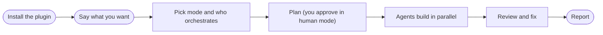
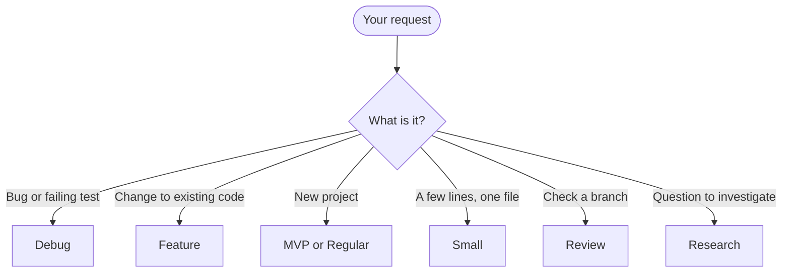
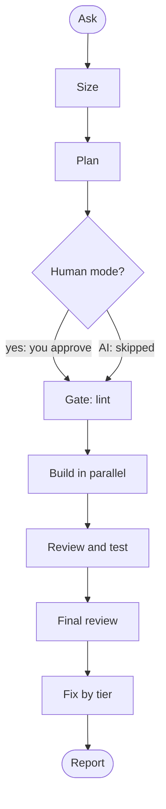
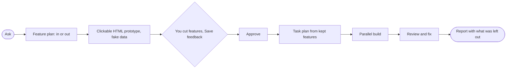
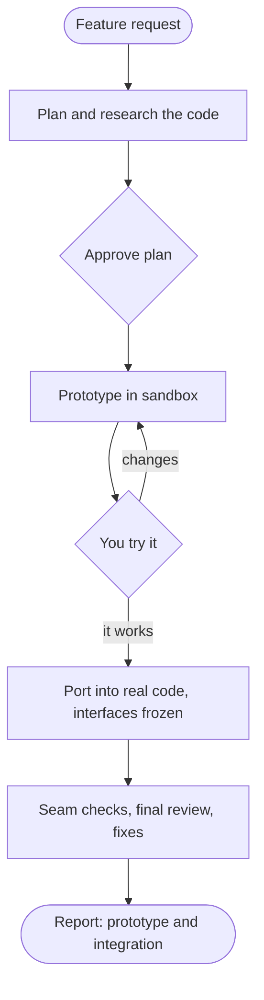
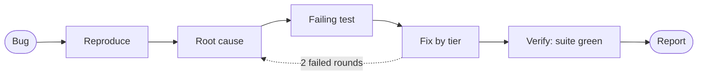
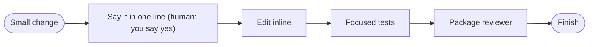
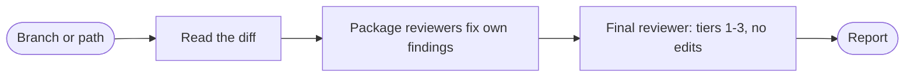
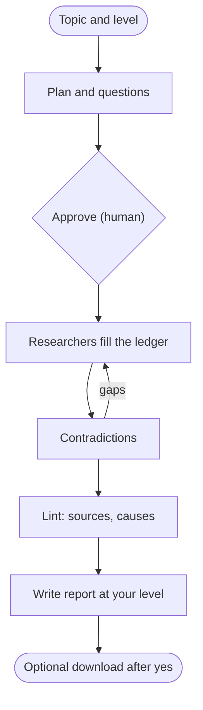

# Facts: start and flows

Every fact line ends with `(src: <path>)`. Writers use only what is here. Diagram sources are proposals drawn from the facts (mermaid, at most 12 nodes).

## Quickstart (first 2 minutes)

- superlite is a software factory: approve a plan once, then it builds the code. (src: README.md)
- Install it, open a session in your project, and say what you want. (src: README.md)
- The first time, superlite shows a one-screen intro. `/superlite:intro` brings it back; `/superlite:help` has every detail. (src: README.md)
- Claude Code install is two commands: `/plugin marketplace add iha2/superlite` then `/plugin install superlite@superlite-dev`. (src: README.md)
- Needs Claude Code, git, Python 3.12 or newer (the tools are Python; the project you build can be in any language) and `bash` (Git Bash on Windows). `uv` is optional. (src: README.md)
- To verify the install, open a fresh session and send `Let's make a react todo list`; a working install starts `inventing` before any code is written. (src: README.md)
- `/superlite:setup` is the first-run check: project language and test command, Python for the tools, model tiers, whether superpowers is suspended, whether `.superlite/` is gitignored. It gives a pass or fix line for each and changes nothing without a yes. (src: commands/setup.md)
- Plain words work as well as commands; the commands are shortcuts. (src: README.md)
- On a first message that names no mode and is not trivial, superlite runs `superlite-cli suggest_flow`, then `/superlite:start` shows a menu. (src: skills/using-superlite/SKILL.md)
- Every run starts its own session automatically (`superlite-cli session ensure`): a branch `superlite/sessions/<topic>` in your checkout, or a parallel worktree if another run is still open. Shipping closes it. (src: README.md)
- Sizing: trivial is just done (human orchestrator: after a yes in chat); bounded gets a short design in chat; architectural gets one batch of questions (up to 4) and one combined design and plan doc. (src: skills/using-superlite/SKILL.md)
- Who orchestrates is asked once, in that same batch: human (approves the plan before it runs) or AI (hands off). It is skipped when the request settles it ("decide yourself", away, headless: AI). (src: skills/using-superlite/SKILL.md)
- Human orchestrator: you get a plain-language review plan with diagrams (a `.review.md`, about two pages, with a rough time and cost); nothing is linted, dispatched or sent to an agent until you reply approve. Any clear approval counts (yes, go ahead, looks good). (src: README.md)
- AI orchestrator: plans, lints, dispatches and rules on open choices itself, with no review plan and no questions. (src: README.md)
- Both stop for destructive, outward (push, merge, publish) or security-sensitive actions. superlite never commits during a run; finished tasks are hidden checkpoints under `refs/superlite/*`. (src: README.md)
- At session end, shipping asks once: "Commit to <session branch>" or "Leave uncommitted". (src: README.md)
- What you see during a run: watch `.superlite/` in your project: `progress.md` (rulings and log), `test-summary.json` (latest test result), `metrics.jsonl` (time and cost per agent). A finished run is archived in `.superlite/runs/<id>/`. (src: README.md)
- The report at the end shows time and cost, projected vs actual. Nothing is committed. (src: assets/flows/regular.txt)

Quickstart diagram (proposal):

## Install per harness (one line each)

- Claude Code: `/plugin marketplace add iha2/superlite` then `/plugin install superlite@superlite-dev`; or `claude --plugin-dir <path-to-superlite>` for one session. (src: README.md)
- Optional agent map pane in Claude Desktop: `/plugin install claude-agent-map@superlite-dev`; without it use `/superlite:tail`. (src: README.md)
- Antigravity: `agy plugin install https://github.com/iha2/superlite`. (src: README.md)
- Codex (App and CLI), marked unverified in the README: `codex plugin marketplace add iha2/superlite`, then install Superlite from the plugin list; add `[features]` `multi_agent = true` to `~/.codex/config.toml` for subagents. (src: README.md)
- Cursor: `/add-plugin superlite` in Agent chat, or search the plugin marketplace. (src: README.md)
- Devin CLI: `devin plugins install iha2/superlite`. (src: README.md)
- Factory Droid: `droid plugin marketplace add https://github.com/iha2/superlite` then `droid plugin install superlite@superlite-dev`. (src: README.md)
- Gemini CLI: `gemini extensions install https://github.com/iha2/superlite`. (src: README.md)
- GitHub Copilot CLI: `copilot plugin marketplace add iha2/superlite` then `copilot plugin install superlite@superlite-dev`. (src: README.md)
- Grok Build CLI (unverified in the README): `grok plugin marketplace add iha2/superlite` then `grok plugin install superlite@superlite-dev --trust`. (src: README.md)
- Kimi Code: `/plugins install https://github.com/iha2/superlite`, then `/new`. (src: README.md)
- OpenCode: tell it to fetch and follow `https://raw.githubusercontent.com/iha2/superlite/refs/heads/main/.opencode/INSTALL.md`. (src: README.md)
- Pi: `pi install git:github.com/iha2/superlite`. (src: README.md)
- Qwen Code: `qwen extensions install iha2/superlite`. (src: README.md)
- Hermes Agent: `hermes plugins install iha2/superlite --enable`; restart active sessions. (src: README.md)
- Muse: `muse plugins install ./superlite` then `muse plugins approve superlite`. (src: README.md)
- Each harness has a tool-mapping file in `skills/using-superlite/references/`; install separately for each harness you use. (src: README.md)

## Commands (one line each)

- `/superlite:start [mode] [what]`: a menu; superlite suggests the mode for your request, you confirm it and pick who orchestrates. A first word of regular, mvp, feature, debug, small, review or research skips the suggestion. (src: commands/start.md)
- `/superlite:mvp <what>`: plan the smallest working version on a clickable HTML prototype, then build it. (src: commands/mvp.md)
- `/superlite:feature <change>`: change existing code: research, a plan you validate, a prototype you try, then the integration build. (src: commands/feature.md)
- `/superlite:debug <bug>`: root cause first, then a fix with a regression test. (src: commands/debug.md)
- `/superlite:research <topic>`: parallel agents, a sourced ledger, a report at your level; `--level director|vp|researcher|simple [slug]` re-renders an existing run. (src: commands/research.md)
- `/superlite:small <change>`: a small change inline with a reviewer, without the planning flow. (src: commands/small.md)
- `/superlite:review [branch or path]`: review and harden a branch; reviewers fix their own findings, the final review reports tiers. Default target: the current branch against its base. (src: commands/review.md)
- `/superlite:human`: switch to the human orchestrator (you approve a review plan before any build). (src: commands/human.md)
- `/superlite:ai`: switch to the AI orchestrator (plans, builds and decides on its own). (src: commands/ai.md)
- `/superlite:approve [path to .review.md]`: approve the review plan; uses the newest `docs/plans/*.review.md` if none is given. (src: commands/approve.md)
- `/superlite:status`: mode, orchestrator, plan approval, task progress, budget. (src: commands/status.md)
- `/superlite:stop`: stop dispatching new tasks cleanly and report where the build stands. (src: commands/stop.md)
- `/superlite:resume [plan path]`: resume an interrupted build from the last checkpointed, tested wave. (src: commands/resume.md)
- `/superlite:agents`: open the agent map pane (needs the claude-agent-map mod), read-only. (src: commands/agents.md)
- `/superlite:tail`: the same run as a live terminal feed, for where the mod is not installed. (src: commands/tail.md)
- `/superlite:report [plan name] [full]`: list stored build reports, show one, or the history across runs. (src: commands/report.md)
- `/superlite:finish`: verify first (full tests), then offer merge or PR options; never pushes without your explicit yes. (src: commands/finish.md)
- `/superlite:merged [slug|branch|PR]`: after the PR merges, confirm it with `gh`, update local main, close the session, delete the local branch; never pushes. (src: commands/merged.md)
- `/superlite:setup`, `/superlite:intro`, `/superlite:help [section]`: first-run check, the intro screen, the detailed help. (src: commands/help.md)

## Phrases to flow

| Situation | Say something like | Flow | What happens |
|---|---|---|---|
| New project | "Build me a static site generator from this spec" | MVP | one batch of questions, a plan, parallel tasks on Sonnet and Haiku, package reviews, one fresh final review (src: README.md) |
| Feature on existing code | "Add CSV export with column widths to the existing app" | Feature | research the code, a plan you validate, a sandbox prototype you try, then a port with frozen interfaces and seam checks (src: README.md) |
| Debug | "This test fails on leap days: find the root cause and fix it" | Debug | cause first, fixes by tier, escalate after two failed rounds (src: README.md) |
| Research | "Research the state of the art in vector search, for a VP" | Research | parallel researchers fill a sourced ledger; contradictions listed with causes; report at your level (src: README.md) |
| Small change | "Rename `build` to `render` everywhere" | Small | stays inline, with a reviewer always (src: README.md) |
| Review | "Review this branch and fix what you find" | Review | package reviewers fix their own findings; the final reviewer reports tiers and never edits (src: README.md) |
| Approve first | "Build X. I will approve the plan" | Human orchestrator | review plan with diagrams; nothing runs until you say yes (src: README.md) |
| Hands off | "Build X. I am away, decide yourself" | AI orchestrator | plans, lints, dispatches and rules itself (src: README.md) |
| Ship it | "We are done: finish the branch" | Finish | verification first, then merge or PR options; never pushes without you (src: README.md) |

- How `suggest_flow` picks: project state first (empty folder: mvp or regular; run in progress: resume or status); then words (bug words: debug; change words like add, change, extend, support: feature; new app, from scratch: mvp or regular; rename, typo, bump: small; review words: review; research words only when no change, build or bug word competes); then size (one file or function: small; screens, data and services together: feature on existing code, regular when new). It prints `suggest: <flow> - <reason> | also fits: <flows>`; same input, same line. (src: skills/swarm/scripts/suggest_flow.py)
- The start menu shows the suggestion first, marked Recommended, then the "also fits" flows. (src: commands/start.md)

Which flow? diagram (proposal):

## Regular flow

- When to use: building something where you do not need a prototype first; sized trivial, bounded or large. It is the default build path and `/superlite:start regular` selects it. (src: assets/flows/regular.txt)
- Steps in order: 1 ASK, 2 SIZE, 3 PLAN, 4 APPROVE, 5 GATE, 6 BUILD, 7 REVIEW, 8 FINAL, 9 FIX, 10 REPORT. (src: assets/flows/regular.txt)
- You: say what you want; answer one batch of questions if the request is large; in human mode, approve the plan. (src: assets/flows/regular.txt)
- superlite: sizes the request (large gets one batch of questions); writes the design and task plan (human mode adds a review plan); lint checks the plan and only stable tasks go out; agents run side by side, Haiku for mechanical work and Sonnet for the rest; reviewers fix their own findings while tests run in the background; one fresh reviewer reads the packet and tiers the findings; fixers by tier (Sonnet, Sonnet high, Opus), then tests again; report with time and cost, projected vs actual. (src: assets/flows/regular.txt)
- Example request (illustrative wording, not quoted from the repo): "Build a REST API for a bookshelf, with tests." (src: skills/using-superlite/SKILL.md)
- Embed `assets/flows/regular.txt` verbatim. (src: assets/flows/regular.txt)
- Diagram (proposal):

## MVP flow

- When to use: a new project; the smallest working version, planned on a clickable prototype first. (src: docs/mvp-flow.md)
- Steps: 1 ASK, 2 FEATURES, 3 PROTOTYPE, 4 FEEDBACK, 5 APPROVE, 6 PLAN, 7 BUILD, 8 REVIEW, 9 REPORT. (src: assets/flows/mvp.txt)
- FEATURES: the MVP plan lists every feature, each marked in or out, and opens with a diagram of how the product is used. (src: assets/flows/mvp.txt)
- PROTOTYPE: one clickable self-contained HTML file in a sandbox, with fake data, no product code, no build step, no network. (src: docs/mvp-flow.md)
- FEEDBACK: you open it in a browser, cut features (toggle in or out, reorder, add notes) and press Save feedback; the file is `mvp-feedback.json`. Cutting a feature removes it from the mock and updates the time and cost estimate. (src: docs/mvp-flow.md)
- APPROVE: human mode, you reply "approve" in chat (the reply approves; the button only saves the file). AI mode: it checks the prototype itself and logs a ruling, no stop. (src: docs/mvp-flow.md)
- PLAN: the task plan is written from the features you kept, cut features go under "Out of scope", and lint gates it. (src: docs/mvp-flow.md)
- BUILD and REVIEW: agents side by side sized to the load; package reviews, one final review, fixes by tier, tests. REPORT: time and cost, plus the list of what was left out. (src: assets/flows/mvp.txt)
- The prototype is deleted at finish, unless it is a web target and the approved feedback keeps it as the frontend's starting file. (src: docs/mvp-flow.md)
- Example request: "Build me a static site generator from this spec". (src: README.md)
- Embed `assets/flows/mvp.txt` verbatim. (src: assets/flows/mvp.txt)
- Diagram (proposal):

## Feature flow

- When to use: add or change a feature in an existing codebase; proves the change on a prototype before touching real code. (src: commands/feature.md)
- Steps: 1 ASK, 2 PLAN, 3 RESEARCH, 4 APPROVE, 5 PROTOTYPE, 6 TRY IT, 7 PORT, 8 REVIEW, 9 REPORT. (src: assets/flows/feature.txt)
- PLAN: what changes and acceptance checks you can try. RESEARCH: read-only code map: entry points, seams, interfaces to keep (they become FROZEN). Graphify is used on a large repo and installed only with your yes. (src: docs/feature-flow.md)
- Grill: after research, one batch of at most 4 questions when something material is open. (src: docs/feature-flow.md)
- APPROVE: human mode, you approve the plan; AI mode skipped. (src: assets/flows/feature.txt)
- PROTOTYPE: a sandbox, `.superlite/sandboxes/<session>/<topic>/` inside your checkout, no worktree and no branch, your checkout untouched. Agents build side by side, 8 tasks at most. (src: docs/feature-flow.md)
- TRY IT: `superlite-cli proto tryout` prints the run command, how to reach the prototype and the acceptance checks. You reply "it works" or list changes; changes go back to the prototype step. In AI mode the checks run automatically and a ruling is logged. (src: docs/feature-flow.md)
- PORT: agents port the prototype into your real code on a dedicated integration worktree; existing interfaces stay frozen, existing tests must pass, prototype stubs and fakes stay behind. (src: docs/feature-flow.md)
- REVIEW: seam checks, one final review, fixes by tier. REPORT: time and cost with prototype and integration shown separately. (src: assets/flows/feature.txt)
- The sandbox is removed at finish (`superlite-cli proto discard`). (src: docs/feature-flow.md)
- Example request: "Add CSV export with column widths to the existing app". (src: README.md)
- Embed `assets/flows/feature.txt` verbatim. (src: assets/flows/feature.txt)
- Diagram (proposal):

## Debug flow

- When to use: a bug or failing test; cause before fix. (src: commands/debug.md)
- Steps: 1 BUG, 2 REPRODUCE, 3 ROOT CAUSE, 4 FAILING TEST, 5 FIX, 6 VERIFY, 7 REPORT. (src: assets/flows/debug.txt)
- You: describe what fails and how to see it; if empty, superlite asks for it in one line. (src: commands/debug.md)
- superlite: runs it and watches it fail; finds the cause before touching code; writes a regression test that fails for that cause; fixes by understanding tier (tier 1 known, one module: Sonnet; tier 2 spans modules or a seam: Sonnet high; tier 3 cause unknown: Opus); verifies the new test passes and the whole suite is green; reports cause, fix and test without widening scope. (src: assets/flows/debug.txt)
- Obvious failures (typo, missing import, clear trace) are fixed directly without ceremony. (src: skills/diagnosis/SKILL.md)
- After 2 failed fixes it stops and re-reads the evidence; after 3 it changes approach (asks you, or hands to a fresh stronger agent). (src: skills/diagnosis/SKILL.md)
- A Grill round (correct behavior, what must not change, how far the fix may reach) runs when something material is open. (src: commands/debug.md)
- Example request: "This test fails on leap days: find the root cause and fix it". (src: README.md)
- Embed `assets/flows/debug.txt` verbatim. (src: assets/flows/debug.txt)
- Diagram (proposal):

## Small flow

- When to use: a change of a few files in one chain, e.g. a rename; no plan document. (src: commands/small.md)
- Steps: a session starts; the change is done inline in a few tool calls and superlite says so; focused tests run; one package reviewer reviews the diff before it claims done; then `superlite-cli finish` marks the session finished and leaves uncommitted work in place. (src: commands/small.md)
- If it spans more than a few files or several chains, superlite says so and switches to the fuller flow. (src: commands/small.md)
- Human orchestrator: small inline work needs only your yes in chat. (src: README.md)
- Example request: "Rename `build` to `render` everywhere". (src: README.md)
- No stored flow text file exists for small (assets/flows has debug, feature, mvp, regular, research only), so a small page has no verbatim block to embed. (src: commands/small.md)
- Diagram (proposal):

## Review flow

- When to use: review and harden an existing branch. Target defaults to the current branch against its base; a path argument limits the review to that path. (src: commands/review.md)
- Steps: resolve target and base; a session starts on the target branch; read the diff; Grill (intent, the risk that matters most, what is out of bounds) when something is open; package reviewers fix their own findings with regression tests; a fresh final reviewer reads the review packet and reports findings in tiers 1 to 3 without editing. (src: commands/review.md)
- Example request: "Review this branch and fix what you find". (src: README.md)
- No stored flow text file exists for review. (src: commands/review.md)
- Diagram (proposal):

## Research flow

- When to use: answer a topic with sources instead of code. (src: commands/research.md)
- Steps: 1 ASK, 2 PLAN, 3 QUESTIONS, 4 APPROVE, 5 RESEARCH, 6 CONTRADICTIONS, 7 LINT, 8 WRITE, 9 DOWNLOAD. (src: assets/flows/research.txt)
- You: give the topic and pick the language level (Director, VP, Researcher, Simple); answer critical questions; in human mode approve the plan. (src: assets/flows/research.txt)
- superlite: plan with scope, sub-questions, search strategy and evidence tiers; researcher agents, one sub-question each, write sources and claims to a ledger and never to the report; conflicts are recorded with a cause and resolved or left open, gaps go back to research; lint checks citations, causes and that all levels match; the report, sources and contradictions are written as markdown. (src: assets/flows/research.txt)
- Levels differ in wording only: same claim ids, citations, numbers and contradictions. Changing level re-renders from the ledger without re-researching (`/superlite:research --level L [slug]`). (src: docs/research-flow.md)
- DOWNLOAD is optional: lists name, source and size; fetches only after your yes. (src: assets/flows/research.txt)
- Example request: "Research the state of the art in vector search, for a VP". (src: README.md)
- Embed `assets/flows/research.txt` verbatim. (src: assets/flows/research.txt)
- Diagram (proposal):

## Finishing a run

- `/superlite:finish` loads proof, runs the project's full tests, then shows merge or PR options; it never pushes or merges without your explicit yes. (src: commands/finish.md)
- After the PR merges, `/superlite:merged` closes the session and deletes the local branch. (src: commands/merged.md)
