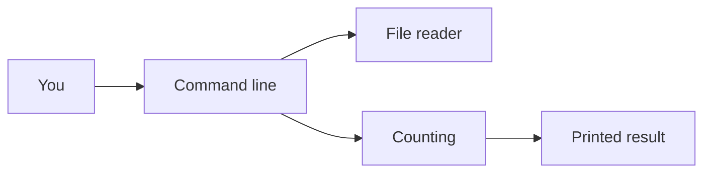
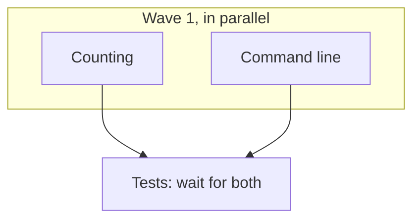

# The review plan (human orchestrator, phase 1)

With a human orchestrator the plan the human reviews is written for a human: plain words, diagrams, about two pages. It is
NOT the agent plan. After the yes the coordinator writes the machine plan (taskgraph, Produces/Consumes, `e.g.` examples,
sizes) from it, with the header line `**Review plan:** <path>`. With an AI orchestrator there is no review plan.

File: `docs/plans/<date>-<topic>.review.md`. Nothing is built, dispatched or written (except this file) before the human's approving
reply. Show the human, in plain text and not with AskUserQuestion, the path, a five-line summary and "Reply approve to start, or tell me
what to change", then END THE TURN. If you understand the answer as approval, send approve:
`sl orchestrator approve --review <path>` (do not pass their words through; records the path and its sha256 in `.superlite/orchestrator.json`).
If you do not, revise and ask again.

## Required sections, in this order

1. `## Summary`: one paragraph: what is being built and why, in plain words.
2. `## What you will get`: bullets of what exists when it is done, as the human would see it.
3. `## What will be built`: a table `| Part | What it does (one sentence) | Size (S/M/L) | Built by |`. "Built by" in plain words
   (a fast helper for routine parts, a careful helper for logic-heavy parts), never agent type names.
4. `## How it fits together`: a mermaid diagram of the parts and how they connect (architecture or context), at most 12 nodes.
5. `## How it gets built`: a mermaid diagram of the build flow: what runs in parallel and what must wait (waves or lanes),
   at most 12 nodes. Optionally a mermaid `gantt` of the rough schedule.
6. `## Decisions you can change`: each open choice with its default, for example `Storage: files on disk (default) | a database`.
7. `## Risks`: what could go wrong and what we do about it.
8. `## Out of scope`: what this will not do.
9. `## How we will know it works`: acceptance checks a human can verify.
10. `## Rough time and cost`: a range from the sizes, labelled rough until the machine plan is linted.

## Example (shortened)

````markdown
# Word counter: review plan

## Summary
A small command-line tool that reads a text file and prints how many lines, words and characters it has.

## What you will get
- A `wordcount` command that takes a file path.
- Clear errors for a missing or unreadable file.
- Tests that cover empty files, accents and Windows line endings.

## What will be built
| Part | What it does | Size | Built by |
|---|---|---|---|
| Counting | Counts lines, words and characters of a text | S | a fast helper |
| Command line | Reads the file, prints the three numbers, handles errors | S | a fast helper |
| Tests | Checks the edge cases above | S | a careful helper |

## How it fits together


## How it gets built


## Decisions you can change
- Characters counted as: Unicode characters (default) | bytes
- Output: three labelled lines (default) | one line like `wc`
- Commits: leave my work uncommitted, superlite takes hidden checkpoints (default) | commit each task on my branch

## Risks
- Very large files: read in chunks (default) so memory stays small.

## Out of scope
- Several files at once, other output formats.

## How we will know it works
- `wordcount sample.txt` prints the expected three numbers for the sample files.
- A missing file prints a clear message and a non-zero exit code.

## Rough time and cost
About 3 to 6 minutes and $1 to $2 (rough, until linted).
````

## Do
- Plain words a non-programmer can follow; short sentences; every table row one sentence.
- Name parts by what they do for the human, not by file or function.
- Keep each diagram at 12 nodes or fewer, with labels in plain words.
- Quote every `subgraph` title and any label with spaces or punctuation (`subgraph W1["Wave 1, in parallel"]`), so the diagram renders.
- Say what you assumed; keep decisions as `default | alternative`. Always list the Commits decision; if the human picks per-task commits, run `sl autocommit on` after approval.
- Keep scope and parts exactly what the machine plan will contain. After the approval the human is not asked again: a later change
  to scope or to an interface the human saw becomes a `Ruling: [scope] ...`, listed at finish under "Changed from the approved plan".

## Do not
- No code, no `%% taskgraph`, no `Produces`/`Consumes` lines, no `e.g.` examples, no file paths, no agent or model names.
- No more than two pages; no placeholders ("TBD").
- Do not lint, dispatch or build before the yes (`lint --stable`, `dispatch`, `wave0` and `build_prime` refuse).
