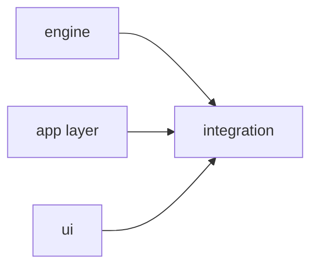
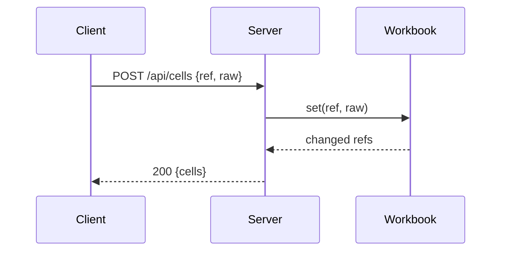

# Writing Plans

A plan is a set of contracts Sonnet implementers can execute without asking questions, and also the input to the 0.3 engine: a machine-readable task graph, interface stubs, per-task time predictions, a predicted schedule and probe plans. Write it so scripts can parse it. Code the implementer would write anyway burns Opus time and invites transcription errors.

Any build with 2+ tasks runs through `superlite:subagent-driven-development`: load it before writing the plan. Never use `general-purpose` agents for build or review work.

Save to `docs/plans/YYYY-MM-DD-<topic>.md`. When called from `superlite:brainstorming`, append to its doc instead. If the spec covers independent subsystems, write one plan per subsystem.

## Lint, extract what's stable, fix the rest

`lint --stable` splits the plan into STABLE and FIX tasks (with reasons) and writes `.superlite/stable.json`. A task is stable when its own checks pass, every Consumes has a clean Produces line somewhere (even in an unstable task), it has no taskgraph edge to an unstable task, and it is not on a flagged `CHAIN:`. Plan-level issues (SPEC coverage, `CHAIN:`, the size cap, `MISSED TARGET`) never block stable tasks. `dispatch` offers only stable tasks. The order is fixed: lint, dispatch the whole stable set (`lint --stable` ends with `DISPATCH NOW: ...`), and only then patch the FIX tasks (edits or a full rewrite, as many rounds as needed), re-lint and dispatch the newly stable ones. No agent waits on plan polishing. Dispatched tasks are frozen: a rewrite keeps their blocks byte-identical, else lint reports `FROZEN:` and the change becomes a follow-up fix task, not a restart. `**Status:** draft` stays as an optional manual hold: `next_tasks` and `dispatch` skip draft tasks and their dependents, and draft tasks may keep placeholders.

## Write for the split

**Who orchestrates sets the mode** (`sl orchestrator status`).
- **Human orchestrator** (the human validates the plan before it runs), two phases:
  1. Write the review plan: `docs/plans/<date>-<topic>.review.md`, plain words with diagrams, no code or taskgraph (`review-plan.md`). Nothing is built, dispatched or written except this file before the human's approving reply.
  2. Show it in plain text, not AskUserQuestion: the path, a five-line summary and "Reply approve to start, or tell me what to change". END THE TURN and do nothing else until the human replies; changes mean revise and ask again.
  3. Only after an approving reply: `sl orchestrator approve --review <path>` (refused without a fresh human reply; `lint --stable`, `dispatch`, `wave0` and `build_prime` refuse until then).
  4. Write the machine plan `docs/plans/<date>-<topic>.md` from the approved review plan, in the order below (same tasks and scope, header `**Review plan:** <path>`), then `schedule --insert`, `lint --stable`, and dispatch the stable set in the same turn.
  5. It patches the FIX tasks, re-lints and dispatches the newly stable ones without asking again, as long as each fix stays inside what was approved (sizes, splits, stubs, field corrections). A fix that changes scope, an interface the human saw, or the spec coverage is decided without asking the human: record it as `Ruling: [scope] <decision> - <why> - <cost if wrong>`; `sl finish` lists these under "Changed from the approved plan". AI orchestrator: no review plan, straight to the machine plan.
- **AI orchestrator** (hands off: the user pre-approved, said "decide yourself", or an agent runs the session): write a queue that starts building while the fixes are made. Lint splits what you write into stable tasks, which build now, and fix tasks, which wait. Follow all six rules. Record open choices as `Ruling:` lines.

In both modes, write for the split:

1. **One Write, written as if in chunks.** Write the plan whole, in one Write, but order it as if it were written in chunks, so the first tasks stand alone as a stable prefix: the header, Global constraints and the main diagram with its `%% taskgraph`; then, optionally, a Wave 0 skeleton task (`Kind: mechanical`, `Model: haiku`; if you omit it, `sl wave0` builds the skeleton brief from your Produces lines and Global constraints, so state the language and test command there); then the root and producer tasks (no incoming edges), each with exact `Produces` lines, the correct `Kind` and a size inside the band; then the consumers, each after its producers. Every block is complete, with no placeholders, so lint can mark it stable and the prefix dispatches before any later task is fixed.
2. **Producers first, with exact `Produces` lines.** Lint resolves each `Consumes` against some task's `Produces` line, so write producers before their consumers: exact name, parameter types and return type. A consumer is then stable the moment it's written, even while its producer is still building or being fixed.
3. **Finish each task block before starting the next.** No placeholders, and every field filled. A half-written task is a fix task, and so is everything with an edge to it.
4. **Size each task for the band as you write it.** Fill Components, LOC owned and Tests honestly, and aim for 2-5 min predicted. Something that looks over 6 min is two blocks from the start (server / UI, engine / CLI), not one block that lint sends back.
5. **Fewest edges.** Draw an edge only when a task's tests run another task's code, never for an interface that has examples (rule 7). Order tasks so that those with no edges come first and each later task adds only what the earlier ones unblock.
6. **Mark the easy ones.** A task that meets the `Kind: mechanical` rules gets `Kind: mechanical` and `Model: haiku` when you write it.
7. **Contract examples.** Under every `Produces` another task consumes that returns structured data, add 2-3 `e.g.` lines: a call and its result with concrete values, in the plan's own language, for example `e.g. parse("1+2") -> Binary("+", Num(1), Num(2))`. One source, two uses: the consumer's fake returns exactly these examples, and the producer's tests assert them. Lint reports `EXAMPLE:` for a consumer whose producer has none (a fix task until it does), and `EDGE:` for an edge that exists only for interfaces with examples: drop it, or run `plan_tools prune` before the first dispatch. Never say stubs cannot compute values: examples are the values.

## Plan shape, in this order

1. **Header:** Goal, Architecture, Tech stack, Spec path, `**Detail:** contracts | tests | full` (default `tests`), `**Target-min:** N` (predicted-total target, default 11), `**Ignore:** a/, b, *.c` (optional: paths or globs your tooling generates beyond the language defaults, e.g. `.next/`, `.env`, `*.sqlite`), global constraints (exact values copied from the spec: version floors, names, formats). Task briefs point here, so do not repeat constraints per task.
2. **Main diagram** (always): Mermaid of components and data flow.
3. **File structure:** every file and its one responsibility. Split by responsibility, not by layer, and follow the repo's patterns.
4. **Task graph** (always, machine-readable): see below.
5. **Predicted schedule:** generated, never hand-written.
6. **Sections, one per component or package:** its tasks, a mini diagram only if the section interacts, and a `**Probe entry:**` line.
7. **Review Focus:** the probe plan.
8. **Self-review.**

## Diagram rules

- Main diagram and task graph: always.
- **Mini diagram only where something interacts:** a sequence across components, a state machine or a protocol, at most about 15 nodes. Skip it for self-contained modules (slug, feed, errors). Their Consumes, Produces, Owns and tests already say everything, and a diagram only repeats them and risks contradicting them.
- Every Mermaid block must parse. Quote labels that contain parentheses or punctuation.

### Task graph

One `Tn --> Tm` edge per line under a `%% taskgraph` comment. **Only execution dependencies are edges:** Tm's tests must run Tn's code. A names-only dependency (a route path, a CLI flag) or one a stub satisfies is not an edge, so it never makes a task wait. Declare nodes above the marker.



Here T1, T2 and T3 run in parallel; T2 and T3 build against T1's stubs, not its code. Waves are only a planning view: the scheduler dispatches a task the moment its dependencies are checkpointed, with no wave barrier and no wave width cap.

## Split by interface

1. **Interface stubs in Wave 0.** Wave 0 holds the skeleton (manifest, package inits, test config, shared error types) and interface stubs for every `Produces` another task consumes. `plan_tools.py stubs` generates them from your `Produces` lines, so write those lines exactly as `module.function(args) -> ret` or `Class.method(args) -> ret`, with a one-line contract in the task. The stub is the contract: implementers may not change a signature without a coordinator ruling.
2. **A task waits only when its tests execute another task's code.** Consumers test against stubs with small fakes, never against the real producer. Integration tests that run both sides go in one small integration task per package at the end, so the consumers themselves don't wait. Consumers' own tests still run against the real producer later, through the seam check (`SUPERLITE_REAL=1`). A chain like parser → evaluator → workbook → CLI becomes one wave of four tasks against stubs, plus the integration task.
2a. **Keep the chain short.** Lint fails with `CHAIN:` when the predicted critical path is over 2.5 times its longest task (with 3 or more tasks on it). Stub more interfaces, or add `Ruling: sequential - <why>` when the order really is forced, such as a migration before its users.
3. **Keep every task inside the size band.** The only measure is predicted time, held in `config/predictor.json` as `size_band` (low_min 1.5, high_min 6.0). Over high_min lint fails `SIZE:`: split along components, for example a server+UI task becomes server (against the workbook stub) and UI (against the spec's JSON contract). Under low_min it prints `NOTE:` (consider merging with a related task in the same package) and never fails. `predict --refit` moves the band from measured task times. The 80k context ceiling stays.
4. **Slow tests stay out of the inner loop.** Mark them `Tests: slow`. Implementers run only fast tests during TDD, and slow suites run once in the background after the checkpoint.
5. **Diagrams show the run.** The graph and schedule show the width and length of the run before anything runs, when a bad split is cheapest to fix.

## Task template

Size, not depth: a task is the smallest unit with its own test cycle that a reviewer could reject alone. Fold setup, config and docs into the task that needs them. Docs that describe other tasks' output depend on them.

````markdown
### T7 minisheet server · Complexity 5 (O-1) · Est. context 38k

**Owns:** src/minisheet/server.py, tests/minisheet/test_server.py
**Components:** 1
**LOC owned:** 120
**Tests:** slow
**Model:** sonnet
**Est. time:** 2.5 min (1 component, about 120 LOC, slow tests)
**Consumes:** Workbook.set(ref: str, raw: str) -> list[str] (T5) · Workbook.get(ref: str) -> Value (T5)
**Produces:** create_server(wb: Workbook, port: int = 0) -> HTTPServer
**Review Focus:** `test_unknown_method_404`: PUT /api/cells gives 404 {"error": "not found"}; `test_oversize_body_413`: 2 MB body gives 413
**Test code (verbatim):** ```python … ```
**Steps:** 1 failing test, 2 run: FAIL, 3 implement, 4 run: PASS
**Notes:** only non-obvious detail (a tie-break rule, an ordering).
````

The title line shows `Complexity` and `Est. context`; drop the mini diagram if the task does not interact.

| Field | Rule |
|---|---|
| `Owns` | Exact paths, only this task's. Two tasks that can run at once never share a file. |
| `Components` | Integer count of components the task builds. |
| `LOC owned` | Integer estimate of lines this task writes. |
| `Tests` | `fast` or `slow` (browser, server and I/O suites are slow, pure functions fast). |
| `Kind` | `design` (the default) or `mechanical`. **Mechanical** means the what is fully decided and only the typing is left: LOC owned ≤ 150, Components ≤ 2, `Tests: fast`, no Review Focus case in deep, numeric, state or protocol, and test code or named tests with exact inputs and outputs. Typical: skeleton and config, thin CLI or route wrappers over a given interface, constant tables, small pure functions with a crisp spec (slug, date format), tests from an explicit list, docs from existing code. Never: parsers, evaluators, servers, UI, anything with state or an ambiguous spec. Lint rejects (`KIND:`) a mechanical task that breaks a rule. |
| `Model` | `haiku` for `Kind: mechanical` (lint rejects haiku on any other kind), otherwise always `sonnet`; lint rejects `opus` (Opus writes about half as fast). Split a task that seems to need Opus. If Sonnet can't get part of it right, a `fixer-opus` handles that part. Security-sensitive code still gets an Opus review. |
| `Est. time` | `predict.py` recomputes it from the four fields above, and the fields win on disagreement. Write them honestly. |
| `Est. context` | `18k + 3.3k + 21.6 per LOC owned + 0.45 per char of docs handed over + 36.9 per LOC read`, plus a 10-15% margin. Over 80k means split. |
| `Consumes`/`Produces` | Exact names, parameter types and return types. An implementer reads only its own task, so this is how it learns what neighbors named things. |
| `Review Focus` | Cases from the Review Focus section that touch this task's files, as named tests (see below). |
| `Test code` | At `contracts`, each test named with exact inputs and outputs. At `tests` and `full`, the code, runnable as written. Include the error and edge cases the spec implies. `**Detail:** full` on one task overrides the header, for tricky cores. |

## Review Focus: the probe plan

Classify each package by app type, then pick its generic categories from the table. Add app-specific risks the domain implies (a spreadsheet: circular references through ranges, huge-range timing, CSV formula injection; a site generator: path traversal in slugs, template recursion).

| App type | Generic categories |
|---|---|
| library / parser / evaluator | deep, numeric, encoding, state |
| CLI | protocol (commands and args), encoding, state, file |
| HTTP service | protocol, encoding, numeric, state |
| web UI | protocol via its API, encoding (rendering, XSS) |
| file I/O / generator | file, encoding, deep |
| data pipeline | numeric, encoding, state, deep |
| concurrency | state (races, partial writes), protocol |
| auth | protocol, state; **security review required** (Opus) |

Rules:
- List, per package: app type, categories, specific risks.
- Copy into each task the cases that touch its files, as named tests with exact inputs and outcomes. The implementer writes them during TDD, so the failures never reach review (lever 1).
- Never list the spec's own examples: tests already cover them.
- A **`**Probe entry:**` line per package** feeds the generated probe adapter, for example `call=minisheet.Workbook.set · run=python -m minisheet · serve=minisheet.server.create_server`. Use `call=` for libraries, `run=` for CLIs, `serve=` for servers. No agent writes adapters.

## Plan size cap: 15k characters

The plan rides in the shared prime and is written on the critical path. Keep contracts, verbatim tests and the required diagrams. Move spec excerpts out and reference them by section. Check with `wc -c`.

## No placeholders

These are plan failures: "TBD", "TODO", "add error handling", "handle edge cases", "similar to Task N", a test without a name and an asserted value, or a type or function no task defines.

## After writing: schedule, then lint --stable (lint waits for approval with a human orchestrator)

Run both. Replace `PLAN` and `SPEC` with the paths. `<superlite-root>` is two levels above this skill's "Base directory for this skill: ..." path (run it through `cygpath -u` first if that exists).

```
bash "<superlite-root>/skills/subagent-driven-development/scripts/sl" plan_tools prune --plan PLAN
bash "<superlite-root>/skills/subagent-driven-development/scripts/sl" plan_tools lint --plan PLAN --spec SPEC --stable
```

`prune` drops the edges that examples make removable (consumer not yet dispatched), then runs `schedule --insert`, which writes the Gantt, its summary line (critical path, peak width, predicted total) and a `shape:` line under a `%% schedule` marker. Never hand-edit that block. `CHAIN [chain-xxxx]` is silenced only by `Ruling: sequential [chain-xxxx] - <why>` with the id lint printed; a ruling written before lint never matches.

Read the lint output:
- **`MISSED TARGET`** is a warning, not a failure. Consider re-splitting or stubbing the tasks on the named critical path. If the chain is inherently sequential, accept the plan and record `Ruling: <why>`.
- **`NOTE:`** (under low_min) is advice only.
- **Every other error must be fixed**: placeholders, Consumes/Produces mismatches, diagram parse errors, `SIZE:` (over high_min), `CHAIN:`, `KIND:`, `OPUS-TASK:`, spec sections with no task. First dispatch every task on the `DISPATCH NOW:` line, then patch the FIX tasks listed under `--stable` (edit or rewrite; keep dispatched blocks unchanged), rerun `schedule --insert` then `lint --stable`, until only `MISSED TARGET` and `NOTE:` remain. Stable tasks need no rework: in delegated mode they dispatch now; with a human approver they wait for the yes (see "Who decides sets the mode").

## Self-review checklist

Run it yourself, not as a subagent. Fix in place, with no re-review.

1. **Coverage:** every spec requirement maps to a task.
2. **Placeholders:** none.
3. **Type consistency:** each Consumes line matches the Produces line of its owner. `clearLayers` in T3 and `clearFullLayers` in T7 is a bug.
4. **Graph:** every edge is an execution dependency, with no cycles, and no two tasks that can run at once share a file.
5. **Measurable fields:** every task has `Components`, `LOC owned`, `Tests`, `Model`.
6. **Review Focus:** each package has an app type, categories and a `Probe entry`, and each task carries the cases for its files.
7. **Limits:** the plan is at most 15k chars, no task is over the size band (`SIZE:`), and schedule and lint have run.

## Handoff

Do not ask about an execution method: it is `superlite:subagent-driven-development` (its inline mode covers small plans). If called from brainstorming, return to it for the single approval; the stable set dispatches as soon as it is approved. Otherwise give the path and wait for the go-ahead, unless the user pre-approved, in which case record any open choice as `Ruling: ...` and proceed.

## Red flags

| Thought | Reality |
|---|---|
| "I'll paste the full code so Sonnet can't go wrong" | `tests` is the default. `full` is for non-obvious algorithms. |
| "T5 can wait for T2, to be safe" | An edge is for code its tests execute. A stub or a name does not need one. |
| "Draw a diagram for every module" | Only for interactions. Self-contained modules get none. |
| "I'll write `Est. time` by gut feel" | Fill in the measurable fields. The predictor and the schedule depend on them. |
| "Lint says MISSED TARGET, so the plan is bad" | It is a warning. Re-split or write a `Ruling:`. |
| "Its README can go in the first wave" | Docs wait for the code they describe. |
