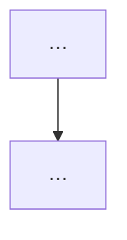

# Spec: <topic>

## Intent

Why this exists (one short paragraph).

## Goals

- …

## Non-goals

- …

## Constraints

- …

## Done looks like

Acceptance the user or tests can check (bullets). These outlive any plan that implements them.

## Decided

What is already fixed (names, formats, boundaries).

## Left to the builder / plan

What the plan may choose (how, sequencing, file layout).

## Diagrams

