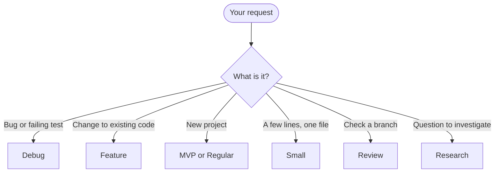

## What you do

Say what you want in plain words. Or type `/superlite:start` and your request. A first word of `regular`, `mvp`, `feature`, `debug`, `small`, `review` or `research` skips the suggestion. Every command is listed on [Commands](/superlite/start/commands/).

| Say something like | Flow |
|---|---|
| "Build me a static site generator from this spec" | [MVP](/superlite/flows/mvp/) |
| "Add CSV export to the existing app" | [Feature](/superlite/flows/feature/) |
| "This test fails on leap days: find the root cause" | [Debug](/superlite/flows/debug/) |
| "Rename `build` to `render` everywhere" | [Small](/superlite/flows/small/) |
| "Review this branch and fix what you find" | [Review](/superlite/flows/review/) |
| "Research vector search, for a VP" | [Research](/superlite/flows/research/) |
| Anything else you want built | [Regular](/superlite/flows/regular/) |

## What superlite does

superlite reads your request and the project state. It runs `superlite-cli suggest_flow`, which prints one line: `suggest: <flow> - <reason> | also fits: <flows>`. The same input gives the same line.

An empty folder points to MVP or Regular. Bug words point to Debug. Words like add, change or extend point to Feature. Rename, typo or bump point to Small.

The start menu shows the suggestion first, marked Recommended. You confirm it or pick another. It also asks who orchestrates: you approve a plan first (human), or it decides alone (AI).

## Example

```text
/superlite:start Add CSV export with column widths to the existing app
```

superlite suggests Feature, because the request changes existing code. You confirm and pick human or AI. Then it opens a [session](/superlite/sessions/sessions/).
