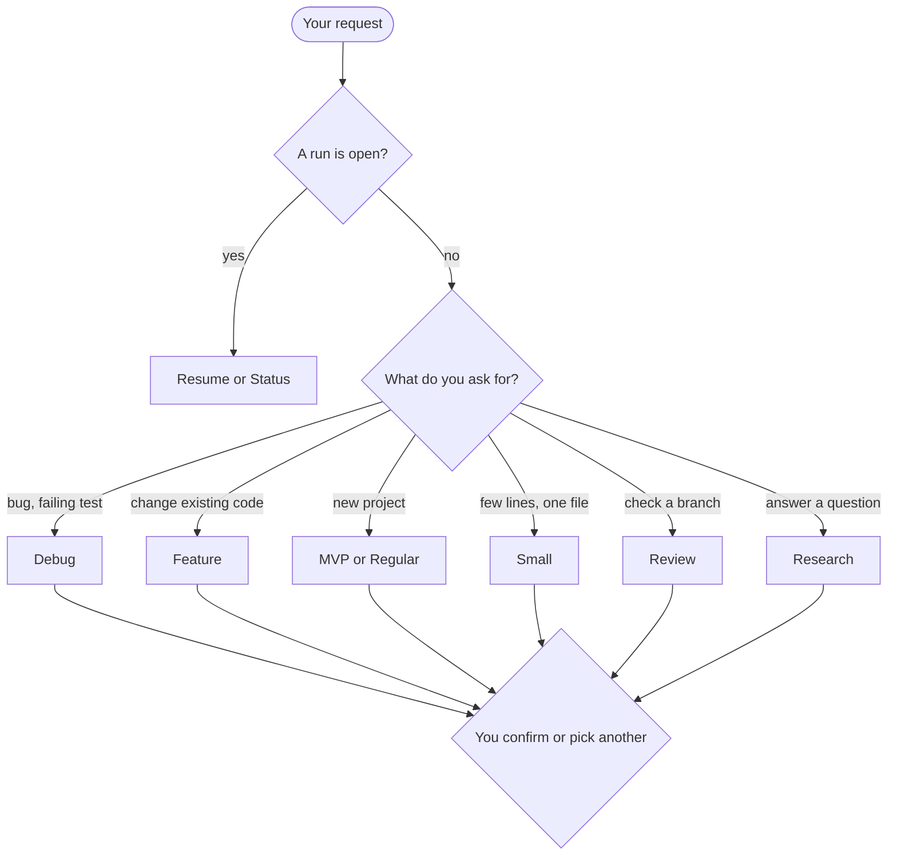
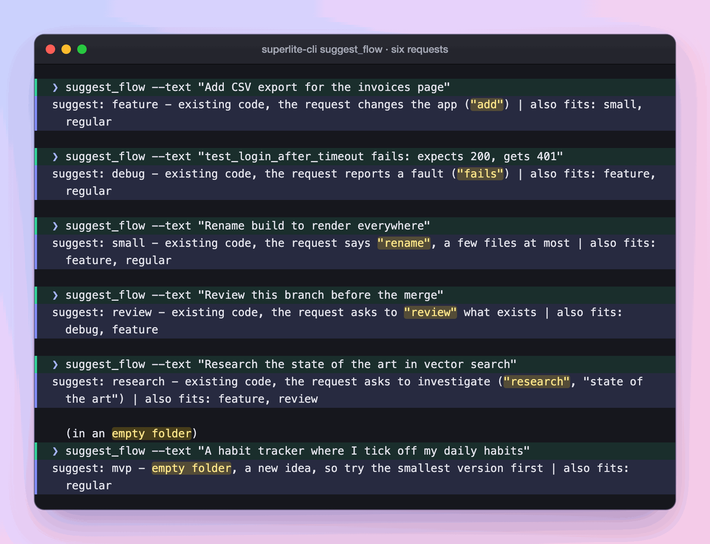

import { Steps } from "@astrojs/starlight/components";

:::tip[TL;DR]
You do not have to know the flow names. Say what you want and superlite suggests one from your words and from what is in the folder. You confirm it or pick another.
:::



## How it works

A script, not a guess, makes the first call. For example, "Add CSV export" in a project with code reads as a change. `superlite-cli suggest_flow` reads your words and the project state. Then it prints one line, and the same input always gives the same line.

It weighs three signals in order.

1. **The folder.** An empty folder points to MVP or Regular. A run that is still open points to Resume or Status.
2. **Your words.** Bug words such as "fails" or "broken" point to Debug. Change words such as "add", "extend" or "support" point to Feature. "Rename", "typo" or "bump" point to Small. "Review" points to Review. "Research" or "sources" point to Research, but only when no build, change or bug word competes.
3. **The size.** One named file or function points to Small. Screens, data and services together point to Feature on existing code, and to Regular on a new project.

The same words can land on different flows. The folder decides:

| You say | Existing code | Empty folder |
|---|---|---|
| "Add CSV export for the invoices page" | [Feature](/superlite/flows/feature/) | [MVP](/superlite/flows/mvp/) |
| "Login test fails with a 401 after the session timeout" | [Debug](/superlite/flows/debug/) | [MVP](/superlite/flows/mvp/) |
| "Build a REST API for a bookshelf, with tests" | [Feature](/superlite/flows/feature/) | [Regular](/superlite/flows/regular/) |
| "MVP of a habit tracker" | [MVP](/superlite/flows/mvp/) | [MVP](/superlite/flows/mvp/) |
| "Rename build to render everywhere" | [Small](/superlite/flows/small/) | [Small](/superlite/flows/small/) |
| "Review this branch and fix what you find" | [Review](/superlite/flows/review/) | [MVP](/superlite/flows/mvp/) |
| "Research the state of the art in vector search, for a VP" | [Research](/superlite/flows/research/) | [Research](/superlite/flows/research/) |

An empty folder has no code to debug or review, so those requests read as a new idea there. The table shows what the script prints for these exact sentences. Your own wording may land elsewhere.

## Example: a request with no flow name

Say you are in your shop project and you type the request without a mode.

<Steps>

1. You type the request.

   ```text frame="terminal" title="Claude Code · ~/shop" ins={1}
   ❯ /superlite:start Add CSV export for the invoices page
   ```

   Because you named no flow, superlite asks the script for a suggestion before it asks you anything.

2. The script prints one line. It read your words and the folder.

   

   *Real output: the script's one-line answer, shown for six different requests; the first is the one in this example.*

   The folder has code, and "add" is a change word, so the answer is Feature. The same words in an empty folder would give MVP. The script is plain rules, so the same input always gives the same line.

3. You pick from a menu, with the suggestion first.

   ```text frame="terminal" title="Claude Code · ~/shop" mark={2} ins={5}
   Which flow?
   › 1. Feature (Recommended)  existing code, the request changes the app
     2. Small                  a few files, inline
     3. Regular                size it, plan it, build it
   ❯ Feature, and I will approve the plan
   ```

   **You decide:** the flow and the orchestrator, in one batch (a second question asks who orchestrates). Take the suggestion or pick another. superlite may override the script when your words clearly say otherwise, and gives a one-line reason ([orchestrators](/superlite/run/orchestrators/)).

4. The flow starts. superlite opens a [session](/superlite/sessions/sessions/) for the topic and prints the Feature screen. From here you are in the [Feature flow](/superlite/flows/feature/).

</Steps>

**What you end up with:** a session on its own branch and the flow that fits, chosen from your words and the folder rather than from flow names you had to remember.

## Good to know

- Start with a flow name and skip the suggestion: `/superlite:start debug the login timeout`. The first words `regular`, `mvp`, `feature`, `debug`, `small`, `review` and `research` count. A `/superlite:` command of its own also skips it.
- superlite may override the script when your request clearly says otherwise. It gives a one-line reason.
- The menu only lists flows that fit the folder. Every flow opens a [session](/superlite/sessions/sessions/).
- Every command has its own entry on [Commands](/superlite/start/commands/).
