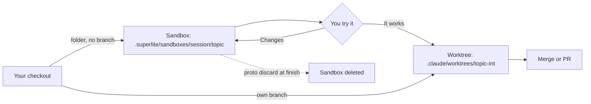

```text
 FEATURE
 ------------------------------------------------------------------------------
  [1 ASK]
      v
  [2 PLAN]
      v
  [3 RESEARCH]
      v
  [4 APPROVE]
      v
.- SANDBOX: folder in this checkout, no worktree -------.
: [5 PROTOTYPE] <-----------------------+               :
:     |                                 |               :
:     +-----------+-----------+         |               :
:     v           v           v         |               :
: [Haiku]     [Sonnet]    [Sonnet]      |               :
: 3 tasks     3 tasks     2 tasks       |               :
:     |           |           |         |               :
:     +-----------+-----------+         |               :
:     v                                 |               :
: [6 TRY IT] ---------------------------+  changes      :
'-------------------------------------------------------'
      v
  [7 PORT]
      |
      +-----------+-----------+
      v           v           v
  [Haiku]     [Sonnet]    [Sonnet]
  3 tasks     3 tasks     2 tasks
      |           |           |
      +-----------+-----------+
      v
  [8 REVIEW + FIX]
      v
  [9 REPORT]
 ------------------------------------------------------------------------------
  1  ASK        You say the change you want.
  2  PLAN       What changes and how you will check it (acceptance checks).
  3  RESEARCH   Read-only code map: entry points, seams, interfaces to keep.
  4  APPROVE    Human mode: you approve the plan. AI mode: skipped.
  5  PROTOTYPE  A sandbox folder in this checkout (.superlite/sandboxes/).
                No worktree, no branch: it uses your real code in place and
                never edits it. Agents build side by side, 8 tasks at most.
  6  TRY IT     You run it. "It works" moves on. Changes go back to step 5.
  7  PORT       Agents side by side port the prototype into your real code.
                Existing interfaces stay frozen. Existing tests must pass.
  8  REVIEW     Seam checks, one final review, fixes by tier.
  9  REPORT     Time and cost, prototype and integration each shown.
 ------------------------------------------------------------------------------
```

Only the port gets a worktree:



## What you do

Describe the change. In human mode, validate the plan and its acceptance checks.

Then try the prototype. superlite prints how to run it and the checks to try. Reply "it works" to move on, or list changes. Changes go back to the prototype, not to a new plan.

## What superlite does

superlite reads your code and builds a code map: entry points, seams, and interfaces to keep. A seam is where two parts of the code meet. Those interfaces stay frozen.

It builds the prototype in a [sandbox](/superlite/sessions/sandbox/) inside your checkout, with no worktree and no branch, so your code stays untouched. The sandbox holds at most 8 tasks.

After you approve, agents port the prototype into your real code, in its own [worktree](/superlite/sessions/worktrees/) on its own branch. Prototype stubs stay behind and existing tests must pass. Seam checks and a final review follow. The report shows prototype and integration separately.

## Example

```text
/superlite:feature Add CSV export with column widths to the existing app
```

You try the prototype, reply "it works", and superlite ports it. It removes the sandbox at finish.

Like every flow, it opens a [session](/superlite/sessions/sessions/). See [all commands](/superlite/start/commands/).
