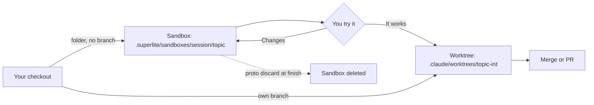
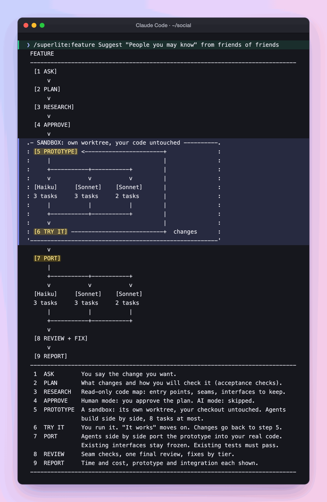

import { FileTree, Steps } from "@astrojs/starlight/components";

:::tip[TL;DR]
Use Feature to add or change something in code that already exists. superlite reads your code, builds a small prototype in a sandbox folder and lets you try it. Only after you say "it works" does it port the change into the real code.
:::

```text
 FEATURE
 ------------------------------------------------------------------------------
  [1 ASK]
      v
  [2 PLAN]
      v
  [3 RESEARCH]
      v
  [4 APPROVE]
      v
.- SANDBOX: folder in this checkout, no worktree -------.
: [5 PROTOTYPE] <-----------------------+               :
:     |                                 |               :
:     +-----------+-----------+         |               :
:     v           v           v         |               :
: [Haiku]     [Sonnet]    [Sonnet]      |               :
: 3 tasks     3 tasks     2 tasks       |               :
:     |           |           |         |               :
:     +-----------+-----------+         |               :
:     v                                 |               :
: [6 TRY IT] ---------------------------+  changes      :
'-------------------------------------------------------'
      v
  [7 PORT]
      |
      +-----------+-----------+
      v           v           v
  [Haiku]     [Sonnet]    [Sonnet]
  3 tasks     3 tasks     2 tasks
      |           |           |
      +-----------+-----------+
      v
  [8 REVIEW + FIX]
      v
  [9 REPORT]
 ------------------------------------------------------------------------------
  1  ASK        You say the change you want.
  2  PLAN       What changes and how you will check it (acceptance checks).
  3  RESEARCH   Read-only code map: entry points, seams, interfaces to keep.
  4  APPROVE    Human mode: you approve the plan. AI mode: skipped.
  5  PROTOTYPE  A sandbox folder in this checkout (.superlite/sandboxes/).
                No worktree, no branch: it uses your real code in place and
                never edits it. Agents build side by side, 8 tasks at most.
  6  TRY IT     You run it. "It works" moves on. Changes go back to step 5.
  7  PORT       Agents side by side port the prototype into your real code.
                Existing interfaces stay frozen. Existing tests must pass.
  8  REVIEW     Seam checks, one final review, fixes by tier.
  9  REPORT     Time and cost, prototype and integration each shown.
 ------------------------------------------------------------------------------
```

Only the port gets a worktree:



## How it works

A feature on existing code can go wrong in two ways. The plan can misread the code (a plan for "People you may know" can read the wrong friends table, or miss that blocked users are stored elsewhere), or the change can pass its tests and still feel wrong. The flow answers both before your real code is touched.

**Research before design.** Read-only agents map the code: entry points, the files and tests the feature touches, and the seams where new and old code meet. The interfaces that must not change are marked FROZEN. If something material is still open, superlite asks one batch of up to four questions that name real files, not guesses.

**A prototype you can try.** The prototype is built in a [sandbox](/superlite/sessions/sandbox/): a plain folder inside your checkout, with no worktree and no branch. Your tracked files are never edited. The sandbox keeps the app's entry point and what the feature touches, and stubs the rest. Its plan has at most 8 tasks.

**Your try-out is a gate.** `superlite-cli proto tryout` prints how to run the prototype, how to reach it, and the acceptance checks from the plan. In human mode the port stays blocked until you reply that it works. Changes go back to the prototype as a fix round, not to a new plan. In AI mode superlite runs the checks itself and logs a ruling.

**Port, not merge.** The port runs on a dedicated integration [worktree](/superlite/sessions/worktrees/) with its own branch. Agents rewrite the prototype's work task by task into your real code. The stubs and fakes stay behind, FROZEN interfaces do not change, and every existing test must still pass. Seam checks, a final review and [fixes by tier](/superlite/run/reviews-and-fixes/) follow, then the [report](/superlite/run/report/).

## Example: People you may know, tried in the sandbox

Say your social network lives in `~/social` and you want to suggest "People you may know" from friends of friends. The app already exists, so this is a feature on existing code.

<Steps>

1. You describe the change.

   

   *Real output: the Feature screen. The diagram is the same for any feature; only your request changes.*

   superlite opens a session on its own branch, then asks the [Regular](/superlite/flows/regular/) menu: human or AI, and whether to run the whole suite.

2. You read the plan, and push back on it.

   ```md title="docs/plans/2026-11-12-people-you-may-know.feature.md"
   ## Goal
   **Suggest people a member may know, based on friends of friends.**
   ...
   ## Acceptance checks
   - Someone 2 friends away appears with "3 mutual friends".
   - Existing friends and yourself never appear.
   - Dismissing a suggestion hides it after reload.
   - Blocked users never appear.
   ```

   **You decide:** approve, or change it. Say you drop "invite by email" and ask for a "Dismiss" button on each suggestion. The plan also has a `## Code map` of the files and tests the feature touches, which is why it names real files.

3. You approve.

   ```text frame="terminal" title="Claude Code · ~/social" mark={1} ins={2}
   Reply approve to start, or tell me what to change
   ❯ approve
   ```

   Nothing is built until you reply ([plan and approval](/superlite/run/plan-and-approval/)). Edit the plan later and you approve again.

4. The prototype appears in a sandbox. superlite cuts a folder inside your checkout and builds a small version of the feature there.

   <FileTree>
   - .superlite/sandboxes/people-you-may-know/people-you-may-know/
     - docs/plans/ the prototype's own plan
     - app/ the social app's entry point, feed and profile pages
     - stubs/ the friends database and notifications, faked
     - tests/ the acceptance checks as tests
     - package.json npm run dev starts it
   </FileTree>

   This is a [sandbox](/superlite/sessions/sandbox/): no worktree, no branch, and your tracked files are never edited. The sandbox keeps what the feature touches and stubs the rest.

5. You try it. `proto tryout` prints how to run it and what to check.

   ```text frame="terminal" title="Claude Code · ~/social" mark={1}
   run: cd ".superlite/sandboxes/people-you-may-know/people-you-may-know" && npm run dev
   try:
     - Open http://localhost:3000/feed and find the "People you may know" card.
     - Click Dismiss on a suggestion, reload the page: it stays hidden.
   ```

   **You decide:** reply "it works", or list changes ("the card should also show on the profile page"). Changes go back to the prototype as a fix round, and the port stays blocked until you say it works. In AI mode superlite runs the checks itself and tells you the result.

6. The port runs on its own worktree. superlite cuts `people-you-may-know-int` off `main` and rewrites the prototype's work into the real social app code. Stubs stay behind, the existing code's interfaces do not change, and the existing tests must pass ([parallel build](/superlite/run/parallel-build/)).

7. You read the report.

   ```text frame="terminal" title="superlite build report" mark={2}
                       Projected   Actual
   wall-clock (min)         8.0      9.5
   agents                    11       10
   ```

   The prototype and the port each get their own [report](/superlite/run/report/).

</Steps>

**What you end up with:** a branch `superlite/sessions/people-you-may-know-int` ready for a pull request into `main`, with the app's full test suite green. The sandbox is discarded at finish. You review and merge.

## Good to know

- At finish, `superlite-cli proto discard` deletes the sandbox and archives its run files into `.superlite/runs/`. The integration worktree is removed too, once its branch is merged or pushed.
- The prototype is capped at about a quarter of the integration estimate. The report shows its share, so the cost of the safety is visible.
- Graphify may help map a large repo. It is installed only with your yes.
- One feature gets one worktree, so several features can run side by side. See [sessions](/superlite/sessions/sessions/).
