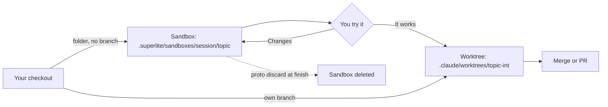

import { FileTree } from "@astrojs/starlight/components";

:::tip[TL;DR]
Use Feature to add or change something in code that already exists. superlite reads your code, builds a small prototype in a sandbox folder and lets you try it. Only after you say "it works" does it port the change into the real code.
:::

```text
 FEATURE
 ------------------------------------------------------------------------------
  [1 ASK]
      v
  [2 PLAN]
      v
  [3 RESEARCH]
      v
  [4 APPROVE]
      v
.- SANDBOX: folder in this checkout, no worktree -------.
: [5 PROTOTYPE] <-----------------------+               :
:     |                                 |               :
:     +-----------+-----------+         |               :
:     v           v           v         |               :
: [Haiku]     [Sonnet]    [Sonnet]      |               :
: 3 tasks     3 tasks     2 tasks       |               :
:     |           |           |         |               :
:     +-----------+-----------+         |               :
:     v                                 |               :
: [6 TRY IT] ---------------------------+  changes      :
'-------------------------------------------------------'
      v
  [7 PORT]
      |
      +-----------+-----------+
      v           v           v
  [Haiku]     [Sonnet]    [Sonnet]
  3 tasks     3 tasks     2 tasks
      |           |           |
      +-----------+-----------+
      v
  [8 REVIEW + FIX]
      v
  [9 REPORT]
 ------------------------------------------------------------------------------
  1  ASK        You say the change you want.
  2  PLAN       What changes and how you will check it (acceptance checks).
  3  RESEARCH   Read-only code map: entry points, seams, interfaces to keep.
  4  APPROVE    Human mode: you approve the plan. AI mode: skipped.
  5  PROTOTYPE  A sandbox folder in this checkout (.superlite/sandboxes/).
                No worktree, no branch: it uses your real code in place and
                never edits it. Agents build side by side, 8 tasks at most.
  6  TRY IT     You run it. "It works" moves on. Changes go back to step 5.
  7  PORT       Agents side by side port the prototype into your real code.
                Existing interfaces stay frozen. Existing tests must pass.
  8  REVIEW     Seam checks, one final review, fixes by tier.
  9  REPORT     Time and cost, prototype and integration each shown.
 ------------------------------------------------------------------------------
```

Only the port gets a worktree:



## How it works

A feature on existing code can go wrong in two ways. The plan can misread the code, or the change can pass its tests and still feel wrong to use. The flow answers both before your real code is touched.

**Research before design.** Read-only agents map the code: entry points, the files and tests the feature touches, and the seams where new and old code meet. The interfaces that must not change are marked FROZEN. If something material is still open, superlite asks one batch of up to four questions that name real files, not guesses.

**A prototype you can try.** The prototype is built in a [sandbox](/superlite/sessions/sandbox/): a plain folder inside your checkout, with no worktree and no branch. Your tracked files are never edited. The sandbox keeps the app's entry point and what the feature touches, and stubs the rest. Its plan has at most 8 tasks, so the prototype stays small next to the real build.

<FileTree>
- .superlite/sandboxes/
  - csv-export/ the session
    - csv-export/ the prototype: entry point, the touched screens, stubs
      - docs/plans/ its own small plan, inside the sandbox
- docs/plans/
  - 2026-11-12-csv-export.feature.md the plan you validate
</FileTree>

**Your try-out is a gate.** `superlite-cli proto tryout` prints how to run the prototype, how to reach it, and the acceptance checks from the plan. In human mode the port stays blocked until you reply that it works. Changes go back to the prototype as a fix round. They do not go back to a new plan, unless they change the scope. In AI mode superlite runs the checks itself and logs a ruling.

**Port, not merge.** The port runs on a dedicated integration [worktree](/superlite/sessions/worktrees/) with its own branch. Agents rewrite the prototype's work task by task into your real code. The stubs and fakes stay behind, FROZEN interfaces do not change, and every existing test must still pass. Seam checks, a final review and [fixes by tier](/superlite/run/reviews-and-fixes/) follow. The [report](/superlite/run/report/) shows the prototype and the integration as two parts.

## Example: CSV export you try in the sandbox

```text
you        /superlite:feature Add CSV export with column widths to the invoices page
superlite  prints the feature screen, asks who orchestrates
you        human
superlite  writes docs/plans/<date>-csv-export.feature.md: goal, what you will see, ## Acceptance checks
superlite  reads the code and adds a ## Code map: entry points, seams, interfaces to keep
superlite  one batch: should the export follow the active filters? is the delimiter fixed?
you        yes to filters, comma only
superlite  Reply approve to start, or tell me what to change
you        approve
superlite  proto: csv-export building, sandbox .superlite/sandboxes/csv-export/csv-export
superlite  proto: csv-export tryout, sandbox .superlite/sandboxes/csv-export/csv-export; waiting for the human's try-out reply
           run: cd "<project>/.superlite/sandboxes/csv-export/csv-export" && npm run dev
           reach: http://localhost:3000/invoices
           try:
             - the Export button downloads invoices.csv
             - column widths follow the visible columns
you        the Amount column is cut off
superlite  fix round 2 on the same sandbox, then the try-out again
you        it works
superlite  creates the integration worktree csv-export-int and ports the work, interfaces frozen
superlite  seam checks, final review, fixes by tier, tests
superlite  report: prototype and integration, each with time and cost
```

The `run:` and `reach:` values come from your project. The shape of the lines is what superlite prints.

## Good to know

- At finish, `superlite-cli proto discard` deletes the sandbox and archives its run files into `.superlite/runs/`. The integration worktree is removed too, once its branch is merged or pushed.
- The prototype is capped at about a quarter of the integration estimate. The report shows its share, so the cost of the safety is visible.
- Graphify may help map a large repo. It is installed only with your yes.
- One feature gets one worktree, so several features can run side by side. See [sessions](/superlite/sessions/sessions/).
