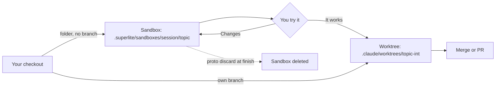
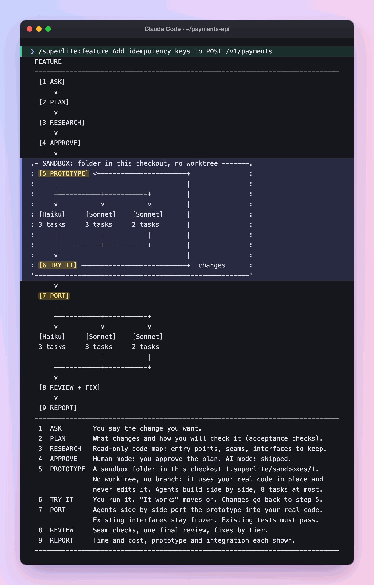

import { FileTree, Steps } from "@astrojs/starlight/components";

:::tip[TL;DR]
Use Feature to add or change something in code that already exists. superlite reads your code, builds a small prototype in a sandbox folder and lets you try it. Only after you say "it works" does it port the change into the real code.
:::

```text
 FEATURE
 ------------------------------------------------------------------------------
  [1 ASK]
      v
  [2 PLAN]
      v
  [3 RESEARCH]
      v
  [4 APPROVE]
      v
.- SANDBOX: folder in this checkout, no worktree -------.
: [5 PROTOTYPE] <-----------------------+               :
:     |                                 |               :
:     +-----------+-----------+         |               :
:     v           v           v         |               :
: [Haiku]     [Sonnet]    [Sonnet]      |               :
: 3 tasks     3 tasks     2 tasks       |               :
:     |           |           |         |               :
:     +-----------+-----------+         |               :
:     v                                 |               :
: [6 TRY IT] ---------------------------+  changes      :
'-------------------------------------------------------'
      v
  [7 PORT]
      |
      +-----------+-----------+
      v           v           v
  [Haiku]     [Sonnet]    [Sonnet]
  3 tasks     3 tasks     2 tasks
      |           |           |
      +-----------+-----------+
      v
  [8 REVIEW + FIX]
      v
  [9 REPORT]
 ------------------------------------------------------------------------------
  1  ASK        You say the change you want.
  2  PLAN       What changes and how you will check it (acceptance checks).
  3  RESEARCH   Read-only code map: entry points, seams, interfaces to keep.
  4  APPROVE    Human mode: you approve the plan. AI mode: skipped.
  5  PROTOTYPE  A sandbox folder in this checkout (.superlite/sandboxes/).
                No worktree, no branch: it uses your real code in place and
                never edits it. Agents build side by side, 8 tasks at most.
  6  TRY IT     You run it. "It works" moves on. Changes go back to step 5.
  7  PORT       Agents side by side port the prototype into your real code.
                Existing interfaces stay frozen. Existing tests must pass.
  8  REVIEW     Seam checks, one final review, fixes by tier.
  9  REPORT     Time and cost, prototype and integration each shown.
 ------------------------------------------------------------------------------
```

Only the port gets a worktree:



## How it works

A feature on existing code can go wrong in two ways. The plan can misread the code (a plan for idempotency keys can miss that the key check must share the payment's transaction, or test a race against an in-memory stub that cannot race), or the change can pass its tests and still feel wrong. The flow answers both before your real code is touched.

**Research before design.** Read-only agents map the code: entry points, the files and tests the feature touches, and the seams where new and old code meet. The interfaces that must not change are marked FROZEN. If something material is still open, superlite asks one batch of up to four questions that name real files, not guesses.

**A prototype you can try.** The prototype is built in a [sandbox](/superlite/sessions/sandbox/): a plain folder inside your checkout, with no worktree and no branch. Your tracked files are never edited. The sandbox keeps the app's entry point and what the feature touches, and stubs the rest. Its plan has at most 8 tasks.

**Your try-out is a gate.** `superlite-cli proto tryout` prints how to run the prototype, how to reach it, and the acceptance checks from the plan. In human mode the port stays blocked until you reply that it works. Changes go back to the prototype as a fix round, not to a new plan. In AI mode superlite runs the checks itself and logs a ruling.

**Port, not merge.** The port runs on a dedicated integration [worktree](/superlite/sessions/worktrees/) with its own branch. Agents rewrite the prototype's work task by task into your real code. The stubs and fakes stay behind, FROZEN interfaces do not change, and every existing test must still pass. Seam checks, a final review and [fixes by tier](/superlite/run/reviews-and-fixes/) follow, then the [report](/superlite/run/report/).

## Example: idempotency keys on a payments API

Say `~/payments-api` is a FastAPI service on Postgres 16 (SQLAlchemy 2 async, Alembic, 34 API tests). Clients retry `POST /v1/payments` after timeouts, so a card can be charged twice. You want an `Idempotency-Key` header: a repeat replays the first response, another body is a 422, a twin in flight is a 409.

<Steps>

1. You describe the change.

   

   *Real output: the Feature screen. The diagram is the same for any feature; only your request changes.*

   superlite opens a session, then asks the [Regular](/superlite/flows/regular/) menu: human or AI, and whether to run the whole suite.

2. Research writes the code map; every path, line range and signature in the plan comes from the repo.

   ```md title="docs/plans/2026-11-25-idempotency-keys.feature.md"
   ## Acceptance checks
   - POST the same body twice with `Idempotency-Key: k1`: both return 201 with the same `id`, the second has `Idempotent-Replayed: true`, and `GET /_fake/charges` lists one charge.
   - Fire two POSTs with `k2` at the same time: one 201, one 409, one charge.
   ...
   ## Code map
   - **Touched:** `src/payments/api/routes.py` `create_payment` (:41-78), `src/payments/db/models.py`; new package `src/payments/idempotency/`.
   - **Seam:** `create_payment` → `PaymentService.create(cmd)` → `GatewayClient.charge(...)`. The key check must wrap the service call, inside the same DB transaction as the payment insert.
   - **Frozen interfaces:** `PaymentService.create(cmd: CreatePayment) -> Payment`; `GatewayClient.charge(amount: int, currency: str, source: str) -> Charge`; the `PaymentOut` response model; migration head `0017_refunds` (0018 builds on it).
   ## Decisions
   - Decided: unique on `(merchant_id, key)`; the first request inserts a `started` row, so a concurrent twin hits the constraint and gets 409.
   - Prototype decides: whether a 5xx is stored for replay (default: no, only 2xx and 4xx).
   - Ruling: [level] L2 - the feature adds a table and its correctness rests on a unique-constraint race that an in-memory stub would hide - cost if wrong: about 40 s more setup per round.
   ```

   **You decide:** approve, or change it. The L2 ruling matters here: the 409 comes from a real unique constraint, so the prototype gets its own Postgres instead of a dict.

3. You approve. In human mode nothing is built before your reply:

   ```text frame="terminal" title="Claude Code · ~/payments-api"
   BLOCKED: no human approval reply since the review plan was written; show the plan, ask the human to reply approve, end your turn
   ```

   You reply `approve` ([plan and approval](/superlite/run/plan-and-approval/)).

4. `superlite-cli proto start` cuts the prototype's sandbox:

   <FileTree>
   - .superlite/sandboxes/host/idempotency-keys/
     - docs/plans/2026-11-25-idempotency-keys.proto.md
     - proto_app.py imports the real create_app, swaps in FakeGateway
     - fakes/gateway.py records charges, serves GET /_fake/charges
     - migrations/0018_idempotency_keys.py
     - idempotency/ fingerprint.py, store.py, dependency.py
     - seed.sql m_test, m_other, m_closed
     - tests/ conftest.py (Postgres on port 55432), test_acceptance.py
   </FileTree>

   The real `payments` package is imported in place, never copied or edited.

5. The prototype plan is linted before any agent starts. Each task names what it produces, with exact examples (excerpt):

   ```md title=".superlite/sandboxes/host/idempotency-keys/docs/plans/2026-11-25-idempotency-keys.proto.md"
   ### T5 key store · Complexity 3 · Est. context 25k
   **Owns:** .superlite/sandboxes/host/idempotency-keys/idempotency/store.py
   **Kind:** design
   **Model:** sonnet
   **Consumes:** table idempotency_keys(merchant_id, key, fingerprint, status, response_status, response_body, created_at) (T3) · fingerprint.of(method: str, path: str, body: bytes) -> str (T4)
   **Produces:** store.claim(s: AsyncSession, merchant_id: str, key: str, fp: str) -> Claim
     e.g. claim(s, "m_test", "k1", fp) on an empty table -> Claim.NEW
     e.g. claim again with the same fp after complete -> Claim.REPLAY(status=201, body=b'{"id":"pay_1",...}')
     e.g. claim with another fp -> Claim.MISMATCH
   **Review Focus:** state: a concurrent claim on a `started` row returns Claim.IN_PROGRESS, not an exception; rows older than IDEMPOTENCY_TTL_S count as absent.
   ```

   The first draft failed. Lint gives the reason and the fix:

   ```text frame="terminal" title="Claude Code · ~/payments-api"
   FIX:
   T0: SIZE: T0 predicted 10.8 min > 8 max; split it along its components | KIND: T0 is not mechanical: no test code or contract with exact inputs and outputs
   T5: T5 consumes FakeGateway.charge from T4, but no Produces line defines it | depends on unstable T1, T4
   PLAN: MISSED TARGET: predicted 27.6 min vs target 6.0 min — critical path T2 → T3
   ```

   After the split, the fixed producer and a 25-minute target, all 8 tasks are stable:

   ```text frame="terminal" title="Claude Code · ~/payments-api" mark={1,6}
   STABLE: T0 T1 T2 T3 T4 T5 T6 T7
   FIX:
   EDGE: T7 does not wait for T6: every interface it takes from T6 has an e.g. example, so the edge is not waited on
   stats: n=83; predicted: 24.1 min, $0.38 (history-backed)
   TIERS: T0=haiku T1=haiku T2=haiku T3=sonnet T4=haiku T5=sonnet T6=sonnet T7=sonnet
   DISPATCH NOW: T0 T1 T2 T3 T4 T5 T6 T7
   ```

   The `e.g.` lines let all 8 start at once: T7 tests against T6's examples, not its code ([parallel build](/superlite/run/parallel-build/)).

6. You try it. `superlite-cli proto tryout` prints how to run it and what to check:

   ```text frame="terminal" title="Claude Code · ~/payments-api" mark={1,2}
   run: cd ~/payments-api/.superlite/sandboxes/host/idempotency-keys && PYTHONPATH=../../../../src uv run uvicorn proto_app:create_app --factory --port 8010
   reach: http://localhost:8010
   try:
     - POST the same body twice with `Idempotency-Key: k1`: both return 201 with the same `id`, the second has `Idempotent-Replayed: true`, and `GET /_fake/charges` lists one charge.
     ...
   ```

   You check the race yourself:

   ```bash
   for i in 1 2; do curl -s -o /dev/null -w '%{http_code}\n' -X POST localhost:8010/v1/payments \
     -H 'Idempotency-Key: k2' -H 'Content-Type: application/json' \
     -d '{"amount":1999,"currency":"eur","source":"tok_visa"}' & done; wait
   curl -s localhost:8010/_fake/charges | jq length
   ```

   **You decide:** reply "it works", or list changes ("store 5xx too"), which reopens the prototype as a fix round. Until you reply, the port is blocked:

   ```text frame="terminal" title="Claude Code · ~/payments-api"
   BLOCKED: no human reply since the prototype was shown; show how to try it, ask the human to reply "it works" or list the changes, end your turn
   ```

7. The port runs on its own worktree: `superlite-cli session create --slug idempotency-keys-int --worktree --base main`. Its plan ports the work into `src/payments/` and pins what must not move:

   ```md title="docs/plans/2026-11-25-idempotency-keys.md"
   Global constraints:
   - FROZEN: `PaymentService.create(cmd: CreatePayment) -> Payment`.
   - FROZEN: `GatewayClient.charge(amount: int, currency: str, source: str) -> Charge`.
   - FROZEN: `PaymentOut` fields and the 34 tests in `tests/api/test_payments.py`.
   - Ported from the sandbox, never merged: `fakes/gateway.py`, `proto_app.py` and `seed.sql` stay behind.
   - Ruling: [tryout] approved round 1; 5xx responses are not stored (prototype decided).
   ...
   ### T6 seam check · Complexity 2 · Est. context 25k
   **Owns:** tests/api/test_idempotency_acceptance.py
   **Consumes:** routes.create_payment(body: CreatePayment, claim: Optional[Claim]) -> PaymentOut (T5)
   **Produces:** test_same_key_same_body_replays, test_same_key_other_body_422, test_concurrent_twin_409, test_no_header_unchanged, test_expired_key_charges_again
     e.g. SUPERLITE_REAL=1 uv run pytest tests/api/test_idempotency_acceptance.py -> 5 passed
   **Review Focus:** the prototype's five acceptance tests, ported to the real `client` fixture; with `SUPERLITE_REAL=1` they hit the real `PaymentService` and testcontainers Postgres, with only `GatewayClient` mocked at its FROZEN signature.
   ```

   ```text frame="terminal" title="Claude Code · ~/payments-api" mark={1,6}
   STABLE: T1 T2 T3 T4 T5 T6
   FIX:
   ...
   stats: n=83; predicted: 19.6 min, $0.47 (history-backed)
   TIERS: T1=sonnet T2=haiku T3=sonnet T4=sonnet T5=sonnet T6=sonnet
   DISPATCH NOW: T1 T2 T3 T4 T5 T6
   ```

   The fake gateway proved the flow. The seam check proves it against the real service. Seam checks, the final review and [fixes by tier](/superlite/run/reviews-and-fixes/) follow.

8. You read the report. `superlite-cli finish --plan docs/plans/2026-11-25-idempotency-keys.md` records the run; the prototype and the port each get their own [report](/superlite/run/report/).

</Steps>

**What you end up with:** a branch `superlite/sessions/idempotency-keys-int` ready for a pull request into `main`: migration `0018_idempotency_keys`, the `src/payments/idempotency/` package, a wired `create_payment`, five new acceptance tests, and the 34 existing tests unchanged and green. `superlite-cli proto discard` deletes the sandbox. You review and merge.

## Good to know

- At finish, `superlite-cli proto discard` deletes the sandbox and archives its run files into `.superlite/runs/`. The integration worktree is removed too, once its branch is merged or pushed.
- The prototype is capped at about a quarter of the integration estimate. The report shows its share, so the cost of the safety is visible.
- Graphify may help map a large repo. It is installed only with your yes.
- One feature gets one worktree, so several features can run side by side. See [sessions](/superlite/sessions/sessions/).
