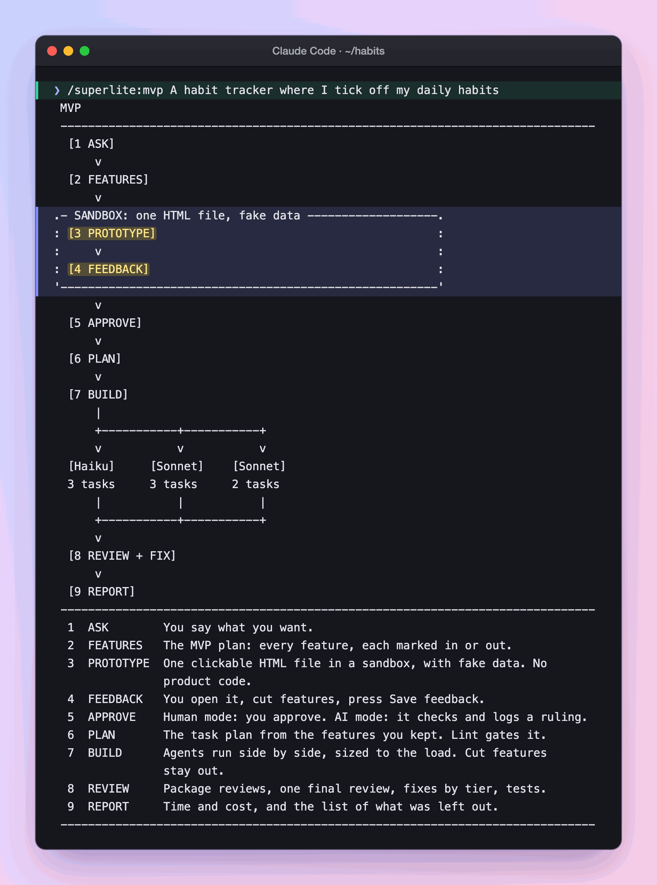

import { FileTree, Steps } from "@astrojs/starlight/components";

:::tip[TL;DR]
Use MVP for a new project when you want to agree on features before any code exists. You click through a fake version in your browser, cut what you do not need, and approve. The build covers only what you kept.
:::

```text
 MVP
 ------------------------------------------------------------------------------
  [1 ASK]
      v
  [2 FEATURES]
      v
.- SANDBOX: one HTML file, fake data -------------------.
: [3 PROTOTYPE]                                         :
:     v                                                 :
: [4 FEEDBACK]                                          :
'-------------------------------------------------------'
      v
  [5 APPROVE]
      v
  [6 PLAN]
      v
  [7 BUILD]
      |
      +-----------+-----------+
      v           v           v
  [Haiku]     [Sonnet]    [Sonnet]
  3 tasks     3 tasks     2 tasks
      |           |           |
      +-----------+-----------+
      v
  [8 REVIEW + FIX]
      v
  [9 REPORT]
 ------------------------------------------------------------------------------
  1  ASK        You say what you want.
  2  FEATURES   The MVP plan: every feature, each marked in or out.
  3  PROTOTYPE  One clickable HTML file in a sandbox, with fake data. No
                product code.
  4  FEEDBACK   You open it, cut features, press Save feedback.
  5  APPROVE    Human mode: you approve. AI mode: it checks and logs a ruling.
  6  PLAN       The task plan from the features you kept. Lint gates it.
  7  BUILD      Agents run side by side, sized to the load. Cut features
                stay out.
  8  REVIEW     Package reviews, one final review, fixes by tier, tests.
  9  REPORT     Time and cost, and the list of what was left out.
 ------------------------------------------------------------------------------
```

## How it works

Cutting a feature from a clickable page is cheap. Cutting it from finished code is not. So MVP moves the decision to the front.

**Features first.** superlite writes an MVP plan organised around features. It opens with a diagram of how the product is used, in the form that fits it: a screen wireframe for a web app, a command tree and a sample session for a CLI, an endpoint table for an API. Each feature has an id, a size, a priority and a recommendation to keep it or leave it out.

**A prototype that is a spec.** superlite builds one self-contained HTML file with fake data. It holds no product code, needs no build step and makes no network call. Its side panel lists the features and tasks with an in or out toggle, a priority order, notes, and a time and cost estimate. Cutting a feature removes it from the mock and updates the estimate. For example, cutting "streak chart" from a habit tracker takes one click, and the estimate drops with it.

**Your reply approves, the button does not.** Save feedback only writes `mvp-feedback.json`. A browser page cannot reach into your project, so you pick the folder, and superlite looks in the project first and in Downloads second. The approval is your reply in chat. After it, superlite writes the task plan from your kept features and lint gates it, as in [plan and approval](/superlite/run/plan-and-approval/). You are not asked again.

**Build.** [Agents](/superlite/run/parallel-build/) are sized to the load. Cut features go under "Out of scope" and the [report](/superlite/run/report/) lists them. With the AI [orchestrator](/superlite/run/orchestrators/) superlite checks the prototype itself, logs a ruling and does not stop.

## Example: a habit tracker

Say you want a habit tracker and you have no code yet.

<Steps>

1. You ask for an MVP.

   

   *Real output: the command and the screen printed the moment you start.*

   superlite prints the stored screen above and opens a [session](/superlite/sessions/sessions/) on its own branch. The folder is empty, so nothing exists yet to read.

2. You answer one menu.

   ```text frame="terminal" title="Claude Code · ~/habits" mark={2}
   Who orchestrates?
   › 1. Human   you approve before anything is built
     2. AI      hands off
   Run the whole test suite at finish?  › No, affected tests only (Recommended)
   ```

   **You decide:** human, and no. The human [orchestrator](/superlite/run/orchestrators/) is what makes the prototype wait for you.

3. You read the feature plan. superlite writes it around features, with a diagram of how the product is used first.

   ```md title="docs/plans/2026-11-12-habit-tracker.mvp.md"
   ### F3 Streak chart
   What you get: a chart of your longest streaks
   Size: M · Priority: could · Recommendation: out
   ```

   The plan is organised by feature because the goal is to agree on features. Each one carries a size, a priority and a keep-or-leave-out recommendation, so you can judge scope before any code exists.

4. The prototype opens in your browser. superlite writes one HTML file with fake data and checks it with `superlite-cli mvp_check`.

   <FileTree>
   - .superlite/mvp/
     - prototype.html the page you open
     - mvp-feedback.json written when you press Save feedback
   </FileTree>

   It holds no product code, needs no build step and makes no network call. It is a spec you can click, not a first draft of the app.

5. You click through it and cut.

   ```text frame="terminal" title="prototype.html · side panel" mark={4}
   [x] F1 Add a habit      must
   [x] F2 Tick today       must
   [ ] F3 Streak chart     could
   estimate: time and cost, updated as you toggle
   ```

   **You decide:** cut F3, move F2 above F1, press Save feedback. Cutting a feature removes it from the mock and updates the estimate. A browser page cannot reach into your project, so Save feedback only writes a file. superlite looks in the project first and in Downloads second.

6. You approve in chat.

   ```text frame="terminal" title="Claude Code · ~/habits" ins={1}
   ❯ approve
   ```

   Your reply approves, not the button ([plan and approval](/superlite/run/plan-and-approval/)). superlite reads `mvp-feedback.json` and writes the task plan: F2 and F1 become tasks in your order, and F3 goes under "Out of scope". You are not asked again.

7. The build runs without you. [Agents](/superlite/run/parallel-build/) build F1 and F2, reviewers fix, and tests run. The [report](/superlite/run/report/) lists F3 as left out.

</Steps>

**What you end up with:** a working habit tracker with the two features you kept, uncommitted on its session branch. The mock is deleted at finish, and F3 stays on the list for a later run.

## Good to know

- Prototype code is never copied into your project. It is a spec for behavior. The one exception is a web target where your feedback keeps it as the frontend's starting file. superlite then converts the page to the plan's framework.
- Otherwise `.superlite/mvp/` is deleted at finish.
- Features you add in the panel are marked unreviewed for the final review.
- After approval, a change of scope becomes a logged ruling, and `superlite-cli finish` lists it under "Changed from the approved plan".
- The run works in its own [session](/superlite/sessions/sessions/). The prototype stays in `.superlite/mvp/`, away from your project code. To change code that already exists, use the [Feature flow](/superlite/flows/feature/).
