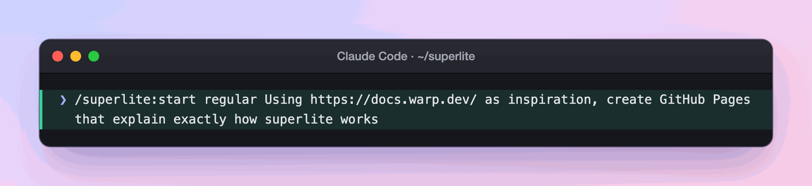
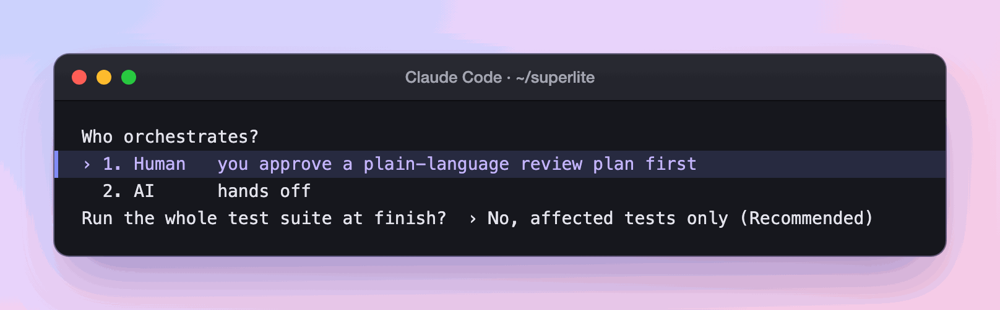
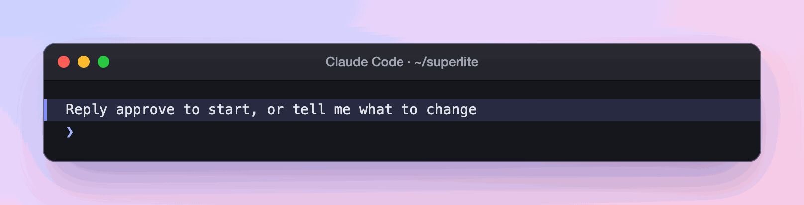
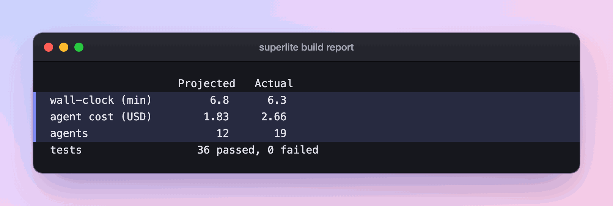
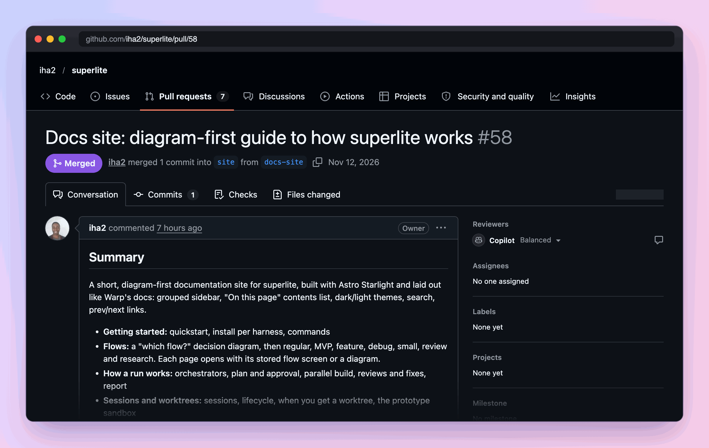

import { Tabs, TabItem, Steps, FileTree } from "@astrojs/starlight/components";

:::tip[TL;DR]
Use Regular to build something when you do not need a prototype first. You get a plan, code built by agents side by side, reviewed and fixed, and a report with time and cost. Nothing is committed.
:::

```text
 REGULAR
 ------------------------------------------------------------------------------
  [1 ASK]
      v
  [2 SIZE]
      v
  [3 PLAN]
      v
  [4 APPROVE]
      v
  [5 GATE]
      v
  [6 BUILD]
      |
      +-----------+-----------+
      v           v           v
  [Haiku]     [Sonnet]    [Sonnet]
  3 tasks     3 tasks     2 tasks
      |           |           |
      +-----------+-----------+
      v
  [7 REVIEW + TEST]
      v
  [8 FINAL REVIEW]
      v
  [9 FIX]
      v
  [10 REPORT]
 ------------------------------------------------------------------------------
  1  ASK      You say what you want.
  2  SIZE     Trivial, bounded or large. Large gets one batch of questions.
  3  PLAN     The design and the task plan. Human mode adds a review plan.
  4  APPROVE  Human mode: you approve before anything runs. AI mode: skipped.
  5  GATE     Lint checks the plan. Only stable tasks go out.
  6  BUILD    Agents run side by side, sized to the load. Haiku: mechanical.
              Sonnet: the rest.
  7  REVIEW   Reviewers fix their own findings. Tests run in the background.
  8  FINAL    One fresh reviewer reads the packet and tiers the findings.
  9  FIX      Fixers by tier (Sonnet, Sonnet high, Opus), then tests again.
  10 REPORT   Time and cost, projected vs actual. Nothing is committed.
 ------------------------------------------------------------------------------
```

## How it works

Regular is the default build path. The other build flows add a step in front of it: a prototype you try ([MVP](/superlite/flows/mvp/), [Feature](/superlite/flows/feature/)).

**Size first.** superlite sorts your request into trivial, bounded or large. A trivial change is just done, after a yes in chat if you approve plans. A bounded change gets a short design in chat. A large request gets one batch of questions (up to four) and one document that holds the design and the task plan. For example, "fix the typo in the README" is trivial, and "build a docs site" is large. Sizing keeps a one-line change away from a full plan, and a big project away from guesses.

**Gate before agents.** Lint checks the task plan. Only stable tasks go out. The rest wait with a reason. A plan that looks fine on paper does not send agents off in the wrong direction. See [plan and approval](/superlite/run/plan-and-approval/).

**Then the build.** [Agents](/superlite/run/parallel-build/) run side by side. Haiku takes mechanical work and Sonnet takes the rest. Reviewers fix their own findings while tests run in the background. One fresh reviewer reads the whole packet and ranks what is left by tier, and fixers take those by tier. [Reviews and fixes](/superlite/run/reviews-and-fixes/) explains the tiers.

The last step is the [report](/superlite/run/report/): time and cost, projected against actual.

<Tabs>
  <TabItem label="Human orchestrator">
    You read a plain-language review plan and reply with any clear approval. Nothing is linted or dispatched before that reply.
  </TabItem>
  <TabItem label="AI orchestrator">
    The approve step is skipped. superlite plans, lints, dispatches and rules on open choices itself. Choose this when you are away.
  </TabItem>
</Tabs>

[Orchestrators](/superlite/run/orchestrators/) covers the choice in full.

## Example: building this docs site

This is the run that built the page you are reading. You are in an ordinary checkout, you want a whole site, and you pick Regular.

<Steps>

1. You type the request.

   

   Because you named `regular`, superlite skips the flow suggestion, shows the stored screen above and sizes the request. A whole site is large, so it asks everything it needs in one batch, not in many small questions.

2. You answer one menu.

   

   **You decide:** human, and no. The first answer sets whether anything waits for you ([orchestrators](/superlite/run/orchestrators/)). Another run was open in the main checkout, so superlite opened this one in its own [worktree](/superlite/sessions/worktrees/) on its own branch. Your branch stays as it was.

   <FileTree>
   - .claude/worktrees/sessions-docs-site/ branch superlite/sessions/docs-site
   </FileTree>

3. You read the review plan. superlite writes it as a file and stops.

   ```md title="docs/plans/2026-11-12-docs-site.review.md"
   ## Summary
   A short, clear documentation site on GitHub Pages, so people know exactly how to use superlite and what it does while it works.
   ...
   ## Rough time and cost
   About 45 to 75 minutes and $15 to $30, mostly research and writing (rough, until the plan is linted).
   ```

   

   **You decide:** reply "approve", or ask for changes and read the plan again. Until you reply, a hook blocks every agent, so nothing is built. The estimate is marked rough because no task list exists yet ([plan and approval](/superlite/run/plan-and-approval/)).

4. You wait while the plan is checked. After your yes, superlite writes 12 tasks and lints them. Lint saves a forecast of 6.8 minutes and lets only stable tasks out. Page writers need the facts and the style guide, so they wait for wave 1.

   ```mermaid
   flowchart LR
     A["Wave 1: facts, style guide, skeleton"] --> B["Wave 2: page writers, checker"]
     B --> C["Wave 3: publish"]
   ```

5. You watch the build. Agents run side by side, up to 6 at once here. Sonnet writes the research and the pages. The one mechanical task, publish, goes to Haiku ([parallel build](/superlite/run/parallel-build/)). Rulings and progress land in `.superlite/progress.md`.

6. The review and fix rounds run without you. Package reviewers fix their own findings while tests run. One fresh reviewer then reads the packet, and fixers take what is left by tier ([reviews and fixes](/superlite/run/reviews-and-fixes/)). This run needed one rework dispatch.

7. You read the report.

   

   The forecast was fixed at lint, so the table compares it with what happened ([report](/superlite/run/report/)). The coordinator's own cost, $6.81, is listed apart from the agents.

</Steps>

**What you end up with:** a `site/` folder on the session branch `superlite/sessions/docs-site`, tested and uncommitted. You commit it and open the pull request. Here that became PR #58.



## Good to know

- Nothing is committed during the run. Finished tasks are saved as hidden checkpoints, not as commits on your branch.
- Both modes stop for destructive, outward or security-sensitive actions: a push, a merge, a publish.
- The run works on its own [session](/superlite/sessions/sessions/) branch, so your current branch stays as it was.
- Watch the run in `.superlite/`: `progress.md` has the rulings and the log.
