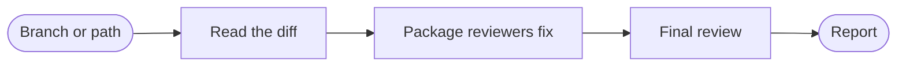

## What you do

Name a branch or a path, or leave it empty to review the current branch against its base. A path limits the review to that path. Answer the one round of questions about intent, the risk that matters most, and what is out of bounds.

## What superlite does

superlite starts a [session](/superlite/sessions/sessions/) on the target branch and reads the diff. It works in place when you are on that branch, and in a [worktree](/superlite/sessions/worktrees/) otherwise. Package reviewers fix their own findings and add regression tests.

A fresh final reviewer then reads the review packet. It reports findings in tiers 1 to 3 and never edits.

## Example

```text
/superlite:review Review this branch and fix what you find
```

You get the fixes from the package reviewers and a tiered list from the final review.
