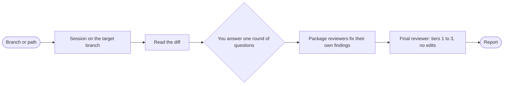

import { Steps } from "@astrojs/starlight/components";

:::tip[TL;DR]
Use Review to check a branch before you merge it. Package reviewers fix what they find and add regression tests. A fresh final reviewer then ranks what is left in tiers 1 to 3 and edits nothing.
:::



## How it works

Two kinds of reviewer do two different jobs, and the split is the point.

**Package reviewers fix.** Each package reviewer reads its part of the diff and fixes what it finds, with a regression test for each fix. A reviewer that fixes its own findings leaves less for you to triage. For example, a reviewer that spots a missing empty-table case adds the case and a test for it.

**The final reviewer judges.** It is a fresh agent that did not see the earlier work. It reads the review packet and reports the remaining findings in tiers 1 to 3. It never edits. A reviewer that cannot change the code has no reason to defend it. [Reviews and fixes](/superlite/run/reviews-and-fixes/) says what each tier means and who fixes it.

**The target.** With no argument, the target is the current branch against its base. A branch name picks another branch. A path (a file or folder) keeps the review inside that path on the current branch. The [session](/superlite/sessions/sessions/) starts on the target branch. It works in place when you are already on that branch, and in a [worktree](/superlite/sessions/worktrees/) otherwise, so your checkout is not switched under you.

The questions are one round: the intent of the change, the risk that matters most, and what is out of bounds. They are asked only when something material is open after superlite reads the diff.

## Example: review a branch before the merge

Say a branch adds CSV export and you want it checked before you merge.

<Steps>

1. You name the branch.

   ```text frame="terminal" title="Claude Code · ~/shop" ins={1}
   ❯ /superlite:review superlite/sessions/csv-export
   ```

   superlite resolves the branch and its base, then opens a [session](/superlite/sessions/sessions/) on that branch. It works in place if you are already on it, and in a [worktree](/superlite/sessions/worktrees/) otherwise, so your checkout is not switched under you.

2. You answer one batch, once superlite has read the diff.

   ```text frame="terminal" title="Claude Code · ~/shop" ins={5}
   What is the intent of this change?
   Which risk matters most?
   What is out of bounds?
   Run the whole test suite at finish?  › No, affected tests only (Recommended)
   ❯ The main risk is wrong totals in the export. Leave the invoice model alone.
   ```

   **You decide:** the risk and the fence. They tell the reviewers where to look hardest and what not to touch. The batch is asked only when the diff leaves something material open.

3. Package reviewers work through the diff. Each takes its part, fixes what it finds and adds a regression test for each fix.

   ```text frame="terminal" title="Claude Code · ~/shop" mark={1}
   package reviewer: export totals ignored the active filter. Fixed, test added.
   ```

   A reviewer that fixes its own finding leaves less for you to triage. The fixes land uncommitted in the session's working tree, so you see them as an ordinary diff.

4. A fresh reviewer ranks what is left. The final reviewer did not see the earlier work and edits nothing.

   ```text frame="terminal" title="Claude Code · ~/shop" mark={1-2}
   tier 2  the export has no limit on row count
   tier 3  the filename ignores the locale
   ```

   It reads the review packet and sorts the remaining findings into tiers 1 to 3 ([reviews and fixes](/superlite/run/reviews-and-fixes/)). A reviewer that cannot change the code has no reason to defend it.

5. You read the report.

   ```text frame="terminal" title="superlite report" mark={1}
   fixes made: 1, tests added: 1
   open findings: tier 2 x1, tier 3 x1
   ```

   It lists the fixes made and the findings by tier, so the open list is short and ranked.

</Steps>

**What you end up with:** the branch with the reviewers' fixes in your working tree, and a short list of what is still open. Read tiers 1 and 2 first. You decide what to do with them, and you decide when to merge.

## Good to know

- Review does not push. Merging or opening a pull request is a separate step, and it stays your call.
- The fixes land uncommitted in the working tree of the session. You see them as an ordinary diff.
- The whole-suite question defaults to no: affected tests only.
- Reviews also run inside every build. Use `/superlite:review` for a branch that was not built by superlite.
