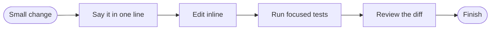

## What you do

Say the change. In human mode, a yes in chat is all superlite needs. It writes no review plan.

## What superlite does

superlite starts a [session](/superlite/sessions/sessions/), makes the change in a few tool calls and says it is working inline. It runs the focused tests. One package reviewer reviews the diff before superlite claims done.

Then `superlite-cli finish` marks the session finished and leaves your uncommitted work in place.

If the change spans more than a few files or several chains, superlite says so and switches to a fuller flow.

## Example

```text
/superlite:small Rename `build` to `render` everywhere
```

You get the rename, the test result and the reviewer's verdict. See [all commands](/superlite/start/commands/).
