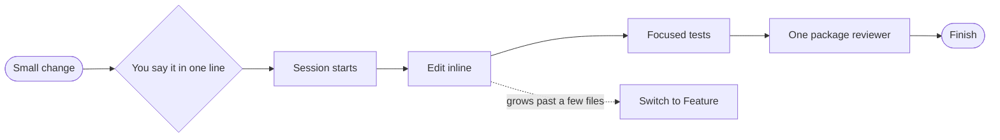

import { Steps } from "@astrojs/starlight/components";

:::tip[TL;DR]
Use Small for a change of a few files in one chain, such as a rename. superlite does it inline, runs the focused tests, and has one reviewer check the diff before it says done. No plan document.
:::



## How it works

A plan is worth its cost when the work is big enough to go wrong. A rename is not: renaming `build` to `render` touches a handful of files, and any mistake shows in the tests. So Small drops the plan, the review plan and the agent waves, and keeps two things: the session and the reviewer.

The session still opens before the first edit, so the change sits on its own branch and is easy to inspect or throw away. The change itself happens in a few tool calls, and superlite says that it is working inline.

The reviewer is the safety net you keep. One `superlite:package-reviewer` reads the diff before superlite claims done. For a change this size, this is the whole review.

If you use the human [orchestrator](/superlite/run/orchestrators/), your yes in chat is the only approval. There is no review plan to read.

## Example: rename `build` to `render`

Say a function name no longer fits and you want it changed everywhere.

<Steps>

1. You say it in one line.

   ```text frame="terminal" title="Claude Code · ~/shop" ins={1}
   ❯ /superlite:small Rename `build` to `render` everywhere
   ```

   You named `small`, so there is no menu to answer and no plan to read. superlite opens a [session](/superlite/sessions/sessions/) first, so the rename sits on its own branch and is easy to inspect or throw away.

2. superlite edits inline. It says so, then changes the function, its callers and the tests.

   ```diff lang="py" title="src/pages.py"
   - from site import build
   + from site import render
   - html = build(page)
   + html = render(page)
   ```

   An edit this size takes a few tool calls. A plan document would cost more than the change.

3. Focused tests run.

   ```text frame="terminal" title="Claude Code · ~/shop" mark={1}
   tests/test_pages.py  tests/test_site.py  passed
   ```

   Only the tests for the files it changed run. The full suite defaults to no and superlite does not ask.

4. One reviewer reads the diff. This is the `superlite:package-reviewer` agent. It fixes what it finds and adds a regression test for each fix, and it is the whole review for a change this size.

5. superlite says it is done.

   ```text frame="terminal" title="Claude Code · ~/shop" mark={1}
   done: 6 files changed, tests pass, reviewer found nothing to fix
   ```

   **You decide:** keep it, adjust it or throw the branch away. `superlite-cli finish` marks the session finished and leaves your work where it is.

</Steps>

**What you end up with:** the rename, uncommitted on the session branch, with passing tests and a review behind it.

## Good to know

- The full suite defaults to no, and superlite asks nothing about it: only the affected tests run.
- If the change spans more than a few files or several chains, superlite says so and switches to the [Feature flow](/superlite/flows/feature/).
- Start with `/superlite:small` when you know the change is small. Otherwise [superlite suggests a flow](/superlite/flows/choose/) from the words "rename", "typo" or "bump", or from a request that names one file.
