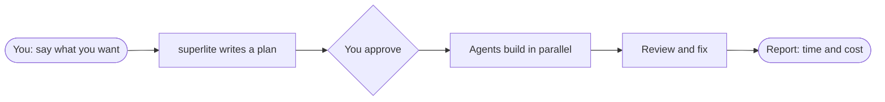

import { CardGrid, LinkCard } from "@astrojs/starlight/components";



You decide twice: what to build, and whether the plan is right. Everything after that is automatic. If you would rather not be asked, pick the AI orchestrator and it decides for you.

## What a run looks like

The superlite lines are a summary of what happens, not exact output.

```text
you        /superlite:feature Add CSV export
superlite  reads the code and writes a plan
superlite  plan ready: docs/plans/2026-11-12-csv-export.review.md
you        looks good, go ahead
superlite  builds a prototype for you to try, then ports it into your code
superlite  report: time and cost, projected vs actual. Nothing is committed.
```

Each run gets its own branch, so a second chat in the same project does not overwrite the first.

## Where to go

<CardGrid>
  <LinkCard title="Quickstart" description="Install it and finish a first run." href="/superlite/start/quickstart/" />
  <LinkCard title="Concepts" description="The map: flows, sessions, plans, agents, reports." href="/superlite/start/concepts/" />
  <LinkCard title="Pick a flow" description="Which mode fits your request." href="/superlite/flows/choose/" />
  <LinkCard title="How a run works" description="Orchestrators, plans, agents and reviews." href="/superlite/run/orchestrators/" />
  <LinkCard title="Commands" description="Every command and when to use it." href="/superlite/start/commands/" />
  <LinkCard title="Install" description="One line per harness." href="/superlite/start/install/" />
</CardGrid>
