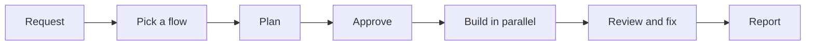

import { CardGrid, LinkCard } from "@astrojs/starlight/components";

<CardGrid>
  <LinkCard title="Use it in 2 minutes" href="/superlite/start/quickstart/" />
  <LinkCard title="Pick a flow" href="/superlite/flows/choose/" />
  <LinkCard title="How a run works" href="/superlite/run/orchestrators/" />
  <LinkCard title="Install" href="/superlite/start/install/" />
</CardGrid>
