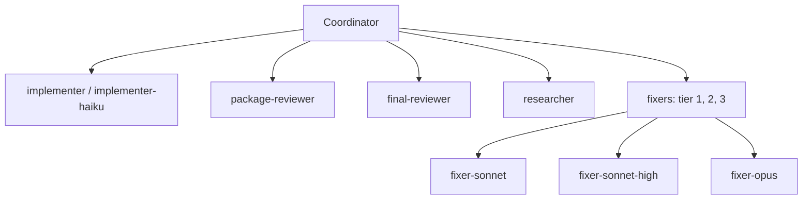

| Agent | Model | Effort | Tools | Job |
|---|---|---|---|---|
| `implementer` | sonnet | medium | Read, Edit, Write, Bash, Grep, Glob | Builds one plan task, then stays idle for reuse. |
| `implementer-haiku` | haiku | high | Read, Edit, Write, Bash, Grep, Glob | Builds one `Kind: mechanical` task as written; stops rather than guesses. |
| `package-reviewer` | sonnet | medium | Read, Edit, Write, Bash, Grep, Glob | Reviews a checkpointed task or package, then fixes its own findings with regression tests. |
| `final-reviewer` | opus | high | Read, Grep, Glob | Reads only the review packet; returns a verdict and tiered findings; never fixes. |
| `researcher` | sonnet | medium | Read, Write, Grep, Glob, Bash, WebSearch, WebFetch | Gathers evidence for one sub-question into the ledger; never writes the report. |
| `fixer-sonnet` | sonnet | medium | Read, Edit, Write, Bash, Grep, Glob | Tier 1: known cause, one module. |
| `fixer-sonnet-high` | sonnet | high | Read, Edit, Write, Bash, Grep, Glob | Tier 2: known cause across modules or a seam, or a known probe class. |
| `fixer-opus` | opus | high | Read, Edit, Write, Bash, Grep, Glob | Tier 3: unknown cause, or a lower tier failed twice. |

No agent has the `Agent` tool, so no agent spawns agents. Where a harness has no plugin agents, each runs as the harness's generic subagent with `agents/<name>.md` as its instructions.
