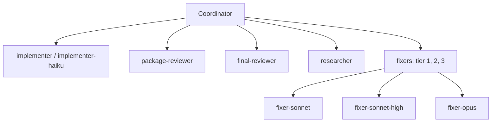

import { Steps } from "@astrojs/starlight/components";

:::tip[TL;DR]
Eight agents do the work and the coordinator only directs them. Builders and fixers get a model that matches the task: haiku for mechanical work, sonnet for most code, opus for the hard calls.
:::



| Agent | Model | Effort | Tools | Job |
|---|---|---|---|---|
| `implementer` | sonnet | medium | Read, Edit, Write, Bash, Grep, Glob | Builds one plan task, then stays idle for reuse. |
| `implementer-haiku` | haiku | high | Read, Edit, Write, Bash, Grep, Glob | Builds one `Kind: mechanical` task as written; stops rather than guesses. |
| `package-reviewer` | sonnet | medium | Read, Edit, Write, Bash, Grep, Glob | Reviews a checkpointed task or package, then fixes its own findings with regression tests. |
| `final-reviewer` | opus | high | Read, Grep, Glob | Reads only the review packet; returns a verdict and tiered findings; never fixes. |
| `researcher` | sonnet | medium | Read, Write, Grep, Glob, Bash, WebSearch, WebFetch | Gathers evidence for one sub-question into the ledger; never writes the report. |
| `fixer-sonnet` | sonnet | medium | Read, Edit, Write, Bash, Grep, Glob | Tier 1: known cause, one module. |
| `fixer-sonnet-high` | sonnet | high | Read, Edit, Write, Bash, Grep, Glob | Tier 2: known cause across modules or a seam, or a known probe class. |
| `fixer-opus` | opus | high | Read, Edit, Write, Bash, Grep, Glob | Tier 3: unknown cause, or a lower tier failed twice. |

No agent has the `Agent` tool, so no agent spawns agents. Where a harness has no plugin agents, each runs as the harness's generic subagent with `agents/<name>.md` as its instructions.

## Example: a fix climbs the tiers

Say task T4 of a build fails its tests and a first fixer cannot clear it.

<Steps>

1. You see an agent named `fixer-sonnet` start on the failure.

   ```text frame="terminal" title="Claude Code · ~/shop" mark={2}
   T4 tests failed
   dispatch fixer-sonnet  finding F-T4-1  note .superlite/fixes/F-T4-1.md
   ```

   It is tier 1, for a known cause confined to one module.

   The coordinator gives a fixer a finding id, here `F-T4-1`, and a note path, `.superlite/fixes/F-T4-1.md`. The note is the fixer's only memory, because each fixer starts fresh.

2. The tests still fail. The coordinator moves to `fixer-sonnet-high`, tier 2, which handles a cause that spans modules or a seam. It fails twice.

   Each failed attempt is written into the note under "Tried and failed", so the next agent does not repeat it.

3. The cause is still unknown, so the coordinator sends `fixer-opus`, tier 3. It reproduces the fault first, then fixes it and adds a regression test.

   It ends with `FIXED` or `NOT_FIXED` and a reason. A fixer fixes only the listed finding and never spawns another agent.

4. Say the coordinator tried to skip a tier on a task marked blocked. The `pre-tool` hook refuses:

   ```text frame="terminal" title="Claude Code · ~/shop" mark={1}
   Blocked: BLOCKED task needs fixer tier opus. Launch the fixer one tier up, not tier T4 need=opus got=sonnet.
   ```

   The tier rule is enforced by the hook, not left to the coordinator's judgement.

</Steps>

**What you end up with:** T4 fixed by the cheapest tier that could do it, with a regression test and a note that records what each attempt learned. The full loop is in [Reviews and fixes](/superlite/run/reviews-and-fixes/).
