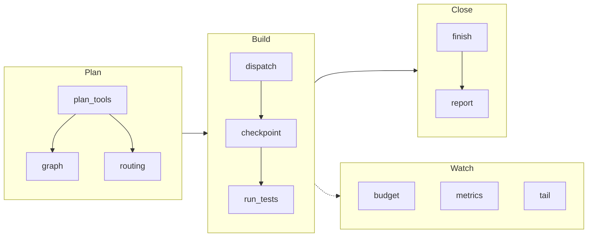
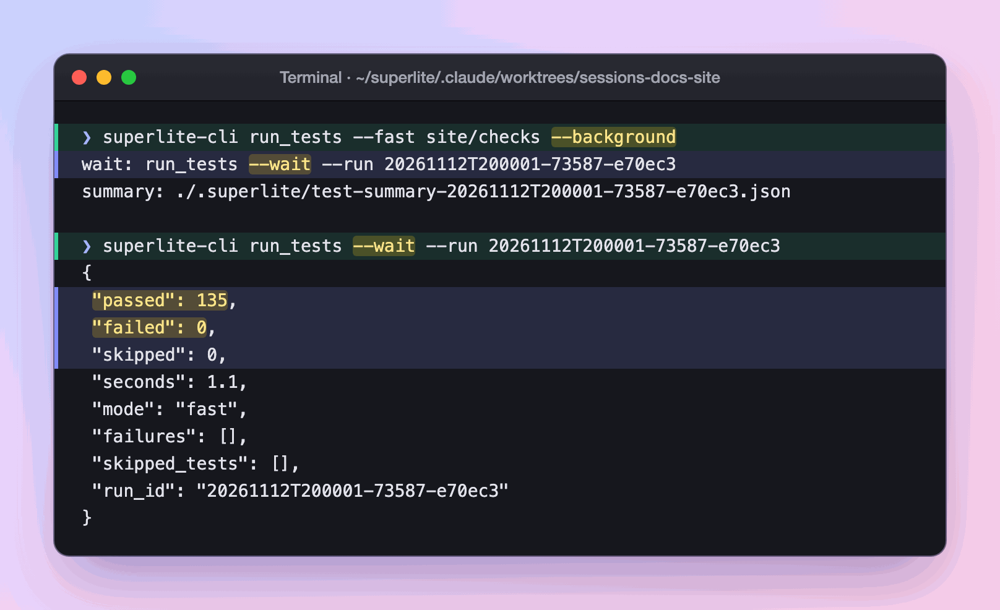

import { Steps } from "@astrojs/starlight/components";

:::tip[TL;DR]
Every tool is one command through one launcher: `superlite-cli <tool>`. The coordinator calls them for you, and you can call them to look at plans, sessions, tests, cost and reports.
:::



The groups are a guide to the order of use. Every tool below works on its own.

## The tools

Run any tool as `bash skills/swarm/scripts/superlite-cli <tool> ...`.


| Tool | What it does |
|---|---|
| `plan_tools` | Plan lint, task graph, stubs, schedule, and the `adapter`, `packet`, `contract` review subcommands. |
| `graph` | Draws the plan's task graph as a mermaid flowchart. |
| `wave0` | Builds the skeleton brief for `implementer-haiku` from the plan. |
| `routing` | Maps each task's features to a tier using `routing.json`. |
| `predict` | Predicts time, context and cost per task; `--refit` fits coefficients. |
| `build_prime` | Builds the shared prime every agent reads first. |
| `task` | Prints task Tn plus the Produces lines of the tasks it consumes. |
| `dispatch` | `ready` tasks, `assign --task Tn`, or both; batches by tier. |
| `host_models` | Resolves a host profile once per run into `.superlite/host-models.json`. |
| `next_tasks` | Computes which tasks are ready. |
| `checkpoint` | Checks scope, then records tasks' owned files as hidden checkpoints. |
| `cost` | `line` for live spend, `table` for per-agent cost. |
| `agent_specs` | `on`, `off`, `status` for opt-in specs; `open` and `prefer` toggles. |
| `run_tests` | Runs the project's tests: `--background`, `--wait`, `--fast`, `--affected`, `--full --reuse`. |
| `testprobe` | The hung-test probe `run_tests` uses. |
| `testcmd` | Resolves the project's test command. |
| `pt_review` | `adapter`, `packet` and `contract` review steps. |
| `probe_run` | Parallel robustness probes with no agents (Python projects only). |
| `incident` | Records and queries the shared incident log. |
| `budget` | One line of elapsed time and cost against target and cap. |
| `metrics` | Per-task time, tokens and cost. |
| `history` | Run history: `write`, `read`, `derive`, `import`. |
| `graphify_gate` | Gates Graphify for search in non-trivial codebases. |
| `orchestrator` | `set human\|ai`, `approve --review <plan>`, `status`. |
| `report` | The end-of-build report, projected against actual. |
| `run_widget` | The before and after run cards as HTML fragments. |
| `suggest_flow` | `--text "<request>"`: one line naming the suggested flow. |
| `research` | Research ledger: `init`, `source`, `claim`, `contradiction`, `lint`, `render`, `list`. |
| `proto` | Feature prototype: `start`, `tryout`, `status`, `discard`. |
| `session` | `ensure`, `close`, `untracked`, `create`, `use`, `split`, `discard`, `status`, `sync`. |
| `mvp_check` | MVP mode: `build`, `stamp` and `check` the prototype page and feedback. |
| `finish` | Collects the finish summary; with `--plan` also writes the after card. |
| `tail` | Live feed of agent starts and finishes and ledger lines. |

The folder `skills/swarm/scripts/` also holds helper modules (session, compact and plan parts) that tools import. They are not called directly.

A checkpoint is a hidden save of one task under `refs/superlite/*`. superlite never commits during a run.

## Example: using the tools by hand

Say you want to know which flow fits a bug report, then run one test file without freezing your terminal.

<Steps>

1. You ask for the suggested flow:

   ```text frame="terminal" title="Terminal · ~/shop" ins={1} mark={2}
   $ bash skills/swarm/scripts/superlite-cli suggest_flow --text "fix the login bug"
   suggest: debug - existing code, the request reports a fault ("bug") | also fits: feature, regular
   ```

   The tool is deterministic: the same request in the same project gives the same line. It reads your folder and your words, with no model call.

2. You start a focused test run in the background:

   ```text frame="terminal" title="Terminal · ~/shop" ins={1} mark={2}
   $ bash skills/swarm/scripts/superlite-cli run_tests --fast tests/test_login.py --background
   wait: run_tests --wait --run <id>
   summary: .superlite/test-summary.json
   ```

   The call returns at once and prints the id of the run. Tests run in a separate process so nothing blocks the session.

   

   *Real output: a full start, wait and result cycle, run on the files that check this site.*

3. You wait for the run with the line it printed, filling in the id:

   ```text frame="terminal" title="Terminal · ~/shop" ins={1}
   $ bash skills/swarm/scripts/superlite-cli run_tests --wait --run <id>
   ```

   The call blocks until the run ends. If the tests stop producing output, it returns early with a `SUSPECT HANG` report, so a hung run never looks like a slow one.

4. **You decide:** read `.superlite/test-summary.json` for the result, or ask for the broader run with `--full`.

</Steps>

**What you end up with:** a flow suggestion and a test result, each from one script. Every skill and agent uses these same tools, so what you ran by hand is what a build runs.
