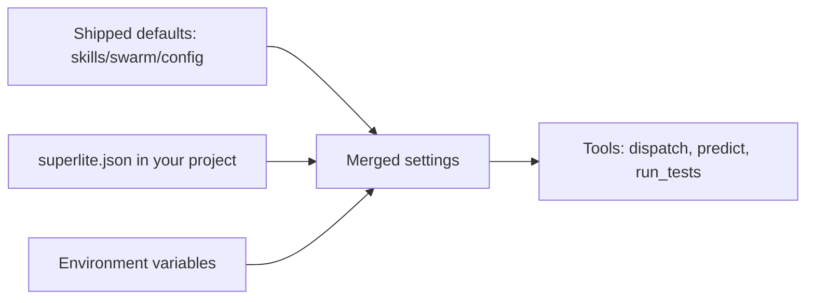

:::tip[TL;DR]
The shipped defaults live in `skills/swarm/config/`. To change them for one project, commit a small `superlite.json` at its root. A missing file changes nothing.
:::



Environment variables and an explicit command flag win over the overlay, and the overlay wins over the shipped defaults.

## Shipped files

Config lives in `skills/swarm/config/`.

| File | Holds |
|---|---|
| `models.json` | Prices (USD per million tokens) and output speed per model. |
| `predictor.json` | Time and context coefficients for `predict`. |
| `gitignore.json` | Ignore entries per language; Wave 0 appends missing ones to `.gitignore`. |
| `testprobe.json` | Hung-test probe thresholds. |
| `routing.json` | Task features to tier (haiku or sonnet), tier limits, stats gate. |
| `hosts/cursor.json` | Per-IDE job to model-slug candidates. |
| `compact.json` | The compact command each host uses for the compact nudge. |

| Model | Input | Output | Cache read | Tokens per second |
|---|---|---|---|---|
| opus | 4.00 | 20.00 | 0.20 | 45 |
| sonnet | 2.00 | 10.00 | 0.10 | 80 |
| haiku | 0.10 | 0.50 | 0.01 | 150 |

Prices are USD per million tokens.

## Project overlay

A committed `superlite.json` at your project root overlays these defaults. A missing file changes nothing. `version` must be `1`.

| Key | Effect |
|---|---|
| `cap` | Dispatch cap, default 10, which an explicit `--cap` overrides. |
| `gitignore` | Lines appended after the shipped list. |
| `hosts` | Replaces a job's candidate list. |
| `testprobe` | Threshold overrides. |
| `models` | Numeric prices on existing model names. |
| `compact_tokens` | Context size that triggers the compact nudge, default 150000. |

Unknown keys exit 2 and name the file. The file does not replace `routing.json`, and a critical-path task never gets haiku.

## Environment

| Variable | Effect |
|---|---|
| `SUPERLITE_TESTPROBE=0` | Turns the hang probe off. |
| `SUPERLITE_TESTPROBE_CONFIG=<path>` | Uses another probe config. |
| `SUPERLITE_PYTHON` | Skips the interpreter probe. |
| `SUPERLITE_COMPACT_TOKENS=<n>` | Sets the compact nudge size, ahead of `compact_tokens`. |
| `SUPERLITE_NO_AUTOCOMPACT=1` | Silences the compact nudge. |
| `SUPERLITE_NO_COST_REPORT=1` | Silences the cost line. |

## Example

A project that wants a lower dispatch cap and an extra ignore line commits this file.

```json
{
  "version": 1,
  "cap": 6,
  "gitignore": ["*.sqlite"]
}
```

Now `dispatch` runs at most 6 at a time unless you pass `--cap`, and Wave 0 adds `*.sqlite` to `.gitignore` after the shipped list. A typo such as `"cappp": 6` exits 2 and names `superlite.json`, so a bad key never passes silently.
