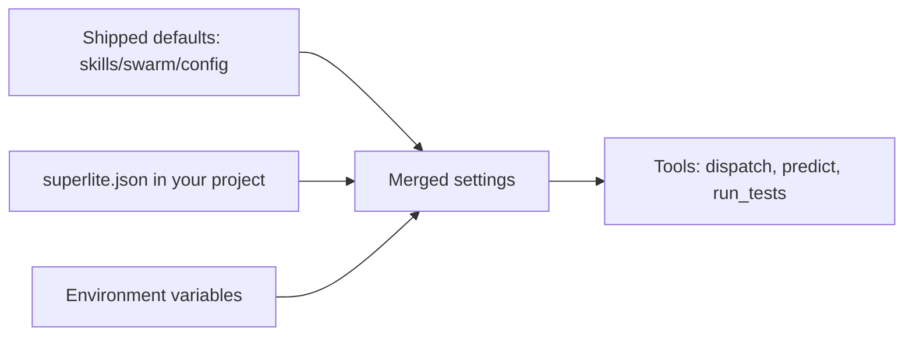
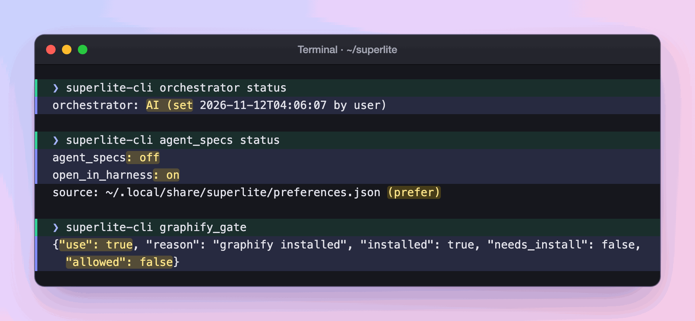

import { Steps, FileTree } from "@astrojs/starlight/components";

:::tip[TL;DR]
The shipped defaults live in `skills/swarm/config/`. To change them for one project, commit a small `superlite.json` at its root. A missing file changes nothing.
:::



Environment variables and an explicit command flag win over the overlay, and the overlay wins over the shipped defaults.

## Shipped files

Config lives in `skills/swarm/config/`.

| File | Holds |
|---|---|
| `models.json` | Prices (USD per million tokens) and output speed per model. |
| `predictor.json` | Time and context coefficients for `predict`. |
| `gitignore.json` | Ignore entries per language; Wave 0 appends missing ones to `.gitignore`. |
| `testprobe.json` | Hung-test probe thresholds. |
| `routing.json` | Task features to tier (haiku or sonnet), tier limits, stats gate. |
| `hosts/cursor.json` | Per-IDE job to model-slug candidates. |
| `compact.json` | The compact command each host uses for the compact nudge. |

| Model | Input | Output | Cache read | Tokens per second |
|---|---|---|---|---|
| opus | 4.00 | 20.00 | 0.20 | 45 |
| sonnet | 2.00 | 10.00 | 0.10 | 80 |
| haiku | 0.10 | 0.50 | 0.01 | 150 |

Prices are USD per million tokens.

## Project overlay

A committed `superlite.json` at your project root overlays these defaults. A missing file changes nothing. `version` must be `1`.

| Key | Effect |
|---|---|
| `cap` | Dispatch cap, default 10, which an explicit `--cap` overrides. |
| `gitignore` | Lines appended after the shipped list. |
| `hosts` | Replaces a job's candidate list. |
| `testprobe` | Threshold overrides. |
| `models` | Numeric prices on existing model names. |
| `compact_tokens` | Context size that triggers the compact nudge, default 150000. |

Unknown keys exit 2 and name the file. The file does not replace `routing.json`, and a critical-path task never gets haiku.

## Environment

| Variable | Effect |
|---|---|
| `SUPERLITE_TESTPROBE=0` | Turns the hang probe off. |
| `SUPERLITE_TESTPROBE_CONFIG=<path>` | Uses another probe config. |
| `SUPERLITE_PYTHON` | Skips the interpreter probe. |
| `SUPERLITE_COMPACT_TOKENS=<n>` | Sets the compact nudge size, ahead of `compact_tokens`. |
| `SUPERLITE_NO_AUTOCOMPACT=1` | Silences the compact nudge. |
| `SUPERLITE_NO_COST_REPORT=1` | Silences the cost line. |

## Example: lowering the cap for one project

Say your laptop struggles when many agents run at once, and your project writes `.sqlite` files you never want committed.

<Steps>

1. You create `superlite.json` at the root of the project:

   ```json title="superlite.json" ins={3-4}
   {
     "version": 1,
     "cap": 6,
     "gitignore": ["*.sqlite"]
   }
   ```

   `version` must be `1`. Commit the file, and everyone who builds in this project gets the same settings.

2. You start a build as usual. Before the first task goes out, superlite merges three layers: the shipped files in `skills/swarm/config/`, then your `superlite.json`, then environment variables and command flags.

   The overlay is small on purpose. You write only what differs, and a missing file changes nothing.

3. The build's first step, Wave 0, appends `*.sqlite` to `.gitignore` after the shipped list for your language. Then `dispatch` runs with a cap of 6 instead of 10. It sends a ready task out only while fewer than 6 are running.

   <FileTree>

   - your-project/
     - superlite.json  the overlay you committed
     - .gitignore  now ends with `*.sqlite`

   </FileTree>

4. **You decide:** on a day you want more speed, pass `--cap 10` to one dispatch call. A flag beats the overlay for that call and leaves the file alone.

   ```text frame="terminal" title="Terminal · ~/social" ins={1}
   $ bash skills/swarm/scripts/superlite-cli dispatch --cap 10
   ```

5. Say you mistype the key as `cappp`:

   ```json title="superlite.json" mark={3}
   {
     "version": 1,
     "cappp": 6
   }
   ```

   The next command exits with code 2 and names `superlite.json`, even when you pass `--cap`. superlite does not ignore the line and run with the wrong setting.

6. Some settings are not in the overlay. Three are kept per user, and each has a status command.

   

   *Real output: the orchestrator mode, the agent-specs preference and the graph-tool gate, read from the user's own settings.*

</Steps>

**What you end up with:** one committed file that changes the concurrency and the ignore list for this project only. The shipped defaults, `routing.json` and the rule that a critical-path task never gets haiku stay as they were.
