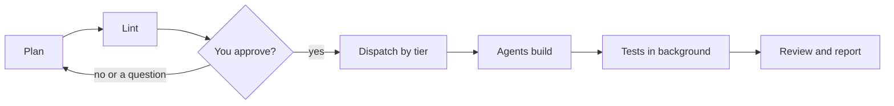

:::tip[TL;DR]
A gate is a rule a script or hook enforces, not one the model is asked to remember. The coordinator cannot write code, nothing starts before you approve, tests never hang the run, and spend stays under a cap.
:::



Along the whole line, the `pre-tool` hook blocks code edits by the coordinator and name-based kills, and the budget line watches cost.

## The gates

Instructions drift. Scripts and hooks do not.

| Gate | What it enforces | How |
|---|---|---|
| The coordinator cannot write code | Every change goes to a fix-only or implementer agent, by tier. | `pre-tool` hook |
| You approve before orchestration | In human mode nothing is linted, dispatched or sent to an agent until a typed reply approves the review plan. | `pre-tool`, `prompt`, `superlite-cli orchestrator` |
| No unsafe kills | No `pkill` or `taskkill /IM`; only PIDs the run started. | `pre-tool` hook |
| Tests never block the coordinator | Raw `pytest`, `npm test`, `go test` become a background `superlite-cli run_tests`. | `pre-tool` hook |
| No hidden waits on tests | A test run in `until`/`while` or sent to `/dev/null` is denied; use `run_tests --wait`. | `pre-tool` hook, hang probe |
| A plan must lint first | Stable tasks dispatch at once, others wait with a reason. | `lint --stable` |
| Same plan, same agents | Task features pick the tier from `routing.json`; Haiku only for mechanical tasks off the critical path. | `routing.py` |
| Agents stay in their tier | A task goes only to an idle agent of its own tier. | `dispatch` |
| Cost caps are enforced | Warns at 70% of the cap; over the cap it stops optional work. | `superlite-cli budget` |
| Every run is measured | Tokens, cost and time are captured and feed the next predictions. | capture hooks, `history.jsonl` |
| No agent spawns agents | Subagents get explicit tool lists with no `Agent`. | agent definitions |

Any clear approval counts: yes, go ahead, looks good, lgtm. A refusal, a question or a bare mention does not. The reply must be newer than the review plan.

## Example

In human mode the coordinator tries to dispatch before you have approved the plan.

```text
coordinator  superlite-cli dispatch ...
pre-tool     Human orchestrator: no build is orchestrated until the human approves
             the plan. Write the review plan docs/plans/<date>-<topic>.review.md
             (see skills/drafting/review-plan.md), show its path with a five-line
             summary, ask the human to reply approve, end your turn, then run
             superlite-cli orchestrator approve --review <path>. ...
you          looks good
coordinator  superlite-cli orchestrator approve --review docs/plans/2026-11-12-csv-export.review.md
```

The `prompt` hook records your reply, and the approve call checks that it is newer than the review plan. See [Plan and approval](/superlite/run/plan-and-approval/) for the full flow.
