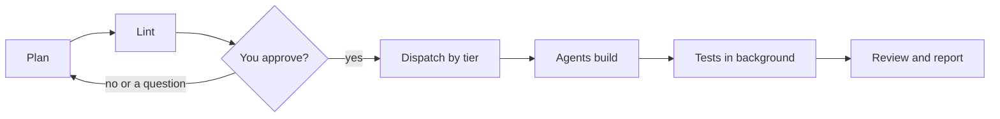

import { Steps } from "@astrojs/starlight/components";

:::tip[TL;DR]
A gate is a rule a script or hook enforces, not one the model is asked to remember. The coordinator cannot write code, nothing starts before you approve, tests never hang the run, and spend stays under a cap.
:::



Along the whole line, the `pre-tool` hook blocks code edits by the coordinator and name-based kills, and the budget line watches cost.

## The gates

Instructions drift. Scripts and hooks do not.

| Gate | What it enforces | How |
|---|---|---|
| The coordinator cannot write code | Every change goes to a fix-only or implementer agent, by tier. | `pre-tool` hook |
| You approve before orchestration | In human mode nothing is linted, dispatched or sent to an agent until a typed reply approves the review plan. | `pre-tool`, `prompt`, `superlite-cli orchestrator` |
| No unsafe kills | No `pkill` or `taskkill /IM`; only PIDs the run started. | `pre-tool` hook |
| Tests never block the coordinator | Raw `pytest`, `npm test`, `go test` become a background `superlite-cli run_tests`. | `pre-tool` hook |
| No hidden waits on tests | A test run in `until`/`while` or sent to `/dev/null` is denied; use `run_tests --wait`. | `pre-tool` hook, hang probe |
| A plan must lint first | Stable tasks dispatch at once, others wait with a reason. | `lint --stable` |
| Same plan, same agents | Task features pick the tier from `routing.json`; Haiku only for mechanical tasks off the critical path. | `routing.py` |
| Agents stay in their tier | A task goes only to an idle agent of its own tier. | `dispatch` |
| Cost caps are enforced | Warns at 70% of the cap; over the cap it stops optional work. | `superlite-cli budget` |
| Every run is measured | Tokens, cost and time are captured and feed the next predictions. | capture hooks, `history.jsonl` |
| No agent spawns agents | Subagents get explicit tool lists with no `Agent`. | agent definitions |

Any clear approval counts: yes, go ahead, looks good, lgtm. A refusal, a question or a bare mention does not. The reply must be newer than the review plan.

## Example: the approval gate stops an early build

Say you work in human mode and ask for CSV export on the reports page.

<Steps>

1. You type the request in Claude Code:

   ```text frame="terminal" title="Claude Code · ~/shop" ins={1}
   Add CSV export to the reports page
   ```

   superlite explores the code, then the coordinator writes a review plan, the short document you read before anything is built.

2. Say the coordinator moves too fast and calls `superlite-cli dispatch` before you have answered. You see the call refused:

   ```text frame="terminal" title="Claude Code · ~/shop" mark={2}
   $ superlite-cli dispatch ...
   Human orchestrator: no build is orchestrated until the human approves the plan.
   Write the review plan docs/plans/<date>-<topic>.review.md ...
   ```

   The `pre-tool` hook blocks it. In human mode nothing is linted, dispatched or sent to an agent until your approval is on record. This gate exists so that you, not the model, decide when spending starts.

3. The coordinator ends its turn and shows the path to the plan, a five-line summary and a closing line.

   ```text frame="terminal" title="Claude Code · ~/shop" mark={2}
   docs/plans/2026-11-12-csv-export.review.md
   Reply approve to start, or tell me what to change
   ```

   **You decide:** read the plan. Reply "looks good" to approve, or say what to change and the plan is revised. A refusal, a question or a bare mention of the word does not count as approval.

4. You reply:

   ```text frame="terminal" title="Claude Code · ~/shop" ins={1}
   looks good
   ```

   The `prompt` hook records your reply in `.superlite/human-replies.jsonl`, and the coordinator runs `superlite-cli orchestrator approve --review docs/plans/2026-11-12-csv-export.review.md`.

   The approve call checks that your reply is newer than the review plan. The coordinator cannot write that file itself, because the same hook protects it. A stale or missing reply makes the call exit with BLOCKED.

5. The build starts. `lint --stable` sorts the tasks: stable ones go out at once, the others wait with a reason. Test runs go to the background. A budget line reports cost against the cap and warns at 70%.

   These later gates need nothing from you. They turn up only when something goes wrong, for example when a test run hangs or spending passes the cap.

</Steps>

**What you end up with:** a build that started only because you said yes, on a plan you read. The reply that unlocked it is stored beside the plan. See [Plan and approval](/superlite/run/plan-and-approval/) for the full flow.
