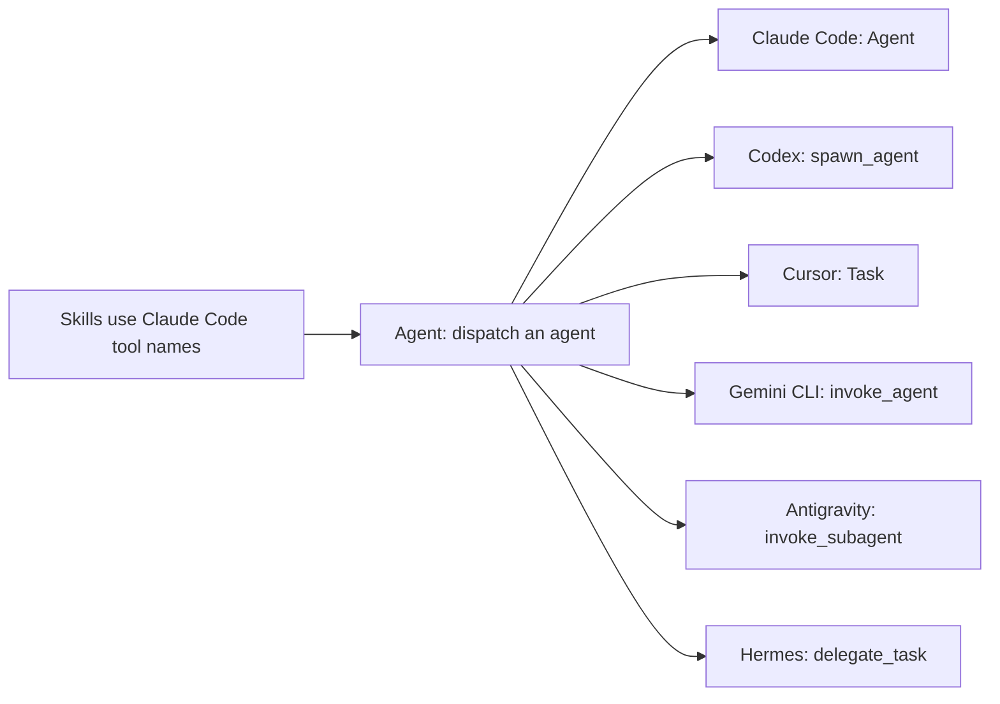

:::tip[TL;DR]
superlite installs as a plugin in 15 harnesses. Install it once per harness you use, then open a fresh session and send a build request to check it works.
:::



Skills are written in Claude Code's vocabulary. Each other harness gets a mapping file in `skills/using-superlite/references/` that says which native tool does the same job. Claude Code needs no mapping. The diagram shows one job, dispatching an agent, and six of the harnesses.

## Install commands

| Harness | Install |
|---|---|
| Claude Code | `/plugin marketplace add iha2/superlite` then `/plugin install superlite@superlite-dev` |
| Antigravity | `agy plugin install https://github.com/iha2/superlite` |
| Codex App | `codex plugin marketplace add iha2/superlite`, then add from the Plugins sidebar (unverified) |
| Codex CLI | `codex plugin marketplace add iha2/superlite`, then `/plugins` (unverified) |
| Cursor | `/add-plugin superlite` in Agent chat |
| Devin CLI | `devin plugins install iha2/superlite` |
| Factory Droid | `droid plugin marketplace add https://github.com/iha2/superlite`, then `droid plugin install superlite@superlite-dev` |
| Gemini CLI | `gemini extensions install https://github.com/iha2/superlite` |
| GitHub Copilot CLI | `copilot plugin marketplace add iha2/superlite`, then `copilot plugin install superlite@superlite-dev` |
| Grok Build CLI | `grok plugin marketplace add iha2/superlite`, then `grok plugin install superlite@superlite-dev --trust` (unverified) |
| Kimi Code | `/plugins install https://github.com/iha2/superlite`, then `/new` |
| OpenCode | Tell OpenCode to follow `.opencode/INSTALL.md` from the repository |
| Pi | `pi install git:github.com/iha2/superlite` |
| Qwen Code | `qwen extensions install iha2/superlite` |
| Hermes Agent | `hermes plugins install iha2/superlite --enable` |

Claude Code can also load a checkout for one session: `claude --plugin-dir <path-to-superlite>`.

To verify, open a fresh session and send `Let's make a react todo list`. A working install starts `inventing` before any code. Install separately for each harness you use.

## Example

You use Claude Code and Gemini CLI. You install in each.

```text
claude  /plugin marketplace add iha2/superlite
claude  /plugin install superlite@superlite-dev
gemini  gemini extensions install https://github.com/iha2/superlite
you     Let's make a react todo list
```

In a fresh session of either tool, that last request should start `inventing` before any code is written. If code appears first, the install did not load in that harness.
