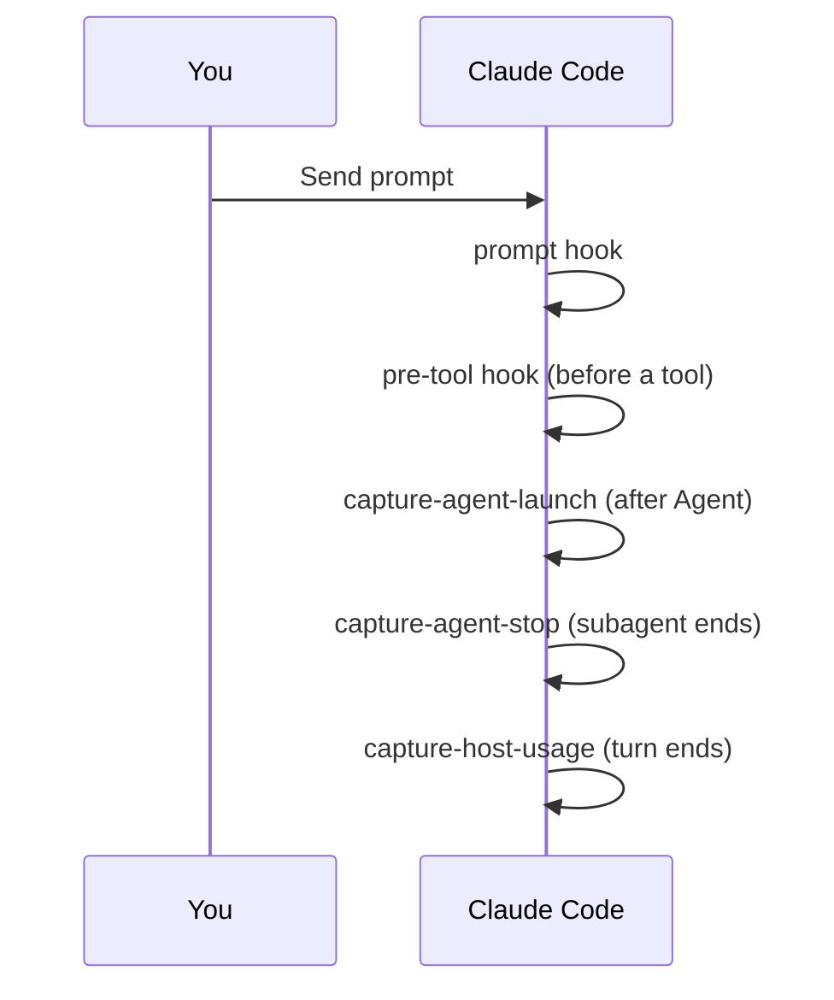

| Hook | Event | Matcher | Job |
|---|---|---|---|
| `session-start` | SessionStart | `startup\|clear\|compact` | Injects `using-superlite`; shows the intro once per installed version. |
| `pre-tool` | PreToolUse | `Edit\|Write\|NotebookEdit\|Bash\|PowerShell\|Monitor\|Agent` | Runs the kill, edit and test guards in order. |
| `prompt` | UserPromptSubmit | none | Records your replies, adds the compact nudge and the cost line. |
| `capture-agent-launch` | PostToolUse | `Agent` | Appends a `launch` record to `.superlite/metrics.jsonl`. |
| `capture-agent-stop` | SubagentStop | none | Appends a `stop` record; time is the gap between the two records. |
| `capture-host-usage` | Stop | none | Appends a `host_usage` record when the host reports usage. |

The guards inside `pre-tool`:

| Guard | Rule |
|---|---|
| Kill guard | Blocks `taskkill /IM`, `pkill`, `killall`, `Stop-Process -Name`. Kill by PID passes. |
| Edit guard | Applies to the coordinator only. It denies writes to `.superlite/orchestrator.json`, `.superlite/feature.json` and `.superlite/human-replies.jsonl`. During a run it allows only `docs/plans/**`, `SPEC*.md`, `docs/**/*.md` and `.superlite/**`. |
| Test guard | Rewrites raw test commands into a background `superlite-cli run_tests`. Denies a test run in an `until`/`while` loop or with output sent to `/dev/null`. |

Run hooks are active only while a run marker exists in `.superlite/`. They fail open on bad input. Cursor uses `hooks/hooks-cursor.json` with its own event names.
