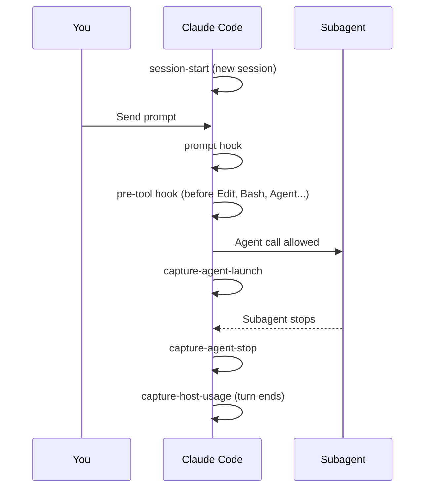

:::tip[TL;DR]
Hooks are small scripts your harness runs at fixed moments. superlite uses them to block unsafe actions before they happen and to record cost and timing after. They fail open on bad input, so a broken hook never stalls you.
:::



## The hooks

| Hook | Event | Matcher | Job |
|---|---|---|---|
| `session-start` | SessionStart | `startup\|clear\|compact` | Injects `using-superlite`; shows the intro once per installed version. |
| `pre-tool` | PreToolUse | `Edit\|Write\|NotebookEdit\|Bash\|PowerShell\|Monitor\|Agent` | Runs the kill, edit and test guards in order. |
| `prompt` | UserPromptSubmit | none | Records your replies, adds the compact nudge and the cost line. |
| `capture-agent-launch` | PostToolUse | `Agent` | Appends a `launch` record to `.superlite/metrics.jsonl`. |
| `capture-agent-stop` | SubagentStop | none | Appends a `stop` record; time is the gap between the two records. |
| `capture-host-usage` | Stop | none | Appends a `host_usage` record when the host reports usage. |

## The guards inside pre-tool

The first guard that denies wins. A test rewrite ends the run of the guards.

| Guard | Rule |
|---|---|
| Kill guard | Blocks `taskkill /IM`, `pkill`, `killall` and `Stop-Process -Name`, and lets kills by PID pass. |
| Edit guard | Stops the coordinator writing project code or the state files `.superlite/orchestrator.json`, `.superlite/feature.json` and `.superlite/human-replies.jsonl`. |
| Test guard | Rewrites raw test commands into a background `superlite-cli run_tests` and denies a test run in an `until`/`while` loop or with output sent to `/dev/null`. |

During a run the edit guard lets the coordinator write only `docs/plans/**`, `SPEC*.md`, `docs/**/*.md` and `.superlite/**`. Run hooks are active only while a run marker exists in `.superlite/`. Cursor uses `hooks/hooks-cursor.json` with its own event names.

## Example

During a run, the coordinator tries to stop a stuck dev server by name.

```text
coordinator  Bash: pkill node
pre-tool     Blocked: this command kills processes by name or pattern, which can
             stop other sessions' processes. Kill only the PIDs you started
             (kill <PID>, taskkill /PID <PID>, Stop-Process -Id <PID>). To find
             the PID, run pgrep -f <pattern>, check it is yours, then kill <PID>.
```

The command never runs. The coordinator reads the message, finds its own PID and kills that instead, which the guard allows.
