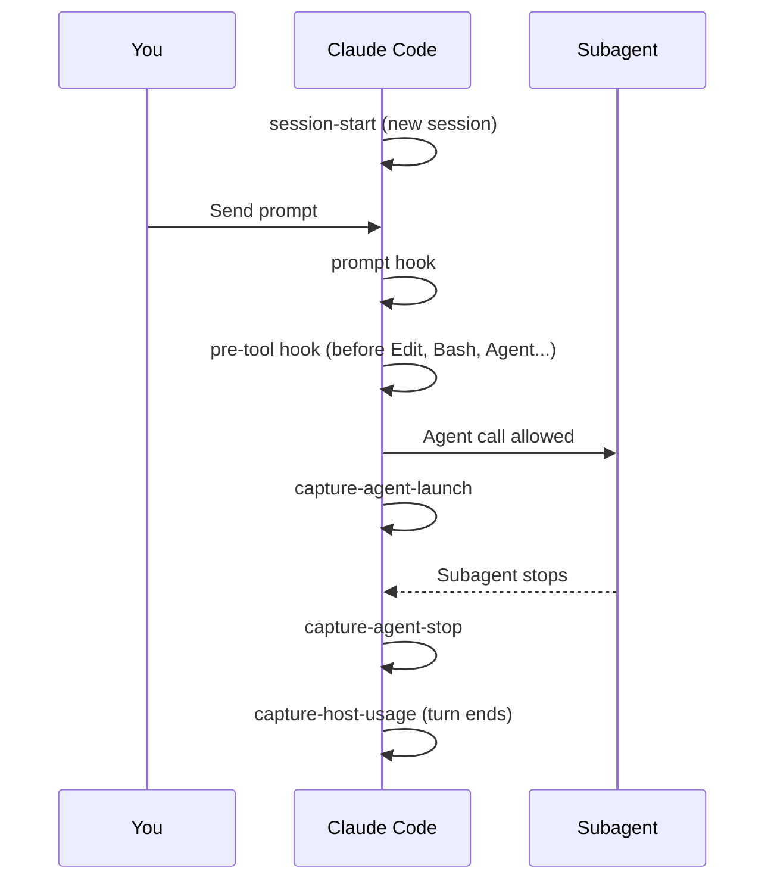

import { Steps, FileTree } from "@astrojs/starlight/components";

:::tip[TL;DR]
Hooks are small scripts your harness runs at fixed moments. superlite uses them to block unsafe actions before they happen and to record cost and timing after. They fail open on bad input, so a broken hook never stalls you.
:::



## The hooks

| Hook | Event | Matcher | Job |
|---|---|---|---|
| `session-start` | SessionStart | `startup\|clear\|compact` | Injects `using-superlite`; shows the intro once per installed version. |
| `pre-tool` | PreToolUse | `Edit\|Write\|NotebookEdit\|Bash\|PowerShell\|Monitor\|Agent` | Runs the kill, edit and test guards in order. |
| `prompt` | UserPromptSubmit | none | Records your replies, adds the compact nudge and the cost line. |
| `capture-agent-launch` | PostToolUse | `Agent` | Appends a `launch` record to `.superlite/metrics.jsonl`. |
| `capture-agent-stop` | SubagentStop | none | Appends a `stop` record; time is the gap between the two records. |
| `capture-host-usage` | Stop | none | Appends a `host_usage` record when the host reports usage. |

## The guards inside pre-tool

The first guard that denies wins. A test rewrite ends the run of the guards.

| Guard | Rule |
|---|---|
| Kill guard | Blocks `taskkill /IM`, `pkill`, `killall` and `Stop-Process -Name`, and lets kills by PID pass. |
| Edit guard | Stops the coordinator writing project code or the state files `.superlite/orchestrator.json`, `.superlite/feature.json` and `.superlite/human-replies.jsonl`. |
| Test guard | Rewrites raw test commands into a background `superlite-cli run_tests` and denies a test run in an `until`/`while` loop or with output sent to `/dev/null`. |

During a run the edit guard lets the coordinator write only `docs/plans/**`, `SPEC*.md`, `docs/**/*.md` and `.superlite/**`. Run hooks are active only while a run marker exists in `.superlite/`. Cursor uses `hooks/hooks-cursor.json` with its own event names.

## Example: a hook stops the coordinator from fixing code itself

Say you approved a plan for CSV export and the build is running. A test in `tests/test_export.py` fails. Hooks are live now, because the run has written its marker files in `.superlite/`.

<Steps>

1. The coordinator, the main Claude Code session, tries to patch `src/reports/export.py` itself. You see the edit refused:

   ```text frame="terminal" title="Claude Code · ~/shop" mark={1}
   Blocked: the superlite coordinator must not write project code. Dispatch it instead:
   - Fix: give a fixer a finding id F-<Tn>-<n> and the note path .superlite/fixes/<id>.md ...
   - New code belongs to an implementer task. You may write only docs/plans/**, SPEC*.md, ...
   ```

   The `pre-tool` hook runs before every `Edit`, `Write` and `Bash` call. Its edit guard denies the call with exit code 2, so the file never changes. It exists because a coordinator that edits code skips the tiers, the checkpoints and the reviews. A script enforces this, since an instruction in a prompt can drift.

2. The coordinator reads the message and launches `fixer-sonnet` with a finding id and a note path. You see an agent start, not another block.

   The guard checks the coordinator only. The fixer is a subagent, so its edits pass. See [Reviews and fixes](/superlite/run/reviews-and-fixes/) for how fix tiers are chosen.

3. The coordinator runs `pytest tests/test_export.py` to check the fix. You see a note that the raw test run was rewritten:

   ```text frame="terminal" title="Claude Code · ~/shop" ins={1} mark={2}
   $ pytest tests/test_export.py
   raw test run rewritten to a superlite-cli run_tests --fast; its summary is in .superlite/test-summary.json
   ```

   This is the test guard. A test run in the foreground can hang the whole session, so the hook swaps it for a background run that the coordinator then waits on. If the run goes silent, the wait returns early with a `SUSPECT HANG` report instead of a frozen terminal.

4. The fixer finishes and stops. Nothing prompts you here.

   `capture-agent-launch` and `capture-agent-stop` appended a record each to `.superlite/metrics.jsonl`, and the gap is the agent's time. The final report reads these records for cost and speed.

   <FileTree>

   - .superlite/
     - incidents.jsonl  one line for the blocked edit, one for the rewritten test run
     - metrics.jsonl  launch and stop records per agent
     - test-summary.json  result of the background run

   </FileTree>

</Steps>

**What you end up with:** the fix landed through a fixer agent, the tests ran without hanging the session, and the two interventions sit in `.superlite/incidents.jsonl` if you want to check them. You approved nothing and typed nothing. If a hook gets malformed input it exits 0 and lets the call through, so a broken hook never stalls you.
