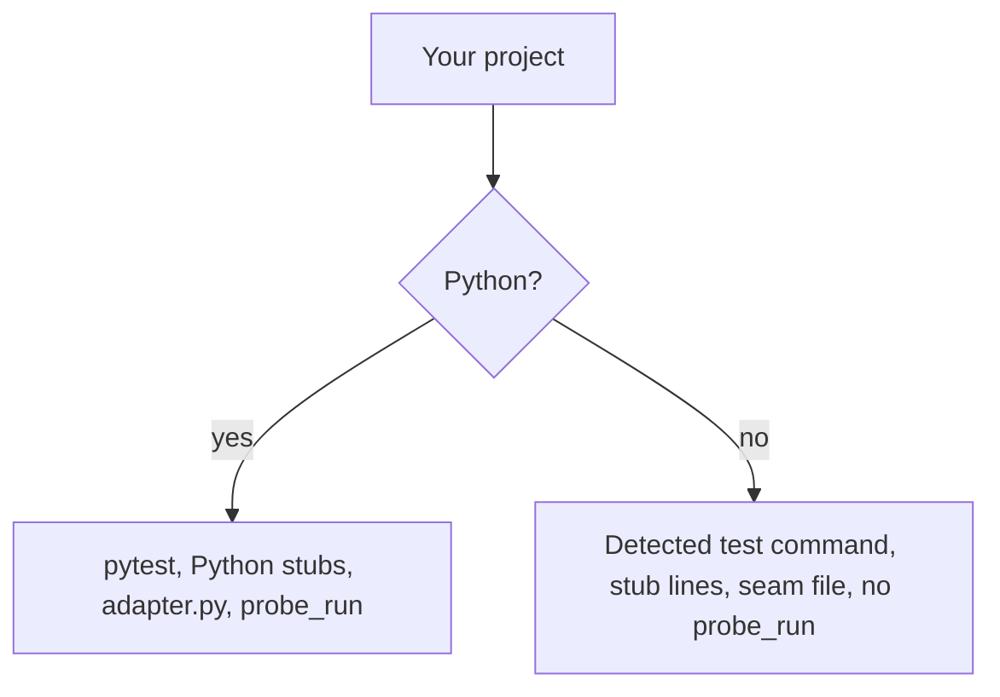

:::tip[TL;DR]
superlite itself runs on Python, but the project you build can use any language. Only the probe stage is Python-only; stubs and the review seam adapt to your language.
:::

## What changes by language

| Part | Python project | Other language |
|---|---|---|
| Test command | `.superlite/test-cmd.json`, else detection | Same; detection covers npm, go, cargo, dotnet |
| `probe_run` | Runs | Python only |
| `plan_tools stubs` | Writes Python stubs | One `stub:` line per Produces signature and a `contract:` line, no `.py` file |
| `plan_tools adapter` | Writes `.superlite/probes/adapter.py` | Writes `seam.ts`, `seam.js`, `seam.go`, `seam.rs`, `seam.cs`, `seam.java`, `seam.rb` or `seam.txt` |

superlite needs Python 3.12 or newer, git and bash (Git Bash on Windows). `uv` is optional.

## Example

You build a Go service. superlite finds `go.mod` and uses `go test ./...` as the test command, so you do not set one. For the Produces signatures in the plan, `plan_tools stubs` prints one `stub:` line each plus a `contract:` line and writes no `.py` file. `plan_tools adapter` writes `.superlite/probes/seam.go`, with `// superlite seam: go` as its first line. `probe_run` does not run, because it is Python only. To pin a different test command, write it to `.superlite/test-cmd.json`.
