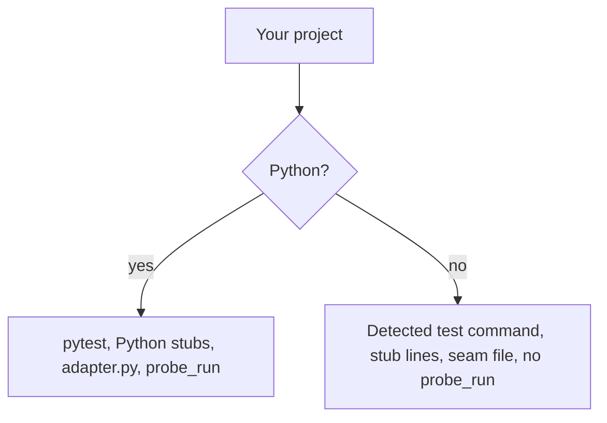

import { Steps, FileTree } from "@astrojs/starlight/components";

:::tip[TL;DR]
superlite itself runs on Python, but the project you build can use any language. Only the probe stage is Python-only; stubs and the review seam adapt to your language.
:::



## What changes by language

| Part | Python project | Other language |
|---|---|---|
| Test command | `.superlite/test-cmd.json`, else detection | Same; detection covers npm, go, cargo, dotnet |
| `probe_run` | Runs | Python only |
| `plan_tools stubs` | Writes Python stubs | One `stub:` line per Produces signature and a `contract:` line, no `.py` file |
| `plan_tools adapter` | Writes `.superlite/probes/adapter.py` | Writes `seam.ts`, `seam.js`, `seam.go`, `seam.rs`, `seam.cs`, `seam.java`, `seam.rb` or `seam.txt` |

superlite needs Python 3.12 or newer, git and bash (Git Bash on Windows). `uv` is optional.

## Example: a Go service

Say you build a Go service, so your project has a `go.mod` and no Python.

<Steps>

1. You ask for a feature as usual. superlite finds `go.mod` and takes `go test ./...` as the test command, so you set nothing.

   The detection covers npm, go, cargo and dotnet projects. Background test runs and the hang probe work the same in every language.

2. The plan lists what each task produces, as signatures. `plan_tools stubs` prints one `stub:` line for each, plus a `contract:` line, and writes no `.py` file.

   A Go project cannot use Python stubs, so the tasks get the signatures as text to build against.

3. For the review seam, `plan_tools adapter` writes a Go file:

   <FileTree>

   - .superlite/
     - probes/
       - seam.go  the review seam

   </FileTree>

   ```go title=".superlite/probes/seam.go" mark={1}
   // superlite seam: go
   ```

   The seam is where a reviewer checks that the tasks fit together. The Python version is `adapter.py`. Other languages get a seam file in their own extension.

4. `probe_run`, the parallel robustness probes, does not run, because it is Python only. Your reviews still run.

5. **You decide:** if `go test ./...` is not what you want, write another command to `.superlite/test-cmd.json` and superlite uses that instead.

   ```json title=".superlite/test-cmd.json" ins={3}
   {
     "language": "go",
     "test": "go test ./internal/..."
   }
   ```

   superlite reads this file before it tries detection.

</Steps>

**What you end up with:** a build that works in Go with the right test command, signature stubs and a review seam, and without the Python-only probes.
