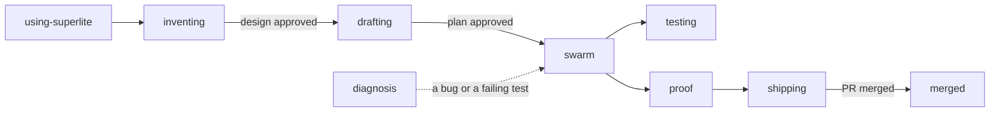

:::tip[TL;DR]
superlite ships 14 skills. Each one is a short instruction file that loads when its trigger fires, so the right rules apply at the right moment. You rarely call one by hand.
:::



The main line runs left to right. `diagnosis` is the side door for a bug. The other skills (`research`, `feature-prototype`, `mvp-prototype`, `upgrade-scan`, `writing-specs`) load only in their own flow or on request.

## The skills

| Skill | Applies when |
|---|---|
| `using-superlite` | Any conversation starts, when it is injected at session start to size your request. |
| `inventing` | You ask to build a feature or change behavior, before any code. |
| `drafting` | A design is approved and a multi-step plan is needed. |
| `swarm` | A plan has a `%% taskgraph`: scheduler, selective reviews, packet-only final review. |
| `testing` | Implementing a feature or bugfix, before implementation code. |
| `diagnosis` | A bug, test failure or unexpected behavior, before proposing fixes. |
| `feature-prototype` | Feature mode, after the plan is approved: cut the smallest runnable container of your app. |
| `mvp-prototype` | MVP mode, after the `.mvp.md` plan: build the one-file clickable prototype and read your feedback. |
| `research` | You want a topic researched with sources, at a chosen language level. |
| `proof` | About to claim work is complete, fixed or passing. |
| `shipping` | Implementation is done and tests pass; decide how to integrate. |
| `merged` | You say a pull request was merged: clean up its session, branch and local main. |
| `upgrade-scan` | After a superlite upgrade: review changes and suggest adoption steps. |
| `writing-specs` | Only when `agent_specs` is on or you ask for a spec: what done looks like and why. |

All skills live in `skills/<name>/SKILL.md`.

## Example

You ask for a new feature in an existing project.

```text
you        Add CSV export to the reports page
superlite  using-superlite sizes the request: a feature, not a one-line fix
superlite  inventing explores the code and agrees a design with you
superlite  drafting turns the design into a plan with a task graph
superlite  swarm builds it; testing comes first inside each task
superlite  proof runs the checks before it says "done"
```

Each line names the skill that is active at that step. If a test then fails, `diagnosis` takes over before anyone proposes a fix.
