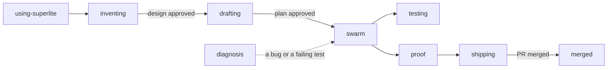
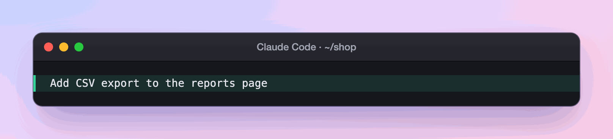

import { Steps } from "@astrojs/starlight/components";

:::tip[TL;DR]
superlite ships 14 skills. Each one is a short instruction file that loads when its trigger fires, so the right rules apply at the right moment. You rarely call one by hand.
:::

The main line runs left to right. `diagnosis` is the side door for a bug. The other skills (`research`, `feature-prototype`, `mvp-prototype`, `upgrade-scan`, `writing-specs`) load only in their own flow or on request.

## The skills

| Skill | Applies when |
|---|---|
| `using-superlite` | Any conversation starts, when it is injected at session start to size your request. |
| `inventing` | You ask to build a feature or change behavior, before any code. |
| `drafting` | A design is approved and a multi-step plan is needed. |
| `swarm` | A plan has a `%% taskgraph`: scheduler, selective reviews, packet-only final review. |
| `testing` | Implementing a feature or bugfix, before implementation code. |
| `diagnosis` | A bug, test failure or unexpected behavior, before proposing fixes. |
| `feature-prototype` | Feature mode, after the plan is approved: cut the smallest runnable container of your app. |
| `mvp-prototype` | MVP mode, after the `.mvp.md` plan: build the one-file clickable prototype and read your feedback. |
| `research` | You want a topic researched with sources, at a chosen language level. |
| `proof` | About to claim work is complete, fixed or passing. |
| `shipping` | Implementation is done and tests pass; decide how to integrate. |
| `merged` | You say a pull request was merged: clean up its session, branch and local main. |
| `upgrade-scan` | After a superlite upgrade: review changes and suggest adoption steps. |
| `writing-specs` | Only when `agent_specs` is on or you ask for a spec: what done looks like and why. |

All skills live in `skills/<name>/SKILL.md`.

## Example: which skill runs when you ask for a feature

Say you ask for CSV export in an existing project.

<Steps>

1. You type the request:

   

   `using-superlite` is already loaded, because the `session-start` hook injected it. It sizes the request as a feature, not a one-line fix, and picks the skill that fits.

2. `inventing` reads the code and asks you questions about the design.

   **You decide:** answer the questions and approve the design. The skill stops before any implementation code exists, so a wrong idea costs you a conversation instead of a rewrite.

3. `drafting` turns the design into a plan with a task graph, and `swarm` builds it. Inside each task, `testing` comes first: the test is written before the code it checks.

   `swarm` is the scheduler, with scripts for the mechanical steps. See [Parallel build](/superlite/run/parallel-build/).

4. Say a test fails during the build. `diagnosis` takes over and finds the cause before anyone proposes a fix, so the fix is aimed at the real fault.

5. `proof` runs the checks before superlite says "done", and `shipping` offers the ways to integrate the work.

</Steps>

**What you end up with:** a finished feature that was designed with you, tested as it was built, and checked before the claim. Each skill held back until its turn, which is why the order never changes.
