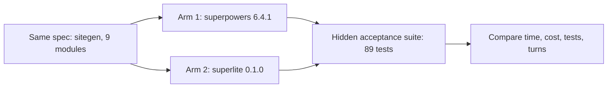

:::tip[TL;DR]
Both plugins built the same project from the same spec, and a hidden test suite scored the result. In the first run superlite finished in 8.8 minutes against 34.4 and cost $3.28 against $8.15, at the same score. It is one run per arm, so read the gaps as indications.
:::

## What was measured

Both plugins built `sitegen`, a stdlib Python site generator, from `bench/task/SPEC.md` (9 modules). Each ran headless on Opus. The hidden suite checks the spec only, and neither arm saw it. The run was on 2026-10-16 and corrected on 2026-10-17. The correction fixed a bug that summed every `result` event and inflated costs 3x and 9x.

| Metric | superpowers 6.4.1 | superlite 0.1.0 |
|---|---|---|
| Wall-clock | 34.4 min | 8.8 min (3.9x faster) |
| Cost (API-equivalent) | $8.15 | $3.28 (60% cheaper) |
| Opus / Sonnet / Haiku cost | $6.43 / $1.72 / none | $1.53 / $1.75 / $0.002 |
| Hidden acceptance tests | 89 / 89 | 89 / 89 |
| Own tests written | 298 | 208 |
| Stops-for-human | 0 | 0 |
| Coordinator turns | 68 | 46 |
| Context per request (median / max) | 108k / 154k | 70k / 90k |
| Subagent dispatches | 21, strictly serial | 10, up to 5 concurrent |
| Agent-busy wall time | 25.1 min | 4.8 min |

## How to read the numbers

Start with the hidden tests. Both arms passed 89 of 89, so the time and cost gaps do not come from a worse result. Wall-clock is the time you wait. Cost is API-equivalent, meaning what the tokens would cost at list price; on a subscription it appears as usage-limit use instead.

Then read the causes. Parallel waves drive the speed: the serial chain fell from 21 dispatches to 3 levels. Superpowers' review after every task took about 12 minutes. Planning took about one minute in both arms. Cost follows context size: superlite's Opus read 2.3M cached tokens against 8.7M, because it took fewer turns at a smaller context.

## A later, larger run

The README reports a second task, a site generator plus a spreadsheet engine (177 hidden tests). The 16.1 minute figure is one run of the current build.

| What we measured | superpowers | superlite |
|---|---|---|
| Wall-clock to a finished build | 33.6 min (stock, 3 runs: 21.2 / 31.9 / 47.6); 23.5 min (orchestrated, 3 runs) | 16.1 min |
| Fastest-to-slowest spread, 3 runs | 26.4 min | 9.1 min |
| Hidden tests passed | 177 / 177 | 177 / 177 |

## Good to know

- There is one run per arm in the first benchmark, so timings could move by 30%.
- The arms overlapped in time and shared rate limits.
- The hidden suite checks the spec only, so it does not measure review quality.
- On the later task, superlite can cost more than superpowers and scores lower on the extra robustness probes (4 of 7 against about 5.7 of 7).

## Example

You want to see whether a gap is real. Look at the row that matches your worry. If you worry about quality, check hidden tests and own tests written: same pass count, and superlite wrote fewer tests of its own. If you worry about cost, check the per-model split, where Opus spend fell from $6.43 to $1.53. If you worry about noise, the 3-run spread row shows how far one run can drift.

The harness is in `bench/`; the full write-up is `docs/benchmark-report.md` in the repository.
