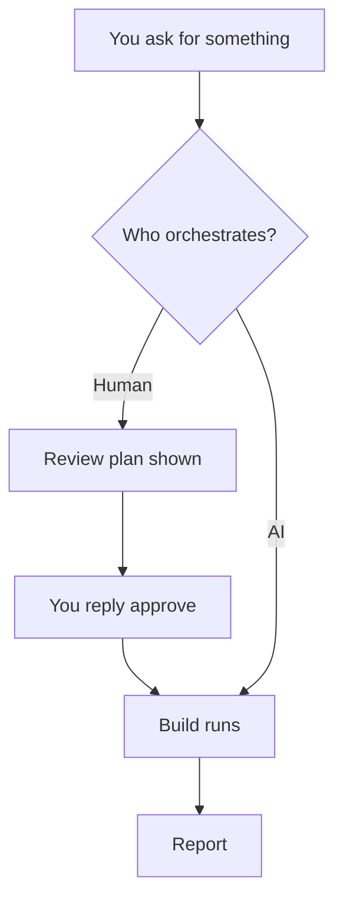

## What you do

Pick one of two choices when superlite asks, once:

- "Human orchestrator: I approve the plan before it runs".
- "AI orchestrator: hands off, it does everything".

Skip the question by saying so in your request, for example "decide yourself" or "I am away". A headless `claude -p` run defaults to AI.

## What superlite does

The orchestrator is whoever runs the plan, lints it and sends tasks to agents. The coordinator (Opus, medium effort) never writes project code or runs raw tests.

In human mode nothing is linted or dispatched until your approving reply. Hooks and scripts enforce this: `dispatch`, `wave0` and `build_prime` exit 4 with BLOCKED before it.

In AI mode superlite never stops to ask, except for destructive, outward-facing (push, merge, publish) or security-sensitive actions. It prints one line naming `/superlite:agents` at the first dispatch.

Small inline work needs only your yes in chat. It has no review plan.

## Example

Check which mode a run is in:

```bash
superlite-cli orchestrator status
```

It prints one line: `human, awaiting approval`, `human, approved <time> by <name>`, `AI`, or `not set (ungated)`.

Next: [plan and approval](/superlite/run/plan-and-approval/).
