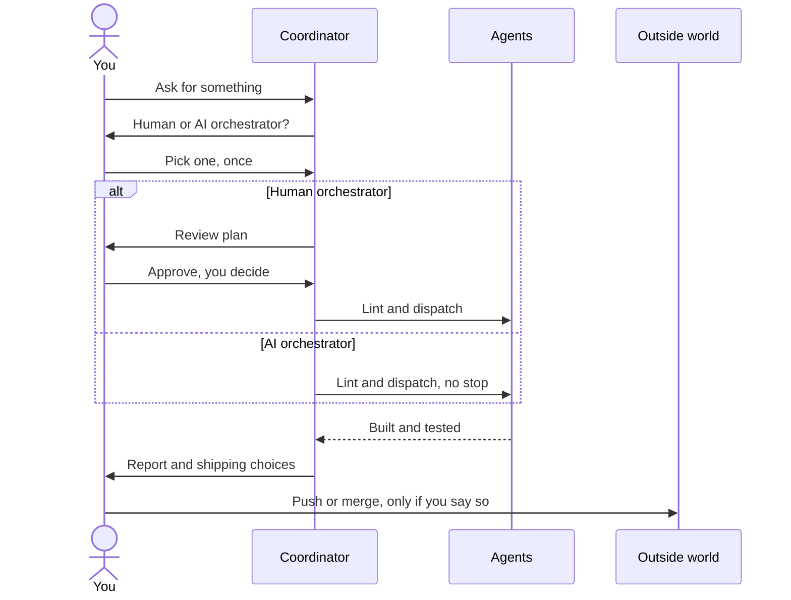

import { Tabs, TabItem, Aside } from "@astrojs/starlight/components";

:::tip[TL;DR]
The orchestrator is whoever decides when a build starts and settles questions on the way. Pick the human one to approve a plan first, or the AI one to hand everything off. Either way, superlite never pushes, merges or deletes on its own.
:::



## How it works

Think of a building site. Someone has to say "start" and sort out surprises. That person is the orchestrator. In superlite the coordinator (Opus, medium effort) does the planning and dispatching, and you choose how much of the deciding is yours. The coordinator never writes project code or runs raw tests. Agents and fixers do that.

<Tabs>
  <TabItem label="Human orchestrator">
    You read a review plan and approve it. Until you do, nothing is linted, dispatched or sent to an agent. Hooks and scripts enforce this: `dispatch`, `wave0` and `build_prime` exit with BLOCKED. After your yes, the run decides on its own and lists any scope change at the end, so you are asked once, not repeatedly.
  </TabItem>
  <TabItem label="AI orchestrator">
    superlite writes the machine plan, lints it, dispatches and rules on questions without stopping. It prints one line naming `/superlite:agents` at the first dispatch so you can watch, and asks nothing about views. Every choice it makes is recorded as a `Ruling:` and shown at the end.
  </TabItem>
</Tabs>

## Example

superlite asks once, as one choice, usually together with its other opening questions.

```text
you        /superlite:feature Add CSV export
superlite  Human orchestrator: I approve the plan before it runs
           AI orchestrator: hands off, it does everything
you        Human orchestrator
superlite  writes docs/plans/2026-11-12-csv-export.review.md and waits
```

It skips the question when your request already settles it: "decide yourself", "I am away", or a design and plan you pre-approved all mean AI. A headless `claude -p` run defaults to AI. You can switch later with `/superlite:human` or `/superlite:ai`, and check the state at any time:

```bash
superlite-cli orchestrator status
```

It prints one line: `human, awaiting approval`, `human, approved <time> by <name>`, `AI`, or `not set (ungated)`.

## Good to know

<Aside type="caution" title="AI mode still stops for these">
An AI orchestrator never ends its turn to wait, with three exceptions: a destructive or irreversible action, a security-sensitive action, and an outward-facing one such as push, merge or publish. For those it takes the safe path: it defers the action, records a ruling and lists what it deferred. You make the final call at shipping.
</Aside>

- Small inline work (trivial or bounded, no plan) is not orchestrated. It needs only your yes in chat and has no review plan.
- The gate is not a polite request. Hooks and scripts block the build commands until your reply is on record, as [gates](/superlite/reference/gates/) explains.

## Next

[Plan and approval](/superlite/run/plan-and-approval/) shows what you read and what your yes unlocks.
