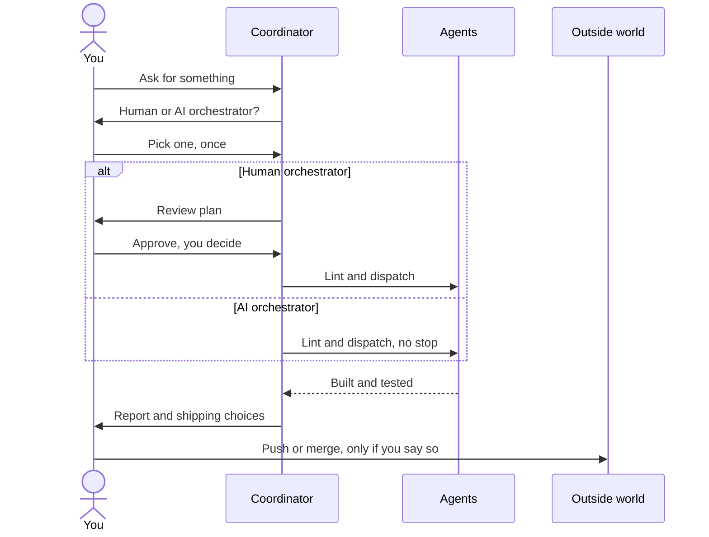
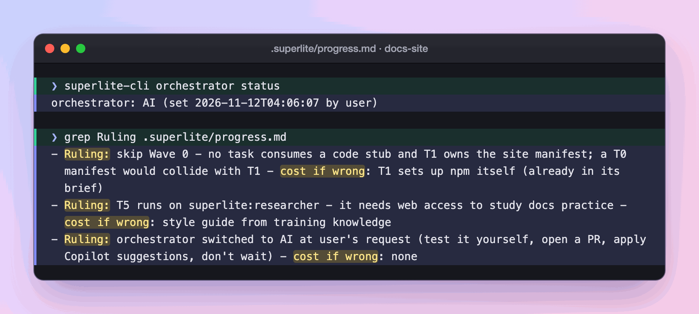

import { Tabs, TabItem, Aside, Steps } from "@astrojs/starlight/components";

:::tip[TL;DR]
The orchestrator is whoever decides when a build starts and settles questions on the way. Pick the human one to approve a plan first, or the AI one to hand everything off. Either way, superlite never pushes, merges or deletes on its own.
:::



## How it works

Think of a building site. Someone has to say "start" and sort out surprises. That person is the orchestrator. In superlite the coordinator (Opus, medium effort) does the planning and dispatching, and you choose how much of the deciding is yours. The coordinator never writes project code or runs raw tests. Agents and fixers do that.

<Tabs>
  <TabItem label="Human orchestrator">
    You read a review plan and approve it. Until you do, nothing is linted, dispatched or sent to an agent. Hooks and scripts enforce this: `dispatch`, `wave0` and `build_prime` exit with BLOCKED. After your yes, the run decides on its own and lists any scope change at the end, so you are asked once, not repeatedly.
  </TabItem>
  <TabItem label="AI orchestrator">
    superlite writes the machine plan, lints it, dispatches and rules on questions without stopping. It prints one line naming `/superlite:agents` at the first dispatch so you can watch, and asks nothing about views. Every choice it makes is recorded as a `Ruling:` and shown at the end.
  </TabItem>
</Tabs>

For example, replying "go ahead" to a review plan is the yes the human gate waits for. Saying "I am away, decide yourself" in your request skips the menu and picks AI.

## Example: the docs site run, from the question to the AI switch

<Steps>

1. **You ask** for a documentation site for superlite on GitHub Pages. Before it plans anything, you get one menu.

   ```text frame="terminal" title="Claude Code · ~/superlite" ins={1} mark={3-4}
   ❯ /superlite:start A documentation site for superlite on GitHub Pages

   ❯ 1. Human orchestrator: I approve the plan before it runs
     2. AI orchestrator: hands off, it does everything
   ```

   The `inventing` skill asks once, in the same menu call as its other opening questions, because every later gate depends on the answer. It skips the menu when your request already says "decide yourself" or "I am away".

2. **You decide:** you pick the human orchestrator. superlite sets the mode.

   ```text frame="terminal" title="Claude Code · ~/superlite" mark={2}
   $ superlite-cli orchestrator status
   orchestrator: human, awaiting approval
   ```

   The mode lives in `.superlite/orchestrator.json` with `approved: false`. From here, hooks and scripts refuse `lint --stable`, `dispatch`, `wave0` and `build_prime`, so a forgetful model cannot start the build.

3. **You read** the review plan. The coordinator writes only this file, opens it, and stops.

   ```md title="docs/plans/2026-11-12-docs-site.review.md" mark={1-2}
   # superlite docs site: review plan

   ## Summary
   A short, clear documentation site on GitHub Pages, so people know exactly how to use superlite and what it does while it works. [...]
   ## Rough time and cost
   About 45 to 75 minutes and $15 to $30, mostly research and writing (rough, until the plan is linted).
   ```

   Plain words come first because this is the one point where you can still change the scope for free.

4. **You decide:** you reply with a clear yes, such as "go ahead".

   ```text frame="terminal" title="Claude Code · ~/superlite" ins={2}
   Reply approve to start, or tell me what to change
   ❯ go ahead
   ```

   A hook writes your reply to `.superlite/human-replies.jsonl`. The coordinator then runs `superlite-cli orchestrator approve --review docs/plans/2026-11-12-docs-site.review.md`, which exits with BLOCKED unless a newer human reply is on file. The typed reply opens the gate, not the model's belief. Detail: [plan and approval](/superlite/run/plan-and-approval/).

5. **superlite rules.** The coordinator writes the machine plan and records a decision you were not asked about.

   ```md title="docs/plans/2026-11-12-docs-site.md" mark={1}
   Ruling: content edges - writers must read finished fact sheets and the style guide; no stub can stand in for facts - cost: wave 2 waits on wave 1.
   ```

   This is the "switch to AI" in practice: after your one yes, the run decides alone. Each ruling states its cost if wrong, so you judge it at the end instead of being interrupted. It is why the page tasks started after the research tasks ([parallel build](/superlite/run/parallel-build/)).

   

   *Real output: the rulings from this docs-site run, as `grep Ruling .superlite/progress.md` lists them.*

6. **You decide:** say you must leave the desk while it builds. You type `/superlite:ai`.

   ```text frame="terminal" title="Claude Code · ~/superlite" ins={1}
   ❯ /superlite:ai
   orchestrator: AI
   ```

   superlite no longer ends a turn to wait for you. It still defers anything destructive, security-sensitive or outward-facing, such as a push, and lists what it deferred. `/superlite:human` switches back.

</Steps>

**What you end up with:** a review plan you approved, a machine plan with its rulings, and a finished build. Shipping stays yours: pushing, merging and publishing happen only on your answer. This run ended in PR #58.

Check the state at any time:

```bash
superlite-cli orchestrator status
```

It prints `human, awaiting approval`, `human, approved <time> by <name>`, `AI`, or `not set (ungated)`. A headless `claude -p` run defaults to AI.

## Good to know

<Aside type="caution" title="AI mode still stops for these">
An AI orchestrator never ends its turn to wait, with three exceptions: a destructive or irreversible action, a security-sensitive action, and an outward-facing one such as push, merge or publish. For those it takes the safe path: it defers the action, records a ruling and lists what it deferred. You make the final call at shipping.
</Aside>

- Small inline work (trivial or bounded, no plan) is not orchestrated. It needs only your yes in chat and has no review plan.
- The gate is not a polite request. Hooks and scripts block the build commands until your reply is on record, as [gates](/superlite/reference/gates/) explains.

## Next

[Plan and approval](/superlite/run/plan-and-approval/) shows what you read and what your yes unlocks.
