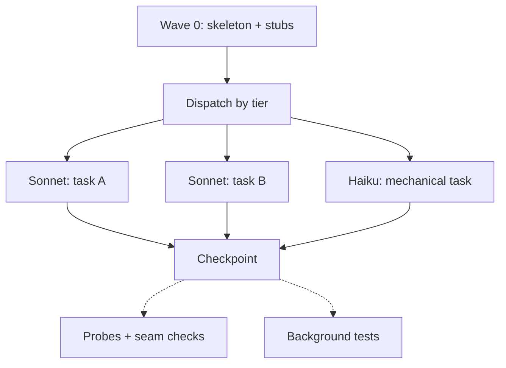

## What you do

Nothing is required. To watch or control the run:

| Command | Effect |
|---|---|
| `/superlite:agents` | agent map pane |
| `/superlite:tail` | live tail where the map is not installed |
| `/superlite:status` | mode, approval, tasks, cost |
| `/superlite:stop` | stop dispatching cleanly |
| `/superlite:resume` | continue from the last checkpointed tested wave |

## What superlite does

Wave 0 comes first: `implementer-haiku` builds the skeleton and a stub for every interface another task consumes. A task waits only when its tests execute another task's code.

Lint fixes the tier from `config/routing.json`. Sonnet `implementer` is the default. Haiku gets only `Kind: mechanical` tasks off the critical path. A task goes only to an idle agent of its own tier.

Each agent reads the same small prime, replies READY, then gets its task. It writes a failing test, implements, and replies DONE, DONE_WITH_CONCERNS, NEEDS_CONTEXT or BLOCKED.

A checkpoint saves a task's files under `refs/superlite/*`. Nothing is committed during a run. Probes, seam checks and tests start in the background. A raw `pytest` is rewritten into a background `run_tests`.

## Example

```bash
superlite-cli checkpoint T3 T5 --dispatch
```

It prints `Tn <sha>` per task, or `Tn FAILED` when a task touched unowned files or has syntax errors.

Next: [reviews and fixes](/superlite/run/reviews-and-fixes/).
