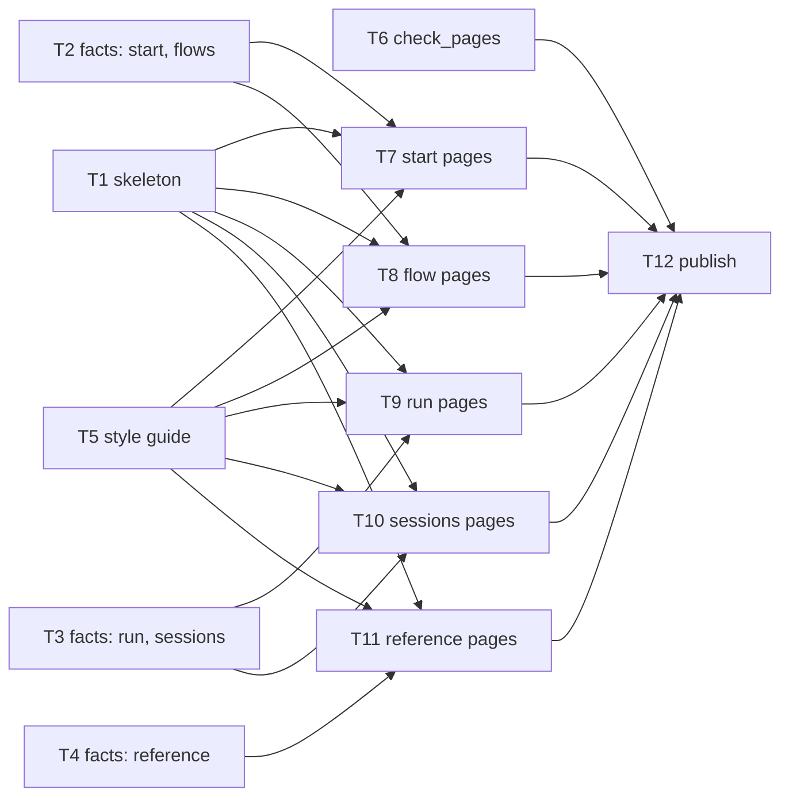

import { Steps, Aside } from "@astrojs/starlight/components";

:::tip[TL;DR]
Agents build tasks side by side. A task waits only when its tests run another task's code. Each finished task is saved as a hidden checkpoint, and nothing is committed during the run.
:::

The docs site run, as its plan drew it. Six tasks have no incoming edge, so they start together.



## How it works

Picture a kitchen. Several cooks start dishes that do not need each other. Only the plating waits for the dishes it plates.

**Waves and the task graph.** The machine plan draws an edge `Tn --> Tm` when Tm's tests execute Tn's code, or when Tm must read what Tn writes. Tasks with no incoming edges form the first wave and run together. A task that merely uses another's interface does not wait. It builds against a stub and the `e.g.` examples in the plan. Waves are a planning view. The scheduler sends a task the moment its dependencies are checkpointed, with no barrier between waves.

**Wave 0** holds the manifest, package inits, test config, shared error types and a stub for every interface another task consumes. `implementer-haiku` builds it. Tasks never wait for its checkpoint, because they build against the stubs.

**Tiers.** Lint picks the agent from `config/routing.json`, and nothing overrides it.

| Tier | Agent | Gets | Context limit |
|---|---|---|---|
| Sonnet (default) | `implementer` | every task that is not mechanical | 80k |
| Haiku | `implementer-haiku` | `Kind: mechanical` tasks off the critical path | 60k |

The critical path is the longest chain of waiting tasks, so a slow task on it delays the run. It never gets Haiku. A task goes only to an idle agent of its own tier, and nothing queues behind a busy one.

## Example: twelve tasks in three waves

<Steps>

1. **You watch.** Nothing to answer. Open the agent map to see tasks and agents.

   ```text frame="terminal" title="Claude Code · ~/superlite" ins={1}
   ❯ /superlite:agents
   ```

   Wave 1 is six tasks at once: T1 skeleton, T2, T3 and T4 (three fact sheets), T5 style guide and T6 check_pages. `superlite-cli dispatch` packs every ready task into one message. They share no edge and own different files, so they cannot collide. The report later shows `peak 6 at once`, which is this wave.

2. **Wave 2 starts task by task.** T7 to T11 are the page tasks. Each waits for T1, T5 and the facts file it writes from. This is the edge list the plan holds for T9, the run pages.

   ```md title="docs/plans/2026-11-12-docs-site.md" mark={1,2,3}
   T1 --> T9
   T3 --> T9
   T5 --> T9
   ```

   These are content edges, the ruling from the [orchestrator](/superlite/run/orchestrators/) page: a page writer cannot guess the facts. T10 needed only T1, T3 and T5, so it could start before T4 finished. There is no barrier between waves.

3. **Each agent builds one task.** It first reads a shared prime: rules, the plan header, global constraints and each stable task's title, files and interfaces. Then it fetches its own task.

   ```text frame="terminal" title="agent for T9" ins={1}
   $ superlite-cli task T9 --plan docs/plans/2026-11-12-docs-site.md
   ```

   The prime is the same for every agent, so the shared part is cached and each task brief stays short. The agent writes a failing test, runs it, implements, runs again, and replies DONE, DONE_WITH_CONCERNS, NEEDS_CONTEXT or BLOCKED in at most 200 words.

4. **The tiers split the work.** Eleven tasks went to Sonnet `implementer`. T12 is a workflow file and a README line with exact steps, so the plan marks it for `implementer-haiku`.

   ```md title="docs/plans/2026-11-12-docs-site.md" mark={3-4}
   ### T12 publish · Complexity 2 · Est. context 25k
   **Owns:** site/.github/workflows/deploy.yml, site/README.md, README.md
   **Kind:** mechanical
   **Model:** haiku
   ```

   Haiku costs less, and a mechanical task has little to get wrong. The report shows T12's model as `?`, so treat that one as unmeasured.

5. **The coordinator checkpoints each result** with `superlite-cli checkpoint Tn`. The task's own files are saved under `refs/superlite/*`, a hidden ref, not a commit on your branch. `Tn FAILED` means it touched files it does not own, or has syntax or import problems, and it goes back to its agent.

6. **Wave 3: T12 publish** waits for all five page tasks and for T6, the check script, because it adds the deploy workflow that runs that check. Then you read how it went.

   ```text frame="terminal" title="docs/plans/2026-11-12-docs-site.report.md" mark={1}
   concurrency: peak 6 at once (projected 6); critical path actual T4 T11; projected T1 > T8 > T12 (6.8 min)
   ```

   The actual critical path was T4 then T11: the reference facts took 3.3 minutes and the reference pages waited for them. The twelve tasks added up to 23.4 task-minutes inside 6.3 minutes of wall-clock, about 3.7 tasks running at any moment.

</Steps>

**What you end up with:** twelve checkpointed tasks, none committed, and tests that ran in the background the whole time. The reviews come next.

## Good to know

- Tests never block the build. `run_tests` writes `.superlite/test-summary.json` in the background, and a raw `pytest` is rewritten into it. A hidden wait is denied.
- No agent spawns agents. The coordinator is the only dispatcher.
- Cost caps warn at 70% of the cap. Over the cap, optional work stops.
- `/superlite:status` shows state. `/superlite:stop` halts dispatching cleanly, and `/superlite:resume` continues from the last checkpointed, tested wave.

<Aside type="note" title="Why a checkpoint is not a commit">
A hidden checkpoint is a safe copy of one task, not part of your history. Your branch gets commits only when you choose, at shipping.
</Aside>

## Next

[Reviews and fixes](/superlite/run/reviews-and-fixes/) covers what happens to the checkpointed work.
