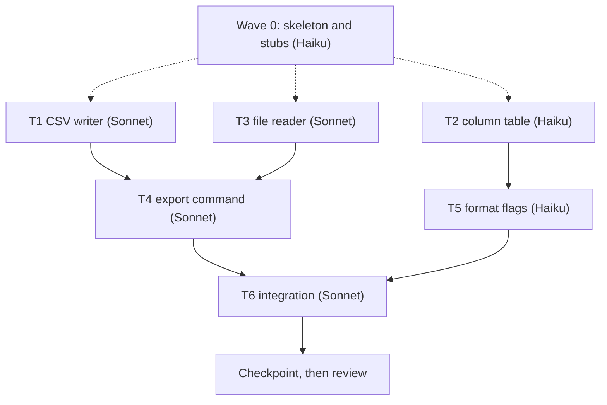

import { Steps, Aside } from "@astrojs/starlight/components";

:::tip[TL;DR]
Agents build tasks side by side. A task waits only when its tests run another task's code. Each finished task is saved as a hidden checkpoint, and nothing is committed during the run.
:::



## How it works

Picture a kitchen. A prep cook lays out the board and knives (wave 0) while several cooks already start on dishes that do not need each other. Only the plating waits for the dishes it plates.

**Waves and the task graph.** The machine plan lists tasks and draws an edge `Tn --> Tm` only when Tm's tests execute Tn's code. Tasks with no incoming edges form the first wave and run together. A task that merely uses another's interface does not wait. It builds against a stub and the `e.g.` examples in the plan. Waves are a planning view. The scheduler sends a task the moment its dependencies are checkpointed, with no barrier between waves.

**Wave 0** holds the manifest, package inits, test config, shared error types and a stub for every interface another task consumes. `implementer-haiku` builds it from a brief that the tools write from the plan, sent with the first dispatch. Tasks never wait for its checkpoint, because they build against the stubs (the dashed lines above). Integration is one small task per package at the end.

**Tiers.** Lint picks the agent from `config/routing.json`, and nothing overrides it.

| Tier | Agent | Gets | Context limit |
|---|---|---|---|
| Sonnet (default) | `implementer` | every task that is not mechanical | 80k |
| Haiku | `implementer-haiku` | `Kind: mechanical` tasks off the critical path | 60k |

A critical-path task never gets Haiku. A task goes only to an idle agent of its own tier, and nothing queues behind a busy one.

## Example: six tasks in three waves

The diagram above is a CSV export feature. Beside wave 0, three tasks start at once (wave 1), two more start as soon as their inputs are checkpointed (wave 2), and integration closes (wave 3).

| Wave | Tasks | Why they can run together |
|---|---|---|
| 1 | T1, T2, T3 | no edges between them |
| 2 | T4, T5 | each needs only its wave 1 inputs |
| 3 | T6 | its tests run T4 and T5 |

T2 and T5 are routine wiring with exact inputs and outputs, so lint marks them Haiku. T1, T3, T4 and T6 hold logic and go to Sonnet. The critical path is T1, T4, T6. Because T2 and T5 are off it, Haiku is allowed. A slow Haiku task cannot delay the run.

<Steps>

1. `superlite-cli dispatch` packs ready tasks into batches. Each line is `Tn agent=ID`, `Tn poll IDs` or `Tn fresh tier=T`.
2. Each agent first reads the same small prime: rules, plan header, global constraints, and each stable task's title, files and interfaces. It replies READY.
3. Its task arrives with `superlite-cli task Tn --plan PLAN`, which also prints what the task consumes.
4. It writes a failing test, runs it, implements, runs again, and replies DONE, DONE_WITH_CONCERNS, NEEDS_CONTEXT or BLOCKED in at most 200 words.
5. The coordinator checkpoints the task.

</Steps>

```text
superlite  superlite-cli checkpoint T1 T2 T3 --dispatch
T1 3f9c2a1
T2 8b01d7e
T3 FAILED
```

A checkpoint saves a task's own files under `refs/superlite/*`. `Tn FAILED` means the task touched files it does not own, or has syntax or import problems, and goes back to its agent. Probes, seam checks and tests then start in the background.

## Good to know

- Tests never block the build. `run_tests` writes `.superlite/test-summary.json` in the background, and a raw `pytest` is rewritten into it. A hidden wait is denied.
- No agent spawns agents. The coordinator is the only dispatcher.
- Cost caps warn at 70% of the cap. Over the cap, optional work stops.
- Watch with `/superlite:agents` or `/superlite:tail`. See state with `/superlite:status`. `/superlite:stop` halts dispatching cleanly, and `/superlite:resume` continues from the last checkpointed, tested wave.

<Aside type="note" title="Why a checkpoint is not a commit">
A hidden checkpoint is a safe copy of one task, not part of your history. Your branch gets commits only when you choose, at shipping.
</Aside>

## Next

[Reviews and fixes](/superlite/run/reviews-and-fixes/) covers what happens to the checkpointed work.
