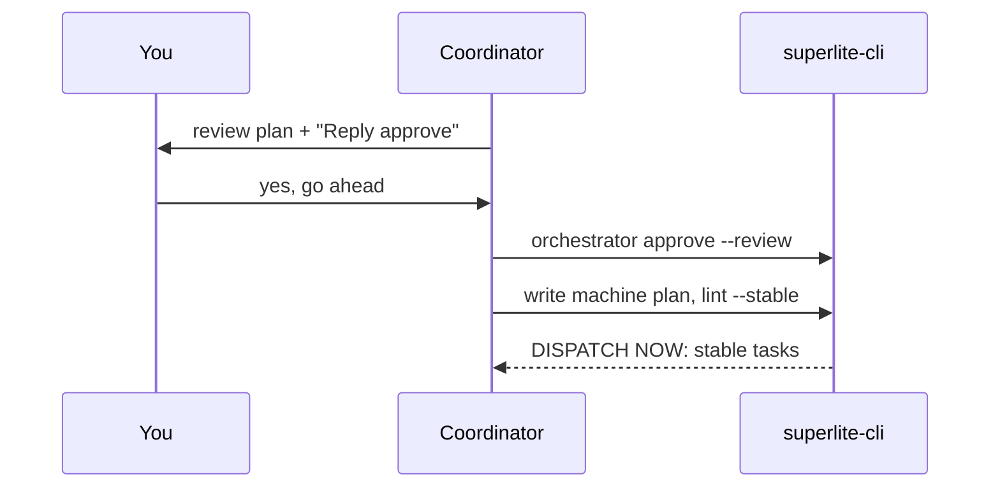

## What you do

Read the review plan. It is plain words with diagrams and a few key code snippets. Reply with any clear approval, such as "yes" or "looks good". You do not retype "approve". Or say what to change.

Say `map` in your reply to open the agent map and watch the run.

## What superlite does

Phase 1: the coordinator writes `docs/plans/<date>-<topic>.review.md` and nothing else. The turn ends and waits. Approval is asked in plain text, because the typed reply is what the hook verifies.

Phase 2, after your yes: it writes the machine plan `docs/plans/<date>-<topic>.md`, a task graph. `plan_tools lint --stable` splits tasks into STABLE (dispatch now) and FIX (wait with a reason). Dispatched tasks are frozen. A later change is a follow-up fix task.

After approval the run decides alone. A scope or interface change becomes `Ruling: [scope] <decision> - <why> - <cost if wrong>`. `finish` lists it under "Changed from the approved plan".

AI mode skips the review plan.

## Example

```text
Reply approve to start, or tell me what to change
```

You answer:

```text
go ahead, and open the map
```

superlite then runs `superlite-cli orchestrator approve --review <path>`. It exits 3 BLOCKED unless your reply is newer than the review plan.

Next: [parallel build](/superlite/run/parallel-build/).
