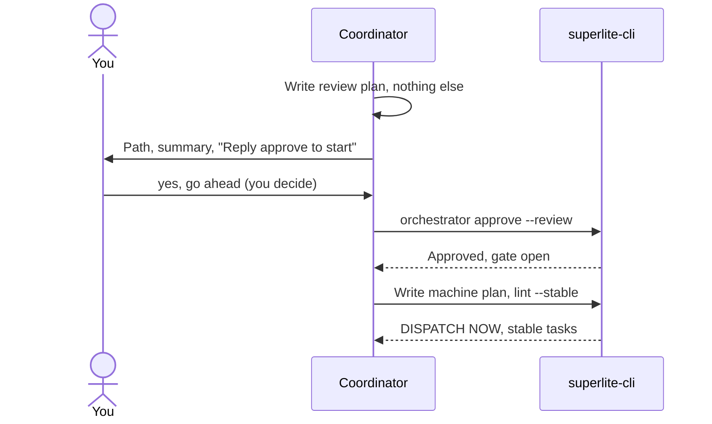

import { Steps, Aside } from "@astrojs/starlight/components";

:::tip[TL;DR]
You approve a short plan written for people, the review plan. Only then does superlite write the machine plan, a task graph for agents, and start building. Your yes is what unlocks the build.
:::



## How it works

One idea, two documents. A plan that a person can judge is not a plan that agents can execute, so superlite writes both, in order.

The review plan is for you. It is plain words, about two pages, with diagrams and a few key code snippets. The machine plan is for agents. It is a task graph with exact contracts. It is written from the review plan with the same tasks and scope, and its header says `**Review plan:** <path>`.

Before your yes, the coordinator writes only the review plan. Approval is asked in plain text, never as a pop-up question, because your typed reply is what the hook verifies. Any clear yes counts: "go ahead" or "looks good". You do not retype "approve".

### The review plan

`docs/plans/<date>-<topic>.review.md` has fixed sections: Summary, What you will get, What will be built, How it fits together, Key code changes, How it gets built, Decisions you can change, Risks, Out of scope, How we will know it works, Rough time and cost.

````markdown
## What will be built
| Part | What it does | Size | Built by |
|---|---|---|---|
| Counting | Counts lines, words and characters | S | a fast helper |
| Tests | Checks the edge cases above | S | a careful helper |

## Decisions you can change
- Characters counted as: Unicode characters (default) | bytes
````

### The machine plan

`docs/plans/<date>-<topic>.md` holds a Mermaid task graph where `Tn --> Tm` means Tm's tests run Tn's code, and one block per task.

````markdown
%% taskgraph
T1 --> T4

### T4 export command · Complexity 4 · Est. context 30k
**Owns:** src/export.py, tests/test_export.py
**Components:** 1
**LOC owned:** 90
**Tests:** fast
**Model:** sonnet
**Consumes:** CsvWriter.write(rows: list[dict]) -> str (T1)
**Produces:** export(path: str) -> int
**Review Focus:** `test_empty_table`: no rows gives only the header
````

Each task must predict 1.5 to 6 minutes (over 6 fails lint with `SIZE:`), and the whole plan stays under 15,000 characters.

## Example

<Steps>

1. You ask for work and choose the human orchestrator. superlite writes the review plan and, if `open_in_harness` is on, opens it for you.
2. It ends its turn with the path, a five-line summary and "Reply approve to start, or tell me what to change".
3. You reply. Add `map` to also open the agent map.
4. It records the approval, writes the machine plan and runs lint.

</Steps>

```text
superlite  Reply approve to start, or tell me what to change
you        go ahead, and open the map
superlite  superlite-cli orchestrator approve --review docs/plans/2026-11-12-csv-export.review.md
superlite  writes the machine plan, lints it, dispatches the stable tasks
```

`orchestrator approve` exits with BLOCKED (exit 3) unless a human reply newer than the review plan exists in `.superlite/human-replies.jsonl`. If you answer with changes instead, superlite revises the review plan and asks again.

## Good to know

Lint splits tasks into STABLE (dispatch now) and FIX (wait, with a reason). A task is stable when its own checks pass, everything it consumes has a clean `Produces` line, and it has no edge to an unstable task. superlite dispatches the stable set first, fixes the rest, then dispatches those. A dispatched task is frozen. Changing it later is a follow-up fix task, not a restart.

<Aside type="note" title="After the yes you are not asked again">
If the machine plan has to change scope or an interface you saw, superlite decides and records `Ruling: [scope] <decision> - <why> - <cost if wrong>`. At the end it lists these under "Changed from the approved plan".
</Aside>

AI mode has no review plan and goes straight to the machine plan. In MVP mode the `.mvp.md` plan is the review plan. In feature mode the `.feature.md` plan is, with a second gate, the prototype try-out (see [feature](/superlite/flows/feature/)).

## Next

[Parallel build](/superlite/run/parallel-build/) shows how the stable tasks run side by side.
