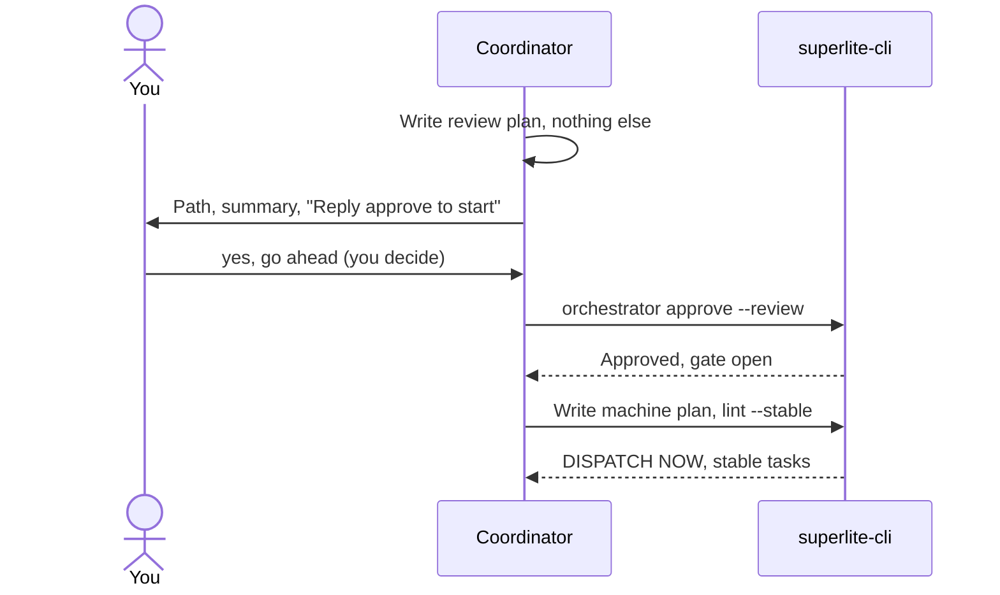
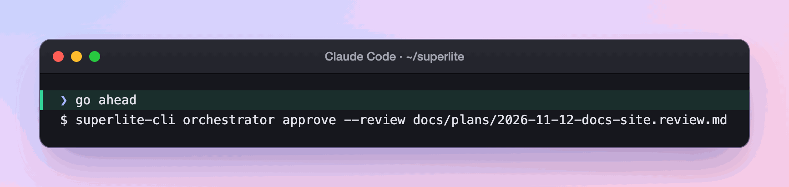
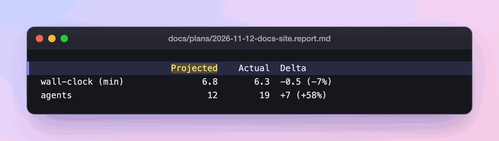

import { Steps, Aside } from "@astrojs/starlight/components";

:::tip[TL;DR]
You approve a short plan written for people, the review plan. Only then does superlite write the machine plan, a task graph for agents, and start building. Your yes is what unlocks the build.
:::



## How it works

One idea, two documents. A plan that a person can judge is not a plan that agents can execute, so superlite writes both, in order.

The review plan is for you. It is plain words, about two pages, with diagrams and a few key code snippets. The machine plan is for agents. It is a task graph with exact contracts. It is written from the review plan with the same tasks and scope, and its header says `**Review plan:** <path>`.

Before your yes, the coordinator writes only the review plan. Approval is asked in plain text, never as a pop-up question, because your typed reply is what the hook verifies. Any clear yes counts: "go ahead" or "looks good". You do not retype "approve".

### The review plan

`docs/plans/<date>-<topic>.review.md` has fixed sections: Summary, What you will get, What will be built, How it fits together, Key code changes, How it gets built, Decisions you can change, Risks, Out of scope, How we will know it works, Rough time and cost.

````markdown
## What will be built
| Part | What it does | Size | Built by |
|---|---|---|---|
| Counting | Counts lines, words and characters | S | a fast helper |
| Tests | Checks the edge cases above | S | a careful helper |

## Decisions you can change
- Characters counted as: Unicode characters (default) | bytes
````

### The machine plan

`docs/plans/<date>-<topic>.md` holds a Mermaid task graph where `Tn --> Tm` means Tm's tests run Tn's code, and one block per task.

````markdown
%% taskgraph
T1 --> T4

### T4 export command · Complexity 4 · Est. context 30k
**Owns:** src/export.py, tests/test_export.py
**Components:** 1
**LOC owned:** 90
**Tests:** fast
**Model:** sonnet
**Consumes:** CsvWriter.write(rows: list[dict]) -> str (T1)
**Produces:** export(path: str) -> int
**Review Focus:** `test_empty_table`: no rows gives only the header
````

Each task must predict 1.5 to 6 minutes (over 6 fails lint with `SIZE:`), and the whole plan stays under 15,000 characters.

## Example: the docs site, from review plan to machine plan

<Steps>

1. **You read** the review plan for the docs site. Its "What will be built" table lists eight parts, such as these three.

   ```md title="docs/plans/2026-11-12-docs-site.review.md" mark={3-5}
   | Part | What it does | Size | Built by |
   |---|---|---|---|
   | Research: how superlite works | Reads the code and docs and writes a fact sheet per page, with the diagrams each page needs | M | a careful helper |
   | Site skeleton | Sets up Starlight, the Warp-style theme, diagram drawing, the sidebar, the base path and search | M | a careful helper |
   | Publishing | The deploy workflow and the README link | S | a fast helper |
   ```

   The coordinator writes only this file and stops. Size (S, M, L) and "a fast" or "a careful helper" are an estimate and a model choice in plain words, so you judge scope, not agent names.

2. **You decide.** The same plan lists "Decisions you can change", each with a default.

   ```md title="docs/plans/2026-11-12-docs-site.review.md" mark={2}
   ## Decisions you can change
   - Where the site lives: its own `site` branch (default) | a separate repo `iha2/superlite-docs`. Checked: [...]
   [...]
   - Page length: about 300 words of prose per guide page (default) | stricter, 200.
   - Full test suite at finish: no, affected tests only (your choice).
   ```

   Answer "use a separate repo" and superlite revises the plan and asks again. A change request never counts as a yes. Answer "go ahead" and it moves on. Approval is asked in plain text because your typed reply is what the hook verifies.

3. **superlite unlocks the build.**

   

   The command records the approval and opens the gate. Until then `lint --stable` and `dispatch` stay blocked.

4. **superlite translates.** It writes the machine plan, whose header points back at what you approved and carries your answers as settings.

   ```md title="docs/plans/2026-11-12-docs-site.md" mark={1,4}
   **Review plan:** docs/plans/2026-11-12-docs-site.review.md
   [...]
   **Detail:** tests
   **Full suite:** no
   **Target-min:** 14
   ```

   Your decision "Full test suite at finish: no" became `Full suite: no`. Same scope, new format, so agents get exact contracts and you never have to read them.

5. **superlite shows its work** as one block per task. This is T12, the plan's mechanical, Haiku-routed task.

   ```md title="docs/plans/2026-11-12-docs-site.md" mark={3-4}
   ### T12 publish · Complexity 2 · Est. context 25k
   **Owns:** site/.github/workflows/deploy.yml, site/README.md, README.md
   **Kind:** mechanical
   **Model:** haiku
   **Review Focus:** workflow checks out `main` into `_main` for the name check
   ```

   `Owns` is why parallel agents never collide: every file has one owner. `Review Focus` tells reviewers where to look first.

6. **superlite lints** the plan with `lint --stable` and saves a forecast before the first dispatch.

   

   The review plan had guessed "45 to 75 minutes" and said "rough, until the plan is linted". The Projected column is the forecast. It is saved once, so the final [report](/superlite/run/report/) compares the result with what lint predicted, not with a number adjusted afterward.

</Steps>

**What you end up with:** two files in `docs/plans/`, an approval on record, and stable tasks ready to dispatch.

## Good to know

Lint splits tasks into STABLE (dispatch now) and FIX (wait, with a reason). A task is stable when its own checks pass, everything it consumes has a clean `Produces` line, and it has no edge to an unstable task. superlite dispatches the stable set first, fixes the rest, then dispatches those. A dispatched task is frozen. Changing it later is a follow-up fix task, not a restart.

<Aside type="note" title="After the yes you are not asked again">
If the machine plan has to change scope or an interface you saw, superlite decides and records `Ruling: [scope] <decision> - <why> - <cost if wrong>`. At the end it lists these under "Changed from the approved plan".
</Aside>

AI mode has no review plan and goes straight to the machine plan. In MVP mode the `.mvp.md` plan is the review plan. In feature mode the `.feature.md` plan is, with a second gate, the prototype try-out (see [feature](/superlite/flows/feature/)).

## Next

[Parallel build](/superlite/run/parallel-build/) shows how the stable tasks run side by side.
