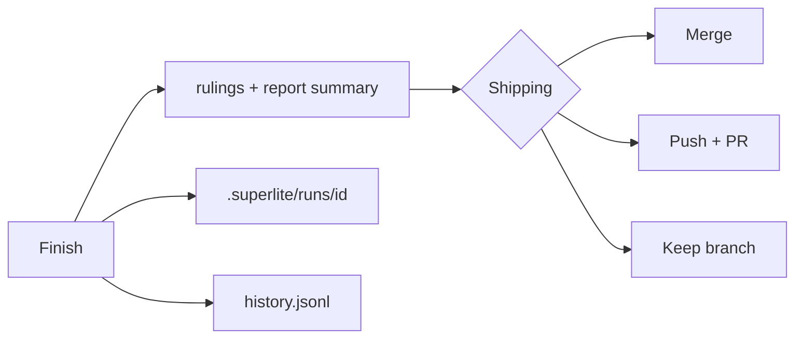

## What you do

Read the rulings, the decisions superlite made for you, each with its cost. Then answer one question: merge locally, push and open a PR, or keep the branch. Before it, choose "Commit to the session branch" or "Leave uncommitted".

## What superlite does

`superlite-cli finish --plan PLAN` moves the run's files into `.superlite/runs/<id>/`, lists "Rulings I made" and prints the report summary. In human mode it also prints the approval time. The full report is `<plan>.report.md`, next to the plan.

Hooks capture each agent's tokens, cost and time into `.superlite/metrics.jsonl`. `superlite-cli history write` appends the run's rows to `~/.superlite/history.jsonl`, which feeds the next run's predictions.

Then `superlite:shipping` verifies and asks. It never pushes or merges without your answer. Unattended runs keep the branch and do not push, merge or commit.

After a PR merges, run `/superlite:merged` to clean up. See the [session lifecycle](/superlite/sessions/lifecycle/).

## Example

```text
/superlite:report
/superlite:report docs/plans/2026-11-12-docs-site.md
/superlite:report docs/plans/2026-11-12-docs-site.md full
```

With no argument it lists stored reports, newest first, plus the last 5 history rows. With a plan it shows one summary. With `full` it shows all.

Back to [human or AI orchestrator](/superlite/run/orchestrators/).
