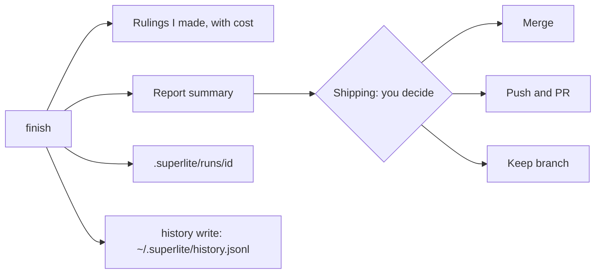

import { FileTree, Steps } from "@astrojs/starlight/components";

:::tip[TL;DR]
When the tests are green, `finish` archives the run, lists the decisions superlite made for you, and writes a report that compares the forecast with what happened. Then it asks how to ship. You decide.
:::



## How it works

`superlite-cli finish --plan PLAN` closes the run. It moves the run's files into `.superlite/runs/<id>/`, lists the rulings, and prints a short report summary. In human mode it also prints the approval time. For example, the docs site run wrote `2026-11-12-docs-site.report.md` and `.report.json` next to its two plans.

<FileTree>

- docs/plans/
  - 2026-11-12-docs-site.review.md
  - 2026-11-12-docs-site.md
  - 2026-11-12-docs-site.report.md full report
  - 2026-11-12-docs-site.report.json same data, for tools
- .superlite/runs/ archive of each finished run, never committed

</FileTree>

Three things feed the report. Lint saves a forecast before the first dispatch, so the projection is fixed and cannot drift toward the result. Hooks capture each agent's tokens, cost and time into `.superlite/metrics.jsonl`. Then `superlite-cli history write` appends the run's rows to `~/.superlite/history.jsonl`, which the next run uses for its predictions.

## Example: reading the docs site report, line by line

<Steps>

1. **You see the summary.** When the tests are green, `finish` prints your rulings and the top of the report, before any shipping question.

   ```md title="docs/plans/2026-11-12-docs-site.report.md" mark={3}
   # superlite build report

   projection: fixed forecast saved at lint 2026-11-12T04:04:54
   ```

   The forecast was saved at lint, before the first dispatch, so it cannot drift toward the result. Run `/superlite:report` to list reports, newest first. `/superlite:report <plan>` shows the summary, and `/superlite:report <plan> full` shows everything.

2. **You read time and agents.**

   ```text frame="terminal" title="docs/plans/2026-11-12-docs-site.report.md" mark={2,4}
                            Projected    Actual  Delta
   wall-clock (min)               6.8       6.3  -0.5 (-7%)
   task-minutes                  23.6      23.4  -0.2 (-1%)
   agents                          12        19  +7 (+58%)
   ```

   Wall-clock is the minutes on the clock. Task-minutes add up each task's own time, so it is far above wall-clock when agents work side by side. The report counts every agent that ran, not only the twelve planned, so 7 more ran than forecast.

3. **You read the cost.** This is where the surprise is.

   ```text frame="terminal" title="docs/plans/2026-11-12-docs-site.report.md" mark={2}
   agent cost (USD, +rework)      1.83      2.66  +0.83 (+45%)
   cost split: agents $2.60, rework $0.06, coordinator $6.81, total $9.47
   ```

   The forecast covers agents only, and they ran 45% over. The coordinator, Opus planning and dispatching, cost $6.81 of the $9.47 total. That is why the cost split is shown: the part you can predict is not the biggest part.

4. **You read how parallel it was.**

   ```text frame="terminal" title="docs/plans/2026-11-12-docs-site.report.md" mark={1}
   concurrency: peak 6 at once (projected 6); critical path actual T4 T11; projected T1 > T8 > T12 (6.8 min)
   ```

   The critical path is the longest chain of waiting tasks, and it sets the minimum time. It moved from the forecast's T1 > T8 > T12 to T4 > T11 because the reference facts (T4) ran 82% over their estimate. See [parallel build](/superlite/run/parallel-build/).

5. **You read quality.**

   ```text frame="terminal" title="docs/plans/2026-11-12-docs-site.report.md" mark={1}
   quality: tests 36 passed, 0 failed; first-time pass n/a; rework dispatches 1; open incidents 18
   ```

   First-time pass counts tasks that passed with no rework. It says n/a here because the run measured none. A rework dispatch is a fix round. Open incidents are logged problems, such as the failing test runs the [reviews](/superlite/run/reviews-and-fixes/) page shows.

6. **You read the takeaway, then decide.**

   ```text frame="terminal" title="docs/plans/2026-11-12-docs-site.report.md" mark={1}
   takeaway: ran 7% faster than projected; cost 45% over; biggest miss T12
   ```

   The takeaway is the report in one sentence. T12's miss is a gap in measurement: it shows 0.0 actual minutes and model `?`, so it looks untimed. `history write` has by now appended this run's rows to `~/.superlite/history.jsonl`, which sharpens the next forecast. Now `superlite:shipping` asks how to ship. **You decide:** commit, merge, push and open a PR, or keep the branch.

</Steps>

**What you end up with:** a report in `docs/plans/`, a history row for the next forecast, and the shipping choice in your hands. This run ended in PR #58.

Other lines in the report:

| Line | What it tells you |
|---|---|
| model mix | Tasks and cost per model. Here Sonnet had 11 tasks. |
| task table | The biggest misses between predicted and actual minutes, with cost. |
| `cost source: est` | In the full report: the cost is estimated from tokens. |

## Good to know

- The report summary prints before any merge or PR option, so you see the cost before you decide.
- Feature runs add a part for the prototype and integration, with the prototype's share against a 25% cap.
- Your rulings are the decisions you did not make yourself. Each shows its cost if wrong, and scope changes also appear under "Changed from the approved plan".

After the report, `superlite:shipping` first asks once whether to commit the finished work to the session branch or leave it uncommitted. It then verifies and asks how to ship: merge locally, push and open a PR, or keep the branch. It never pushes or merges without your answer. Unattended runs keep the branch and do not push, merge or commit. After a PR merges, run `/superlite:merged`. See the [session lifecycle](/superlite/sessions/lifecycle/).

## Next

Back to [human or AI orchestrator](/superlite/run/orchestrators/), or see [how a run starts](/superlite/run/plan-and-approval/).
